# NPC 每日生活与行为逻辑总览

> 版本：1.1 · 2026-10-12  
> 基线：当前白膜 Demo v0.15、已确认的 NPC 行为规则与最新贿赂修复。  
> 用途：交给开发人员实现，或将**本文件全文**交给 AI 开发。  
> 适用地图：任意提供本文件语义设施、寻路、感知和物资接口的洞穴地图。  
> 在原文档上更新为开发规范，保留原文件路径；不新增另一份并行规范。
> 本文件是一份独立规格；理解核心规则不需要原地图、历史聊天或旧文档。

## 阅读导航

| 部分 | 面向谁 | 读完应该理解什么 |
|---|---|---|
| [第一部分：整体设计说明](#第一部分整体设计说明) | 策划、制作人、美术、开发人员及其他项目成员 | 洞穴如何运转，NPC 为什么这样行动，玩家怎样影响它们，哪些行为可以换地图复用 |
| [第二部分：开发与 AI 实施规格](#第二部分开发与-ai-实施规格) | 程序员、负责实现的 AI | 数据和接口、精确条件、优先级、执行过程、结束与失败处理、参数和验收 |
| [附录 A：当前地图示例](#附录-a当前-demo-的-53-人作息与地图绑定示例) | 需要核对现有 Demo 的开发者 | 当前 53 人的具体配置；新地图不必复制这些编号和坐标 |

第一次阅读可先完整读第一部分。交给 AI 开发时，提供**整份文件**及目标工程、地图资料，使用第二部分第 23 节的开发指令。第一部分解释系统意图，第二部分规定精确行为，二者采用同一套规则。

## 第一部分：整体设计说明

### 一、这套 NPC 系统要带来什么体验

玩家潜入一个正在生活和工作的哥布林洞穴。没有玩家干预时，食材被种出来、搬进厨房、做成饭、送上餐桌；守卫巡视，居民吃饭、休息、喝酒、赌博，晚上举行祭祀。玩家可以观察这些活动，判断哪里人少、谁会经过、何时容易行动。

玩家干预之后，洞穴的运行会改变：投币让追捕者停下，起火把工作人员引去取水，移走墙灯改变视野与疲惫，关闭门影响行走和配送。变化经过真实的动作和同伴传话继续影响其他人，玩家可以在潜入过程中立即观察并利用。

每个 NPC 都有自己的职责、需求和有限知识。系统的目标是让这些因素共同产生可信行动，而无需给每一种玩家操作组合写一段固定剧情。

**一个贯穿全系统的例子：**搬运工正在送原料，途中看到货架起火。他保留已搬起的货物，去水源取水，回到火边完成泼水，然后继续交货。如果途中收到附近同伴求救，他会根据是否持水重新安排先后；如果只听到远处的声音，则需要先检查，不能立即知道那里具体发生了什么。

### 二、整体架构：世界事实、个人认知、决策和执行

可以把系统理解为四个相互衔接的部分：

| 部分 | 负责什么 | 简单例子 |
|---|---|---|
| 实际世界 | 地图、门、光、声音、火、物品和真实库存 | 货架确实在燃烧，厨房确实只有两件原料 |
| 每个人知道的事情 | 他看见、听见、从同伴那里获知和记住的内容 | 搬运工看见货架起火，隔墙厨师暂时不知道 |
| 行为选择 | 结合职责、需求、当前任务和可行条件，决定现在先做什么 | 本人着火先自救；有水时优先救着火同伴 |
| 实际执行与恢复 | 走路、拿取、开门、加工、泼水、传话；记录进度并恢复未完成事项 | 到水边才取到水，回到火边才灭火，之后继续原批货物 |

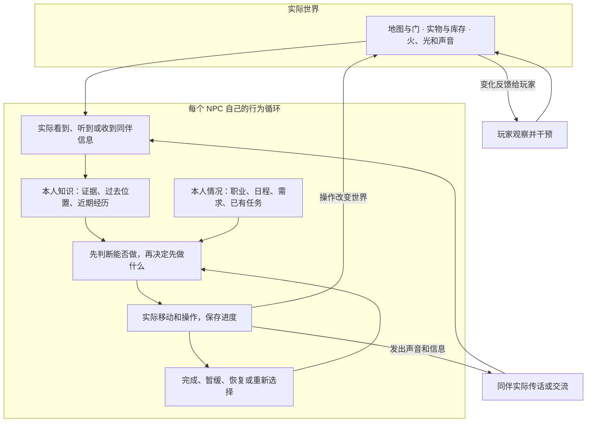

世界中的火、物品和库存可以由共同系统维护，但 NPC 的知识属于各自本人。**世界知道某处起火，不代表全体 NPC 知道。**同样，看见同伴正在调查，只能说明他在处理某件事；想知道线索，得靠近询问或听见报告。

日程和突发反应使用同一套移动与执行规则。救火、生活、巡逻都要面对相同的门、墙和路径，不能事件一开始就把人传送到目标处。

### 三、八种身份，以及它们如何一起维持洞穴

所有人共享吃饭、休息、睡眠、喝酒、赌博、聊天和观察环境的能力。职业决定平时的职责和部分应对方式，需求决定何时在合适节点离开岗位。

| 层级／身份 | 平时做什么、去哪里 | 发现玩家后 | 发现物品火灾后 |
|---|---|---|---|
| 普通·厨师 | 厨房取料点 → 加工点 → 出锅；缺料时检查并请求补货 | 报告守卫 | 取水灭火 |
| 普通·守卫 | 固定岗扫视，或沿巡逻路点循环；按班次睡眠、参加训练 | 追捕并呼喊附近守卫 | 取水灭火 |
| 普通·搬运工 | 厨房运输、仓库分拣或酒馆供货；祭祀时搬贡品 | 报告守卫 | 取水灭火 |
| 普通·种植者 | 种植点照料 → 收获真实食材 → 下一批 | 报告守卫 | 取水灭火 |
| 中级·酒馆老板 | 接近客人服务；缺酒时取原料、酿酒 | 现场报告 | 避火 |
| 中级·赌场老板 | 赌场岗位与个人生活；对赌场内的钱感兴趣 | 现场报告 | 避火 |
| 中级·守卫队长 | 到监督点观察现场守卫；训练时到场监督 | 追捕并呼喊附近守卫 | 取水灭火 |
| 高级·长老 | 整理祭器、主持祭祀，按缺席记录到熟悉住处呼叫 | 现场报告 | 避火 |

自己身体着火时，任何身份都先自救。已经持水且实际发现着火同伴的人可以救人；空手主动接手取水救助，当前开放给四种普通职业。

默认 53 人：24 名守卫、15 名搬运工、4 名厨师、6 名种植者、3 名中级 NPC 和 1 名长老。人数可以随地图配置，行为规则保持。分拣和酒馆供货是搬运工的岗位，不额外生成独立职业。

供给链决定 NPC 的工作有实际用途：

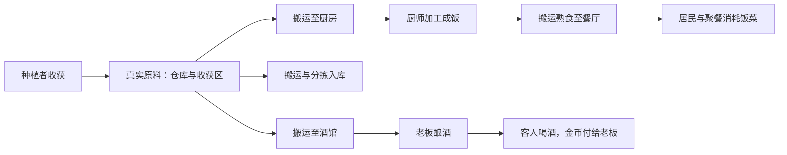

没有原料就做不出饭，没有饭就无法降低饥饿，没有酒或服务人员就无法成功喝酒。运输只改变物资位置，加工才产生产物，消费才减少库存。玩家拿走或烧毁东西，会通过这些真实条件影响后续活动。

### 四、一天如何展开，行走路线为什么会改变

下表是一日的主要节奏。时间表示“开始考虑这件事”，实际发生还要看当前任务、需求、资源和路程。

| 游戏时段 | 主要活动 | 观察重点 |
|---|---|---|
| 00:00—06:00 左右 | 日间居民睡眠，夜班守卫值勤 | 换班维持夜间活动；危险仍可能打断睡眠 |
| 06:00—06:40 | 日间居民错峰起床、回岗位 | 真实从住所走到工作处 |
| 上午至午饭前 | 加工、收获、物流、服务、站岗和巡逻 | 需求提前达到门槛也可在安全节点处理 |
| 13:00—15:00 | 错峰午饭，然后回工作 | 到场吃到真实饭菜才完成 |
| 14:00—17:00 | 各人分配一个娱乐窗口，工作与生活交替 | 并非所有人整个下午都待在酒馆或赌场 |
| 16:00—17:30 | 守卫先步行集合，17:00—17:30 训练，队长到场监督 | 形成阶段性岗位空缺；高优先事项可打断 |
| 18:00 起 | 交贡品 → 搬运 → 祭祀 → 聚餐 | 依到场、物资和长老情况推进 |
| 20:00—22:00 | 错峰晚饭，继续工作和值勤 | 聚餐成功可以满足当日晚饭 |
| 21:00—22:00 | 额外娱乐候选 | 睡眠、紧迫需求和职责仍可能优先 |
| 22:00—22:30 起 | 日间居民错峰回床睡眠 | 夜班继续生活和值勤 |

夜班守卫默认在 10:00—16:00 睡觉，醒来参加集合训练。取消训练时采用较晚的起床时间，详见后文配置。

各职业在自己的工作路线之间插入生活路线：**工作处 → 餐位／休息点／酒馆／赌场 → 恢复工作；睡眠窗口到来后回住所。**地点不是固定坐标，路线由当前可走的通路计算。守卫恢复原巡逻路点，搬运者恢复原批货物，厨师恢复原锅的进度。

普通吃饭和娱乐通常在卸货、出锅、收获完成、巡逻到点等节点重新选择，避免做半步就反复改主意。突发危险可以立即打断；严重疲惫在满足响应资格时也能暂停普通工作去睡眠。

### 五、同职业的人为什么会有不同表现

每人都有自己的饥饿、疲惫、社交需求、钱包、娱乐偏好、床位和错峰时间。日常没有新增情绪系统，但这些数值已能造成差异。

| 本人情况 | 行为上的变化 |
|---|---|
| 饥饿增加 | 更倾向用餐；没吃到饭需求保留 |
| 疲惫增加 | 更倾向歇脚；严重疲惫会寻找阴暗处睡眠 |
| 社交需求增加 | 更倾向喝酒、赌博、聊天，也更可能接受邀约 |
| 钱包不足 | 喝酒和赌博不具备条件，可考虑聊天 |
| 贪财倾向不同 | 实际金币的吸引和赌博邀约评分有所不同 |
| 个体时间不同 | 吃饭、娱乐、入睡和起床错开 |
| 最近经历不同 | 各自记得不同线索、失败路线和当地异常，警戒可能不同 |

需求持续增长。去餐厅的路上不算吃饭，去床的路上不恢复疲惫，单独等赌伴不降低社交需求。只有对应活动确实发生，才得到相应满足。

### 六、忙不过来时，NPC 如何决定先做什么

行为选择有两层。第一层处理现场响应和已经承担的任务；可以正常生活时，第二层再比较吃饭、休息、娱乐和职业工作。

**先检查能不能做，再比较先后。**看见钱却已知火灾时，拾币不具备资格；不能只看“金币的分数比火灾高”就判断他会抛下火灾。

| 情况 | 主要规则 |
|---|---|
| 自己着火 | 永远先自救 |
| 已持水，接手了着火同伴救助 | 优先救人，高于追捕 |
| 实际金币可拾取 | 优先于追捕、搜索和普通传话；保存原任务 |
| 本人知道活动火灾或正在自救／避火 | 不为金币分心；具体任务仍按资格和优先级选择 |
| 追捕与空手取水救同伴冲突 | 追捕更高；取得水后救助优先级提高 |
| 已确认玩家并满足投币条件 | 进入停追／停报和谈判流程，按窗口处理 |
| 工作和普通生活冲突 | 到安全节点比较饥饿、疲惫、社交及岗位限制 |
| 当前目标失效或不可达 | 暂缓、换合法目标或恢复其他职责，不无限重复失败动作 |

完整优先级在第二部分第 7 节。日常需求评分在第 8 节。这里的说明不能替代精确的资格条件。

同一时刻只推进一个主要行为。NPC 可以记得很多事，但不能一边取水一边完成烹饪，也不能拾币时同时累计抓捕。

### 七、它们怎样知道发生了什么

| 信息途径 | 能知道什么 | 不能据此直接知道什么 |
|---|---|---|
| 视觉 | 实际视野内、未被遮挡的玩家、火、金币和同伴动作 | 墙后、身后远处、隐藏区域的实时目标 |
| 听觉 | 声音发生的位置线索；听到的明确求救、邀请或报告 | 普通脚步声本身不能证明一定是玩家 |
| 同伴传话／交流 | 对方已经获得且仍有效的线索、最后知道的位置 | 同伴不知道的信息和隐藏目标的持续实时位置 |
| 熟悉设施 | 自己的床、岗位、水源、报信地点和职责相关库存区 | 到场前不凭空获得已被玩家改变的物件详情 |
| 本人记忆 | 上次实际见闻、已接手任务和失败位置 | 记住过去位置不代表目标永远在那里 |

视觉受朝向、距离、墙门家具、目标处光照、烟和睡眠限制。黑暗主要缩短有效可见距离。声音随传播路径衰减，墙和关闭门影响它能否传到听众；消息不会瞬间覆盖整张地图。

巡逻搭档也需要实际交流信息。看到队友回来可以重新配合巡逻，想共享玩家线索仍要靠目击、呼喊或询问。

### 八、从发现玩家到追捕和恢复

初次短暂看见玩家，NPC 先疑惑，再去现场检查。没有进一步线索就回原任务；多次独立异常会使本人加强当地警戒。持续看清达到确认条件后，普通人报告，守卫追捕。

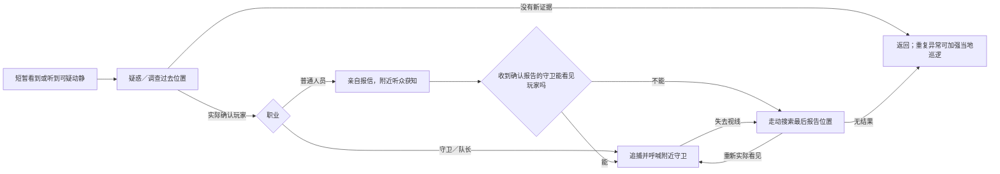

守卫的确认速度随着距离变近、玩家更亮、本人警戒更高而提高。只照亮守卫本人，不能当成照亮玩家。收到明确报告的附近守卫已有确认信息，直接追捕或搜索，不再从疑惑开始。

追捕需要实际接近并持续接触才抓捕成功。失去视线后，沿最后目击位置附近的可达点移动搜索，不远程追踪隐藏玩家，也不原地罚站。搜索结束后按个人警戒记录巡逻或回原任务。

### 九、金币、谈判和贿赂怎样影响行为

所有哥布林贪财，但对金币的具体响应仍受职业、地点和当前危险限制。实际感知的地面金币可以让追捕者、搜索者或普通报信者停下，亲自过去取钱。钱没了或任务结束，就重新检查原来要做的事。

| 玩家做什么 | 对应结果 |
|---|---|
| 对未确认自己的 NPC 投币 | 可以吸引调查和拾取；不会凭空开启停追谈判 |
| 对已确认自己的普通职业投真实金币 | 满足条件后停追／停报，实际拿币后进入约 5 模拟秒的谈判窗口 |
| 在有效条件内贿赂 | 默认支付 4 币，80% 成功；投出的 1 币另外计算 |
| 合法贿赂失败 | 钱已消耗；原响应恢复，追捕谈判需重新示好 |
| 余额不足、过期或对象非法 | 不扣贿赂费 |
| 贿赂成功 | 这次潜入本人直接忽略玩家，继续环境响应和个人生活 |
| 雇空闲普通非守卫开门／搬货 | 合法时执行一次真实服务；与已确认后投币谈判是不同入口 |

这里的秒数是**模拟秒**：1 倍速时对应现实秒数；暂停停止计时，观察倍速会缩短现实等待时间。

“忽略玩家”包括视觉、玩家动作声和同伴的玩家举报，不能过一会儿又被同伴说服重新追捕。但受贿者仍会对真实火灾、金币、灯光和同伴求救作反应，已经传出去的报告也不会从别人记忆中撤销。

队长、两位老板和长老不通过当前普通贿赂入口被收买。当前没有永久伙伴系统；一次受雇任务也不等于招募伙伴。

### 十、火灾与同伴救助必须真的执行

发现火灾的依据是实际目击或有效报告。正常墙火把和正常摆放的火盆用于照明；材料起火、翻倒／落地的燃烧器物才按失控火源处理。

| 情况 | 实际过程 | 行为结束后 |
|---|---|---|
| 普通职业／队长处理物品火 | 记住火点 → 走水源装水 → 返回可操作的安全火边 → 泼水并消耗水 | 检查其他本人已知火点，或恢复旧任务 |
| 老板／长老处理物品火 | 去稳定的可达安全位置避火 | 危险解除后恢复旧任务 |
| 自己身体着火 | 持水自救，或去水源；不可达时离开火后扑打 | 清除身体火并恢复，不立即踏回刚点燃自己的位置 |
| 有水的人发现着火同伴 | 接手 → 实际走近 → 泼水救人 | 消耗水、清身体火，释放救助占用 |
| 空手普通职业接手救助 | 去取水 → 回最后已知位置 → 再确认目标并救助 | 路上不忘；到场找不到才有限寻找 |

从水源走回火场不套用普通调查的短超时。目标被别人灭掉时保留水，再比较其他本人已知目标；某处不可达只暂缓那一处，不能清空所有火灾任务。

物品火和身体火分别处理。救了人，脚下材料可能仍烧；灭了地面一格，也不能假装身体火已经消失。完成泼水必须改变真实火源，动画和状态文字只是反馈。

火可以继续产生后续影响：救火途中看见另一个火点、听到新的求救或返回发现原料缺失，都能引出下一项行为。每一步有实际证据或未完成职责作为依据。

### 十一、同伴的行动怎样改变其他人的选择

| 看见／听见同伴的行为 | 当前支持的反应 | 信息与任务边界 |
|---|---|---|
| 同伴身体着火、求救 | 接手救助、实际取水和泼水 | 用过去位置寻找，不能全图跟踪 |
| 守卫在疑惑、调查或搜寻 | 空闲守卫接近询问，交流后接收线索 | 看见动作不等于立即知道玩家是谁、在哪里 |
| 同伴准备喝酒、赌博或聊天 | 保存有效邀请，在安全工作节点决定赴约 | 邀请给实际目的地；岗位和需求仍约束回应 |
| 赌场只有一位赌客 | 等待或邀请第二人 | 至少两名有钱赌客真正到场才开局 |
| 巡逻伙伴回来 | 局部看见后恢复队形配合 | 不共享追捕知识 |
| 队长在训练现场监督 | 到位且建立视线的守卫累计训练 | 队长缺席就等待，不能隔墙算训练 |

赌博当前两人一局；完成才在两个人钱包之间转移金币。有人被危险打断，未完成赌局取消，双方不因半局自动得到钱或满足社交需求。

### 十二、灯光、疲惫与睡眠是怎样连起来的

光照参与同一套真实世界判定：决定能看见多远、玩家识别快慢、哪里适合疲惫睡眠，以及强光能否持续照到睡着的人。

工作点太暗时，NPC 尝试检查附近墙挂点，寻找真实火把，搬回挂墙并点亮。主动固定照明只能挂墙；脱手／投掷后的落地物仍存在，但不算完成了工作墙灯。

如果没有火把、挂点或可达路径，补光尝试结束并冷却，NPC 继续原工作。**黑暗不降低工作速度，只在实际暗处工作时额外增加疲惫。**走路、取水、补光、休息不计这项工作加成。

疲惫严重且当前响应允许时，NPC 保存原工作，在附近找阴暗、安全、可达的位置睡；找不到则回熟悉床位。到达并真正睡着才恢复疲惫，恢复到醒来门槛后继续原任务。

睡着后关闭视觉。身体位置被足够强的光连续照射约 3 模拟秒，有一次 50% 概率醒来；短闪、弱光和隔墙照不到都不满足。没有醒来时不会每帧重复抽签，光醒后短时间内不马上再睡。

### 十三、守卫安排、训练、祭祀与聚餐

守卫的日常职责与共同活动有明确安排。默认每班两人固定岗，其余双人巡逻；普通吃饭、休息、娱乐最多同时离岗两人，按等待顺序安排，避免一直由同一批人得到名额。危险、金币和严重疲惫等响应按各自规则处理。

训练时，守卫和队长实际到各自站位；提前到只等待，正式窗口内且队长现场监督才算训练。结束恢复原岗位和巡逻进度。危险或追捕可以打断，不能为了维持队形忽略现场情况。

每晚祭祀分四步：

1. **集合交贡品：**居民自己把贡品放到集货处，最多等十个游戏分钟。
2. **搬运：**交付阶段结束后，搬运工把实际贡品搬到祭坛，不替居民提前代交。
3. **正式祭祀：**长老实际在位、条件满足才推进；长老得知火灾、离位或睡眠等情况会暂停有效时间。
4. **聚餐：**沿真实厨房与送餐链用餐，一人同场成功吃一次；之后恢复日常。

**当前守卫例外：**固定岗继续值守，巡逻队错峰交贡品，正式仪式后返回职责。当前不是全体同时离岗。聚餐时守卫仍按日常安排吃饭，厨师继续供餐，厨房搬运者先送饭再吃。

祭坛没有贡品时不会凭空补齐，长老到场后转聚餐；未完仪式跨午夜不再复制第二场。具体阶段时长和暂停条件在第二部分第 16 节。

### 十四、中断、失败和昨天的影响

任务暂停之后，NPC 仍记得已经搬起的货、已经加工的一部分，以及原先的职责。尚未拿到的物品预约通常释放，让其他人有机会使用。恢复时重新看路径、目标和当前更高优先事项，不能机械回到过期状态。

| 场景 | 可观察结果 |
|---|---|
| 门关了但可开 | 走到门边实际开门，或选择更合适的绕路 |
| 确实走不到目的地 | 保留已有货物，暂缓和冷却；之后重新尝试 |
| 金币／原料被别人先拿走 | 领取失败，不能生成替代副本 |
| 缺饭、缺酒或没有赌伴 | 等待有上限，需求不满足，之后回职责再尝试 |
| 工作被火灾打断 | 保留批次和进度，完成救火后再恢复合法任务 |

“被昨天影响”当前指**同一次探索持续运行跨日**：位置、钱包、需求、库存、火、门和未完成任务继续存在；警戒与见闻按各自期限到期，每日活动用新日期判断。午夜不重建洞穴，也不把每个人重置为初始状态。

结束探索后重新进洞是另一种情况：当前重建人口、临时任务、普通物资、时间和当局贿赂；保留玩家金币、已成功入库食材、图鉴和烧痕。跨次探索的永久伙伴关系与完整个人经历尚未纳入。

### 十五、涌现是什么：一组规则如何形成不同结果

同一个起火操作，不同人的位置、知识、持水情况和任务会形成不同结果：

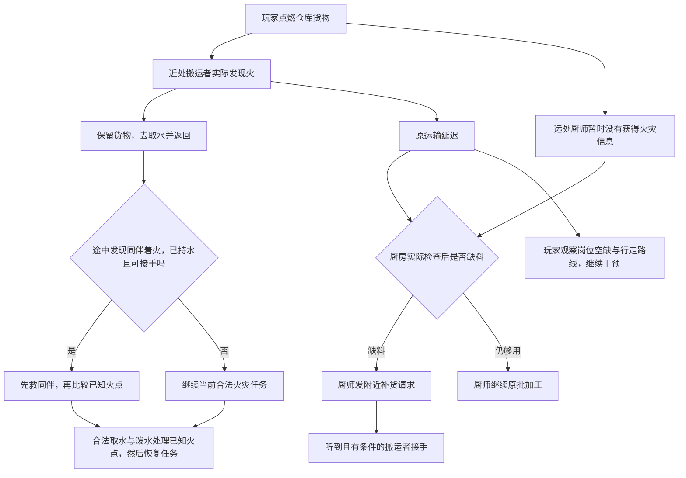

图中的“缺料”“救同伴”都需要满足实际条件，不是起火之后必定上演的后续剧情。另一张地图、不同时间或剩余库存不同，链路就可能停在不同位置。

| 玩家干预 | 基础规则的组合 | 可能形成的机会 |
|---|---|---|
| 移走墙灯 | 视野缩短、补光路程、暗处疲惫、严重疲惫睡眠 | 局部暗路和岗位空缺 |
| 报信路上丢钱 | 实际金币吸引、报告暂停、谈判或恢复 | 延迟信息传播，争取行动时间 |
| 追捕时丢钱 | 停追取币、短时谈判；其他人保留各自信息 | 分开追捕者，选择贿赂或脱身 |
| 堵住物流路线 | 开门或绕路、失败保货、有限冷却、实际库存减少 | 利用重试路线与补货人流 |
| 祭祀时制造火灾 | 局部感知和传话、职业响应、长老已知情况决定暂停 | 改变人员分布和活动推进 |

开发时实现这些小行为及其共同规则，具体组合在运行中发生。判断是否可信，应能沿着证据、动作和资源找到原因。

### 十六、换地图时哪些会变，哪些继续复用

| 继续复用的行为规则 | 每张地图需要提供的内容 |
|---|---|
| 八种身份及工作方式 | 人数、岗位分配、出生处和住所 |
| 日程窗口、需求及活动选择 | 工作点、餐位、休息点、酒馆和赌场位置 |
| 视觉、听觉、消息及个人警戒 | 墙门家具、导航、声音传播和真实光场 |
| 取水灭火、身体自救和同伴救助 | 水源、可燃物、火边安全操作面与通路 |
| 墙面补光 | 墙挂点、真实可取火把及工作点的照明关联 |
| 巡逻、队形和训练 | 有序巡逻路点、固定岗、训练站位 |
| 交贡品、运输、祭祀与聚餐 | 集货处、祭坛、餐厅及真实供给连接 |
| 领取、加工、交付和任务恢复 | 库存、操作点、容量、路径失败结果 |

例如把水源从厨房旁改到走廊尽头，只改变取水路径与耗时；不应改变“到场才能装水”和“返回才能泼水”的规则。地图更大时还要检查报信等明确时限是否合适，不能用瞬移和全图信息共享补偿。

以下仍是背景或后续规划：特殊伙伴永久招募、伪装准入、队长霸凌与脸面、老板护财策略、完整失踪调查与惩罚、跨探索个人社会存档。本文说明的是当前 NPC 行为基线，AI 不能根据这些背景自行扩展。

**读到这里应能回答：谁在做什么、为何现在选择这件事、他从哪里获得信息、操作究竟改变了什么，以及之后如何恢复。**需要逐项实现时，按下面的开发章节查精确规则。

| 开发问题 | 第二部分对应章节 |
|---|---|
| 范围、核心约束、时间与身份 | 0—3 |
| 数据、状态归属、地图和世界接口 | 4—6 |
| 决策、日程、职业工作和生活 | 7—10 |
| 感知、玩家处理、金币谈判和贿赂 | 11—13 |
| 火灾、同伴回应、补光和仪式 | 14—16 |
| 资源、中断恢复、跨日和重新进入 | 17—18 |
| 参数、调试、涌现与地图接入 | 19—20 |
| 验收、实施顺序和给 AI 的指令 | 21—23 |

## 第二部分：开发与 AI 实施规格

以下各节使用明确的数据、条件和单位描述第一部分的设计。**开发者与 AI 必须完整阅读，并依据这些精确要求实现和验收。**不能只把第一部分的示例链路硬编码成事件序列。

本部分编号保持 0—23，供正文交叉引用和开发沟通使用。数据名称是语义契约，目标工程可以采用自己的合理实现；动作条件、资源结果和恢复行为必须符合规格。

### 0. 使用方法与规格边界

1. 本部分可作为独立实施规格；先阅读第 0 节范围，开发者再阅读第 1—7 节，建立时间、数据、地图接口与决策约束。
2. 按第 8—16 节实现各职业、日程、感知和现场反应。
3. 第 17—20 节规定资源、中断、跨日、配置和调试行为。
4. 第 21 节给出可复现的验收用例；第 23 节是可直接复制给 AI 的开发指令。
5. 附录 A 保留当前 Demo 的 53 人作息和地点表，只供核对地图绑定。

**规范用词：**“必须”是验收要求；“默认”是当前数值，可通过配置调整；“建议”是实现方法；“待实现”不属于本次行为基线。

本次需要复现的是现有 NPC 系统：四种普通职业、三种中级职业、一种高级职业，以及它们的日常生活和对现场变化的响应。底层算法可以采用行为树、状态机、效用评分或等价实现，但玩家可观察的行为、认知边界和资源结果必须一致。

本文件没有要求在运行时调用大语言模型。NPC 的实时决策应使用确定的条件、数据和优先级；AI 开发工具负责实现这些规则。

#### 0.1 已确认的最新规则

| 项目 | 本文件采用的规则 |
|---|---|
| 金币与追捕 | 实际拾币优先于追捕、搜索和普通传话；处理完恢复原任务 |
| 投币谈判 | 已确认玩家的普通职业感知真实投币后可谈判；先投币、后确认也要重新判断 |
| 谈判时长 | 实际拿到金币后约 5 模拟秒；取币阶段最多 20 模拟秒 |
| 贿赂成功 | 本次潜入忽略玩家本人、玩家动作声和同伴的玩家举报；仍处理环境和生活 |
| 光照与工作 | 黑暗不减速、不停工；实际暗处工作额外积累疲惫 |
| 工作补光 | 使用真实火把，挂到工作处附近墙上；失败仍能继续工作 |
| 同伴反应 | 局部救助、守卫询问、娱乐邀约、巡逻队形，不自动共享全图状态 |
| 灭火 | 实际取水、回到火边、完成泼水、消耗水并改变真实火源 |

#### 0.2 当前基线与早期规划的区别

以下项目必须明确区分，避免实施时把不同版本混合：

| 项目 | 当前基线 | 早期背景或规划，未纳入本次实现 |
|---|---|---|
| 祭祀守卫 | 固定岗继续值守；巡逻守卫错峰交贡品，之后返回岗位 | 所有人同时离岗、据点几乎无人防守 |
| 特殊伙伴 | 当前没有伙伴招募和永久合作系统 | 留在洞穴、记得玩家、每次入洞到原地点再邀请 |
| NPC 长期记忆 | 同一次探索跨日延续；重进重建普通 NPC | 跨多次探索保留每人社会关系和完整经历 |
| 人物性格 | 贪财、社交倾向、职业职责和少量地点兴趣 | 队长霸凌与脸面、老板护财策略、酒馆全部情报 |
| 失踪与惩罚 | 长老根据未交贡品名单去熟悉住处呼叫 | 完整失踪侦查、抓出惩罚、流放 |
| 场所准入 | 当前基线没有伪装准入 | 玩家伪装成哥布林进入酒馆和赌场 |
| 地图物品扩展 | 只接入已经定义的感知、火、光、门、物资结果 | 酒瓶醉酒、击晕、大力伙伴、液体滑倒等独立规划 |

如果要采用右列规则，应另行修改规格和对应验收；不得在实现中自行开启。

### 1. 核心行为约束

| 编号 | 必须遵守的约束 |
|---|---|
| C01 | NPC 只根据自己的视觉、听觉、现场交流、已有记忆及熟悉设施作决定 |
| C02 | 声音给出位置线索；普通异常声音不能直接证明玩家身份 |
| C03 | 每个执行周期只执行一个选中的主要行为；其他目标可以保存，不能同时完成 |
| C04 | 高优先级中断保留已有货物、已消耗原料的加工批次和未完成职责 |
| C05 | 到达目的地、满足操作距离和视线后才推进对应操作；走路时间不算加工时间 |
| C06 | 同一物件、金币、食材、水或工作批次不能被重复消费、复制或凭空补足 |
| C07 | 目标消失、不可达或失去必要条件时，必须结束、暂缓或换可执行目标，不能永久卡住 |
| C08 | 已确认救火和救助任务不能仅因取水路程较长而遗忘 |
| C09 | 日程是候选窗口，不是定时瞬移；日常生活在安全工作节点重选 |
| C10 | 守卫搜索必须实际走动，不能仅站在最后目击点旋转或罚站 |
| C11 | 知道一个目标的过去位置，不等于持续读取它当前的隐藏位置 |
| C12 | 暂停停止模拟；观察者模式继续模拟；倍速统一推进移动、动作和截止时间 |
| C13 | 地图通过配置提供地点与路线；行为代码不得写入原地图坐标或固定 NPC 编号 |
| C14 | 同一规则和状态必须有一个负责维护的所有者，避免 UI、决策和动作各存一份相互矛盾的结果 |
| C15 | 涌现来自通用小行为的组合；不能为每种玩家操作组合硬写一条专用事件剧本 |

**说明：**事件类型和基础动作仍需要定义，例如“火灾报告”“取水”“拾币”。不提前设计的是“某房间起火后固定让某三个人执行某段剧情”这样的组合剧本。

### 2. 时间、距离与数值约定

#### 2.1 时间必须分为两种

| 名称 | 定义 | 用途 |
|---|---|---|
| 模拟秒 `sim_seconds` | 1 倍速下等于实际经过秒；暂停时不增加 | 感知、移动、拿取、加工、调查、谈判、路线失败冷却 |
| 游戏分钟 `game_minutes` | `起始分钟 + sim_seconds × 48 / 60` | 一天作息、午饭窗口、训练、祭祀、跨日记录 |

当前起始时刻是第 1 天 12:00，默认时间倍率为 48。1 游戏小时等于 75 模拟秒；从 12:00 到 18:00 为 450 模拟秒。

观察倍速 2×/4×/8×只改变模拟推进速度，不改变“拿币后 5 模拟秒”和“18:00 集合”的相对含义。所有计时器必须明确单位，不能混用系统时钟、帧数和游戏分钟。

#### 2.2 与地图尺寸解耦

定义行为距离单位 `U`，代表一个标准导航格宽度。原 Demo 的 `U = 32 像素`；新地图只需将 `U` 映射到自己的世界单位，不必沿用像素。

- 本文件写为 `7U` 的范围不能误写成 7 像素或固定 224 世界单位。
- 动作计时与需求增长不因贴图分辨率改变。
- 不规则地图可使用连续寻路；`U` 仍作为距离参数的参考尺度。
- “到达操作点”和“能接触目标”分别判断，不能用过大的到达半径跨过真正的操作距离。

#### 2.3 需求与倾向

| 数据 | 范围／默认 | 含义 |
|---|---|---|
| 饥饿 | 0—100；每游戏小时 +9 | 越高越需要吃饭 |
| 疲惫 | 0—100；基础每游戏小时 +5 | 越高越需要休息或睡眠 |
| 社交需求 | 0—100；每游戏小时 +7 | 越高越想喝酒、赌博或聊天 |
| 暗处工作额外疲惫 | 每游戏小时 +5 | 只计实际在岗干活、照度低于 0.22 的时间 |
| 贪财 `greed` | 0—1；默认个体约 0.65—0.95 | 影响金币兴趣和部分娱乐评分 |
| 社交倾向 `sociability` | 0—1；默认个体约 0.4—0.88 | 影响社交候选门槛 |
| 钱包 | 非负整数；当前初始 8—20 枚 | 真实余额；喝酒、赌博、拾币改变余额 |

日常需求不是情绪系统。当前不需要开心、愤怒、关系好感、报复等数据。

默认个体初值用稳定序号 `i` 生成：饥饿 `22 + (i mod 7) ×3`，疲惫 `12 + (i mod 5) ×6`，社交 `15 + (i mod 5) ×10`，贪财 `0.65 + (i mod 4) ×0.1`，社交倾向 `0.4 + (i mod 5) ×0.12`，钱包 `8 + (i ×3 mod 13)`。夜班守卫初始疲惫改为 `55 + (i mod 3) ×4`。新项目可以通过配置替换初值，不能用随机日程切换代替需求判断。

需求的基础增长在行动、休息和睡眠时仍推进；休息／睡眠恢复量另行扣减，最终限制在 0—100。暗处加成只计实际工作时间。

### 3. 身份与能力矩阵

默认人口共 53，人数属于关卡配置，不是行为规则。

| 等级／身份 | 默认人数 | 日常职责 | 物品火灾 | 玩家确认后 | 普通贿赂 |
|---|---:|---|---|---|---|
| 普通·厨师 | 4 | 取料、做饭、检查厨房供给 | 取水灭火 | 报告守卫 | 支持 |
| 普通·守卫 | 24 | 白／夜班、站岗或双人巡逻、训练 | 取水灭火 | 追捕并喊援军 | 确认后投币谈判 |
| 普通·搬运工 | 15 | 厨房运输、仓库分拣或酒馆供货 | 取水灭火 | 报告守卫 | 支持 |
| 普通·种植者 | 6 | 照料、收获实际食材 | 取水灭火 | 报告守卫 | 支持 |
| 中级·酒馆老板 | 1 | 酿酒、服务、收钱 | 避火 | 现场报告 | 不支持普通贿赂 |
| 中级·赌场老板 | 1 | 赌场岗位、通用生活 | 避火 | 现场报告 | 不支持普通贿赂 |
| 中级·守卫队长 | 1 | 监督、监督训练、通用生活 | 取水灭火 | 追捕并喊援军 | 不支持普通贿赂 |
| 高级·长老 | 1 | 整理祭器、祭祀、缺席呼叫 | 避火 | 现场报告 | 不支持普通贿赂 |

共同能力：吃饭、休息、睡眠、喝酒／赌博／聊天、观察环境、保存未完成任务。任何身份自己着火都先自救；任何已经持水且实际发现遇险同伴的人都可以救助。空手主动接手同伴救助默认只开放给四种普通职业。

赌场老板只对赌场区域内的钱产生拾取兴趣；其他身份没有这个地点限制。队长仍贪财，会被实际金币打断追捕，但不会因此开放普通谈判。

“分拣工”“货商”“酒馆伙计”不是新增身份，必须由搬运工岗位或酒馆老板职责表达。

### 4. 数据契约与状态归属

下列是语言无关的数据要求，可按目标引擎使用类、组件或结构体实现。字段不要求照搬名称，语义必须齐全。

#### 4.1 NPC 静态定义

```text
NpcDefinition
  id                     唯一、稳定的身份 ID
  occupation             八种职业之一
  work_assignment        搬运岗位：kitchen / warehouse / tavern
  shift                  day / night
  resident_order         稳定个体序号，用于错峰和同分排队
  greed, sociability     倾向值
  leisure_preference     drinking / gambling
  initial_wallet         初始真实金币
  bindings               住所、工作、餐位、娱乐、训练等语义地点 ID
  patrol_route_id        守卫巡逻路线 ID
  patrol_team            本队、带队者和伙伴 ID
  schedule               午饭候选时间、娱乐窗口、睡眠窗口
```

#### 4.2 NPC 运行数据

| 数据组 | 必需内容 | 所有者 |
|---|---|---|
| 需求 | 饥饿、疲惫、社交、钱包 | NPC 生活模块 |
| 日常动作 | 活动类型、目的地 ID、到场情况、已完成工作量 | NPC 生活／职业模块 |
| 高优先行为 | 当前行为、目标、阶段、恢复上下文 | NPC 行为执行模块 |
| 认知 | 感知线索、最后已知位置、来源、取得时间、确认情况 | NPC 认知模块 |
| 火灾任务 | 已知火点、已接手火点、是否持水、操作进度、暂缓期限 | NPC 救火执行模块 |
| 玩家处理 | 识别进度、最后目击位置、追捕／搜索进度、个人警戒记录 | NPC 警戒模块 |
| 金币与谈判 | 目标金币 ID、中断前行为、已感知的示好币、取币／谈判截止时间 | NPC 金币与贿赂模块 |
| 当局贿赂 | `bribed_this_run` | NPC；所有玩家识别与报告入口统一检查 |
| 社会反应 | 救助请求、同伴询问、邀约、最后已知同伴位置 | NPC 同伴模块 |
| 已有实物 | 货物批次、熟食份数、水、照明器物 | 实物所有者；NPC 保存持有引用 |
| 每日记录 | 吃饭日期、娱乐日期、训练日期、贡品交付、聚餐已吃 | NPC／共同活动所有者 |
| 路线恢复 | 当前路线、门操作进度、失败地点与冷却 | NPC 导航模块 |

`state` 表示当前响应模式，例如追捕、报告、取水；`activity` 表示被保留的日常职责，例如做饭。二者可以同时存在：厨师当前在取水，但仍记得未完成的那锅饭。

#### 4.3 Task：一个行为的完整上下文

```text
Task
  type, stage
  target_id
  last_known_position
  work_done
  destination_id
  committed_resource_ids
  deadline_sim_seconds   仅在该动作确实有期限时设置
  resume_context         被中断任务的必要上下文
```

必须避免只保存“在救火”而不保存火点和取水阶段。也不能把“知晓火灾”“已取水”“已完成灭火”做成含义不清的一串布尔变量。

**任务结果至少区分：**执行中、完成、被中断、目标失效、不可达、条件暂不满足。不能把所有结果都当作“完成”并满足需求。

#### 4.4 Knowledge：NPC 已知线索

```text
Clue
  clue_id                 同一线索转述时保持不变
  kind                    player / noise / fire / peer_help / invitation
  source_kind             seen / heard / reported / familiar
  source_npc_id           有实际传话者时填写
  target_id               真正获知身份时填写，可为空
  last_known_position
  observed_at_sim_seconds
  confirmed               是否已经得到对应事件的确认
  expires_at              临时线索的有效期
```

可见目标位置刷新、失视后按旧位置行动。同一报告被转述十次仍是一条线索，不能变成十次独立异常并把警戒刷满。

### 5. 地图语义配置：换地图时只替换这里

行为层使用“这里能做什么”，地图层负责“它在哪里、怎么走”。设施必须有稳定 ID、类型、所属区域、可用操作点、容量和当前是否可用。

#### 5.1 必需语义设施

| 语义类型 | 供什么行为使用 | 必需配置 |
|---|---|---|
| `home` / `bed` | 正常睡眠、已知住处、缺席呼叫 | NPC 绑定、床边可用点、睡眠容量 |
| `work.cook` | 做饭 | 实际加工点、关联原料区／熟食输出区 |
| `stock.raw` | 厨房运输、分拣、补货、酒馆供货 | 共享库存区和取物点 |
| `stock.kitchen_raw` | 厨师取料 | 厨房输入库存和可达取料点 |
| `stock.kitchen_meal` | 搬运熟食 | 已完成熟食库存和领取点 |
| `work.sort` | 分拣 | 操作点、关联仓库、卸货点 |
| `work.grow` | 种植 | 操作点、产物落点、关联收获区 |
| `dining.seat` / `dining.stock` | 吃饭和聚餐 | 独立餐位、实际熟食库存／服务区 |
| `tavern.serve` / `tavern.brew` / `stock.tavern_raw` | 喝酒、服务、酿酒 | 老板岗位、原料点、加工点、客位 |
| `casino.table` | 赌博 | 场所区域、可用赌客位置、参与容量 |
| `guard.post` | 站岗、普通人报信 | 固定岗／熟悉报信目的地 |
| `patrol.route` | 巡逻 | 有序路点、覆盖区域、带队配对 |
| `training.slot` / `training.captain` | 集合和训练 | 每人站位、队长位置、可建立视线 |
| `social.rest` | 休息、聊天、等待 | 安全可用点，避开门口 |
| `ritual.deposit` / `ritual.altar` | 交贡品、运输、正式仪式 | 交付点、集货区、祭坛操作点 |
| `water.source` | 取水、身体自救 | 实际可达取水点与操作面 |
| `torch.mount` | 工作照明 | 真实墙体、挂点、靠近点、占用情况 |
| `safe.local` | 避火、疲惫睡眠 | 从局部导航空间筛选；不必预放专用点 |
| `player.staging` | 受雇搬运交付 | 临近撤离区域的实际卸货点 |

不同语义设施可以共用场所，例如交贡品前室同时放餐桌；必须保持“贡品”和“熟食”的库存及操作含义分别清楚。

#### 5.2 路线和地点绑定示例

以下是接口示例，ID 由新地图自己定义，不代表必须存在这些同名房间。

```yaml
npc_bindings:
  cook_a:
    home: bed_a
    workplace: cook_station_a
    dining: dining_seat_a
    tavern: tavern_guest_a
    casino: casino_guest_a
    social_rest: rest_a
  carrier_a:
    home: bed_b
    work_assignment: kitchen
    workplace: carrier_wait_a
    raw_sources: [warehouse_input, harvest_area]
    raw_delivery: kitchen_input
    meal_pickup: kitchen_meals
    meal_delivery: dining_stock
  guard_a:
    home: bed_c
    shift: day
    duty: patrol
    patrol_route: production_route
    patrol_partner: guard_b
    training_slot: training_a

routes:
  production_route:
    waypoints: [guard_post, warehouse_edge, kitchen_edge, grow_area, tavern_edge]

ritual:
  deposit: tribute_deposit
  altar: altar_main
  dining_stock: dining_stock
```

#### 5.3 地图载入验证

必须在进入关卡前检查：

- 绑定 ID 存在，职业所需设施有可用点。
- 可用点不在实体内部、墙内或门框里；物件位置和可操作位置分别配置。
- 巡逻路线有至少一个可达路点；队友 ID 合法，不能自己跟随自己。
- 训练站位有容量；床位共用应避免同时睡眠的占用冲突。
- 墙挂点确实依靠墙体，发光点位于墙外可照亮的空间。
- 厨房—仓库—餐厅、酒馆—原料区、集货区—祭坛的供给关系完整。

关键设施缺失时返回可读的配置错误；运行中设施被破坏／堵住时走正常失败与重试规则，不能凭空生成新设施。

### 6. 行为层需要的世界接口

这些是语义契约，开发者可合并为较少模块，不必照表创建一堆透传类。

| 接口职责 | 必须能执行的操作 | 认知限制 |
|---|---|---|
| 时钟 | 当前模拟秒、游戏分钟、日期、暂停、倍速 | 所有行为使用同一时钟 |
| 地图与导航 | 解析熟悉设施、寻路、到达判断、门操作、失败结果 | 不根据隐藏玩家位置生成搜索路线 |
| 视觉 | 朝向／距离／遮挡／照度／烟雾的可见判断 | 返回实际能感知的对象 |
| 声音 | 发出声源、传播衰减、返回实际听众与位置线索 | 不将全部 NPC 作为默认听众 |
| 消息 | 将带 `clue_id` 的报告传给实际听众 | 报告携带过去已知位置，不等于共享实时跟踪 |
| 物资 | 查询任务绑定库存、领取、转移、交付、原子消费 | 可登记共享生产库存；移动中的玩家／同伴器物位置仍需现场获知 |
| 火与光 | 实際火源、光场、烟、可燃物、灭火、点灯 | NPC 只从自己的已知火点选目标 |
| 占用 | 对物资、墙挂点、同伴救助、社交会话申请／释放 | 同一事务不能重复接手并重复结算 |
| 身体状态 | 身体着火、清除身体火、持水 | 身体火和物品火是不同目标 |
| 调试与表现 | 行为、阶段、原因、目标、操作结果和路径失败记录 | UI 读取事实，不反过来制造状态 |

允许世界层在原子操作时检查“目标是否还存在”，防止重复消费；这不意味着 NPC 可以主动查询全图所有隐藏目标。

### 7. 总决策：条件筛选 → 优先级比较 → 实际执行

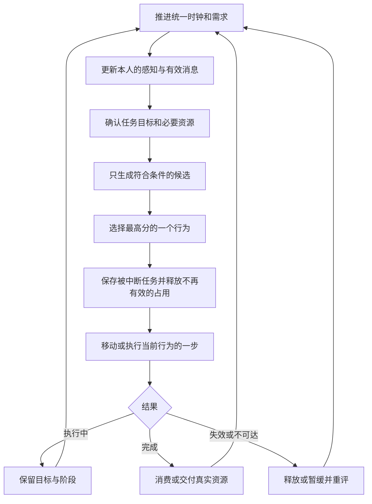

#### 7.1 上层优先级

| 分值 | 候选 | 必须满足的资格／特殊规则 |
|---:|---|---|
| 1000 | 自身身体着火 | 自己正在着火 |
| 950 | 已持水帮助着火同伴 | 实际感知并接手救助，本人未着火 |
| `920 + greed × 20` | 拾取实际金币 | 有目标金币且允许分心；已知火灾、自救、避火、谈判时关闭；中高级报告中关闭 |
| 900 | 追捕／搜索 | 当前在追捕或搜索；受贿者不可通过玩家线索进入 |
| 880 | 投币谈判 | 普通职业、已确认玩家、真实玩家金币、窗口有效 |
| 850 | 空手帮助着火同伴 | 普通职业接手有效救助；先取水 |
| `800 + max(0, 20 - 火点距离/U)` | 物品火灾或避火 | 有当前活动的本人已知火点 |
| 690 | 调查金币声 | 实际听到且仍在调查有效位置线索 |
| 650 | 继续报告 | 正在报告，或报告被金币暂停 |
| 640 | 初次疑惑 | 处于未确认视觉疑惑 |
| 630 | 调查视觉线索 | 已从疑惑转为检查最后已知位置 |
| 620 | 严重疲惫睡眠 | 疲惫 ≥90；没有正在处理的怀疑、调查、报告、追捕、搜索、地区警戒或金币中断记录 |
| 520 | 工作处墙面补光 | 已在工作点发现太暗，或继续已接手补光；祭祀期间不另启动 |
| 500 | 已携熟食交付 | 本人真实携带熟食，目的地不在失败冷却 |
| 490 | 一次受雇服务 | 已接受真实任务，目的地可尝试 |
| 480 | 调查其他线索 | 有需要现场调查的有效声音／光变化 |
| 470 | 请求补货／继续补货 | 搬运工、实际请求、无冲突货物，或已有补货批次 |
| 460 | 日常原料运输 | 已携日常厨房运输批次 |
| 450 | 分拣／酒馆供货 | 已携该岗位批次 |
| 410 | 询问附近守卫 | 实际看见同伴异常，自己空闲且可接手；受贿者不接入玩家询问 |
| 400 | 加强地区巡逻 | 本人的地区警戒仍有效 |
| 300 | 祭祀／贡品运输 | 共同活动有效，或本人已有贡品批次 |
| 40 | 配送不可达时等待 | 携货目的地在失败冷却，保留货物并处理可行生活需求 |
| 0 | 日常 | 由生活模块选择工作、训练、用餐、娱乐、睡眠等 |

**分值不是无条件命令。**例如火灾分值低于金币，但知道火灾时金币不具备资格，因此不会为了钱放弃已经知道的火灾。携水救人仍优先于追捕；自己着火永远先自救。

同分候选按稳定顺序选择，不能每帧随机切换。已经接手且仍合法的同类目标优先保持；完成、失效、冷却或新更高优先事项出现后再换目标。

#### 7.2 执行伪代码

```text
tick(sim_delta):
    更新需求和到期记录
    到感知周期时接收视觉、听觉和局部消息
    更新任务合法性与阶段
    生成满足资格的候选
    选择最高优先候选
    若切换：保存必要工作上下文，按任务规则释放占用
    执行选中任务的一步
    根据任务结果完成、恢复、暂缓或重新选择
    输出可观察状态与理由
```

建议视觉感知周期默认为 0.15 模拟秒，移动与动作连续推进。听到实际报告可以立即更新线索，但本周期不能同时结算两个主要行为。

### 8. 一天的日常活动与行走路线

#### 8.1 日程窗口

所有“时间到”都只是提出候选；真正切换受当前任务、安全节点、需求、岗位和资源限制。

| 游戏时段 | 普通居民／白班守卫／中高级 NPC | 夜班守卫 |
|---|---|---|
| 00:00—06:00 左右 | 正常睡眠 | 值勤与按需生活 |
| 06:00—06:40 | 错峰起床，实际走到岗位 | 继续值勤，与白班有重叠 |
| 起床后—13:00 | 职业工作；需求提前达到门槛时在安全节点处理 | 10:00 起进入白天睡眠窗口 |
| 13:00—15:00 | 错峰午饭候选，实际吃到才完成 | 默认仍睡眠 |
| 14:00—17:00 | 每人分配其中一个小时作为娱乐候选窗口，仍穿插工作 | 默认 16:00 起床 |
| 16:00—17:00 | 守卫和队长实际步行集合；其他身份继续日常 | 集合训练 |
| 17:00—17:30 | 守卫训练、队长监督 | 同样参加训练 |
| 17:30—18:00 | 恢复岗位、路点和未完成动作 | 恢复日常 |
| 18:00 起 | 交贡品、运输、祭祀与聚餐；详见第 16 节 | 按岗位规则交贡品／值勤 |
| 20:00—22:00 | 错峰晚饭候选；工作与生活继续 | 值勤中按需求和离岗名额处理 |
| 21:00—22:00 | 额外娱乐候选窗口 | 同左 |
| 22:00—22:30 起 | 错峰回床睡眠 | 继续夜间值勤 |

默认错峰算法，`i` 为稳定居民序号：

```text
午饭候选：13:00 + (i × 11 mod 60) 分钟，窗口在 15:00 结束
晚饭候选：20:00 + (i × 7 mod 60) 分钟，窗口在 22:00 结束
娱乐候选：14 / 15 / 16 点之一 + (i mod 20) 分钟，当小时结束
白班睡眠开始：22:00 + (i mod 4) × 10 分钟
白班起床：06:00 + (i mod 3) × 20 分钟
夜班睡眠：10:00—16:00；关闭训练时为 10:00—17:40
```

新项目也可直接配置每人的时间窗口；不得把错峰时间绑定到旧地图 NPC 编号。

#### 8.2 安全工作节点

| 日常职责 | 允许重新选择普通生活需求的节点 |
|---|---|
| 做饭 | 一锅完成；没有可拿原料且未领取批次 |
| 分拣 | 同一批完成并卸货 |
| 运输 | 同一批交付；目标本次不可达而进入等待 |
| 种植 | 当前收获批次完成 |
| 酿酒 | 当前批次完成；缺料且没有拿到原料 |
| 站岗 | 一轮岗位观察结束 |
| 巡逻 | 到达路点并完成观察；跟随者到有效跟随节点 |
| 服务、整理祭器、监督 | 当前日常动作片段完成，或明确空闲节点 |

危险、追捕、金币、有效现场响应和严重疲惫可以立即中断；普通“想吃饭／想喝酒”不能每帧把未完成批次推倒重来。

默认一轮站岗为 `18 + (i mod 4)` 模拟秒；服务、祭器整理和监督的一段为 `30 + (i mod 5)` 模拟秒。它们决定普通生活重选的节点，不关闭期间的感知，也不限制高优先响应。实际收获、烹饪和分拣分别按各自完整批次处理。

#### 8.3 生活候选评分

先判断是否处于正常睡眠窗口；允许睡眠时选择回床。否则比较有效候选：

| 候选 | 进入条件 | 默认评分 |
|---|---|---|
| 休息 | 疲惫 ≥70，休息点可尝试 | `40 + (疲惫 - 70) × 1.5 × 疲惫权重` |
| 吃饭 | 饥饿 ≥55，或当日午／晚饭窗口未完成；用餐重试已到期 | `40 + max(饥饿 - 55, 0) × 1.5 × 饥饿权重` |
| 自选娱乐 | 社交 ≥ `75 - sociability ×20`，或个人娱乐／晚间窗口有效 | `20 + max(社交 - 75, 0) ×0.5` |
| 同伴邀约 | 有有效邀请、钱包与岗位允许，社交 ≥ `50 - sociability ×10` | `28 + max(社交 -45, 0) ×0.5`；赌博再加 `greed ×4` |

饥饿和疲惫权重默认都为 1。没钱不能喝酒／赌博，可选择聊天；当前还有每完成若干动作选择聊天的个体变化。聊天是社会交流，不需要引入第三种娱乐场所。

守卫的普通生活离岗还受第 9.5 节名额限制。不能因为没有离岗名额停止增长需求。

#### 8.4 日常路线总表

| 身份／岗位 | 使用新地图语义地点的路线 |
|---|---|
| 厨师 | 床 → 厨房取料点 → 加工点 → 继续取料；需要生活时去餐位／休息／酒馆或赌场 → 加工点 → 床 |
| 厨房搬运 | 床 → 绑定仓库或收获区 → 厨房卸原料；或厨房领取熟食 → 餐厅卸货 → 下一批；生活后回工作 → 床 |
| 仓库分拣 | 床 → 未分拣库存或收获点 → 分拣操作点 → 入库 → 下一批；生活后回分拣 → 床 |
| 酒馆供货 | 床 → 绑定原料区 → 酒馆原料卸货点 → 下一批；生活后回供货 → 床 |
| 种植者 | 床 → 种植操作点 → 收获落点 → 下一批；餐位／休息／娱乐 → 种植点 → 床 |
| 站岗守卫 | 床 → 固定岗 → 岗位观察；批准离岗后去餐位／休息／娱乐 → 原岗；训练后回岗 → 床 |
| 巡逻守卫 | 床 → 路线首点 → 后续路点循环；生活／训练结束回原路点；睡眠窗口回床 |
| 队长 | 床 → 监督岗 → 观察附近守卫；训练时去监督位置；生活后回监督岗 → 床 |
| 酒馆老板 | 床 → 服务点／到场客人附近；缺酒时去原料区 → 酿造点 → 服务；生活后回酒馆 → 床 |
| 赌场老板 | 床 → 赌场岗位；生活需求时去餐位／休息／娱乐 → 赌场 → 床 |
| 长老 | 住所 → 祭器整理点／交流点；祭祀去集货点、缺席者熟悉住所、祭坛、餐位 → 住所 |

路线描述的是任务目的地序列。真正路径由当前导航、门、阻挡、危险记忆和容量决定，不能播放一条固定轨迹假装 NPC 在生活。

### 9. 职业工作与社会供给

#### 9.1 厨师

触发：没有更高优先事项，生活选择仍是工作。

1. 本人在厨房检查原料；记录上次数量。数量减少且厨房需要原料时，向附近可听到的搬运工发出补货请求。
2. 检查厨房／餐厅／在途熟食，以及其他厨师已领取原料折算的预计产出。预计总量不能超过熟食目标 60 份。
3. 选择可领取原料，走到取料点，拿取 0.6 模拟秒后持有 1 件。
4. 实际回到自己的加工点，累计 18 模拟秒，黑暗也按正常速度推进。
5. 原子结算：消耗这 1 件原料，厨房熟食增加 8 份；不能同时把饭自动送到餐厅。
6. 出锅或缺料时进入安全节点，决定下一件事。

失败：原料没有、已被领取、烧毁或拿走，取消未完成领取并释放占用；已经拿到的原料保留在原锅。缺料不得生成饭菜，也不得将等待算作做饭成功。

#### 9.2 搬运工

默认岗位分配为厨房 6 人、仓库分拣 5 人、酒馆供货 4 人。所有岗位都可以救火、执行已接受的一次服务和搬祭祀贡品。

| 岗位／任务 | 触发与步骤 | 完成与默认节奏 |
|---|---|---|
| 厨房原料运输 | 到绑定仓库／收获区 → 领取最多 2 件 → 实际搬到厨房 | 同一批卸货；下一普通原料批次间隔 60 模拟秒 |
| 厨房熟食运输 | 空手、厨房有饭、餐厅加在途少于 36 份时优先领取 | 最多 6 份搬到餐厅；厨房扣除、携带、餐厅加入是三步 |
| 仓库分拣 | 领取最多 2 件未分拣库存／收获 → 分拣点实际加工 6 模拟秒 → 入库 | 标记已分拣；同一批不重复加工；间隔 40 模拟秒 |
| 酒馆供货 | 酒馆原料和已预约／在途不足目标 6 件 | 领取最多 2 件并卸到酒馆原料区；间隔 40 模拟秒 |
| 厨师补货请求 | 实际听到本地请求，有可领取原料且没有冲突批次 | 领取请求需要的原料并交厨房；无可用原料时结束本次请求 |
| 祭祀贡品运输 | 共同活动进入运输，集货点有贡品 | 领取最多 4 件 → 祭坛；维护在途数量 |

搬运者已经携货时不能再创建另一份冲突货物。路径失效保留批次，进入等待、生活或其他合法响应，冷却后重新尝试交付。

#### 9.3 种植者

- 在绑定的种植操作点累计 40 模拟秒的有效工作量。
- 一批完成后生成 2 件真实落地食材，并标记为可运输收获。
- 当前三种食材按共同收获顺序轮换；新地图可换美术和名称，生产数量与规则按配置。
- 默认全社会每日总收获上限 40 件；午夜重置每日计数，不清除已收获库存。
- 中断保留未完成工作量；只有批次真正完成才能生成产物。
- 当前没有播种、肥料、季节等额外农业链。

#### 9.4 酒馆老板与赌场老板

| 活动 | 条件与步骤 | 成功结果 |
|---|---|---|
| 酒馆服务 | 老板处于正常服务、有酒；客人实际进入酒馆、有钱，老板与客人不足 5U 且无遮挡 | 6 模拟秒完成一次；消耗 1 杯酒，客人付 1 币给老板，客人社交需求 -20 |
| 酿酒 | 酒水不足目标 30 杯，取得现场可见且可达的 1 件酒馆原料 → 回酿造点加工 | 30 模拟秒产出 6 杯酒；只消费同一原料一次 |
| 缺酿造原料 | 前往熟悉原料区查看 | 无原料不推进加工；可以在安全节点处理需求 |
| 赌场岗位 | 正常日程选择服务并到赌场岗位 | 维持岗位与个人生活；当前没有玩家赌场小游戏 |

酒馆默认初始库存 24 杯。还没拿到酿酒原料时，有酒且出现客人可以切去服务；已经开始真实批次则保留该批次。酿酒与出售不能同时完成。

老板和长老也受通用吃饭、休息、娱乐和异常响应影响。当前不保证它们除睡眠／祭祀外永远留在岗位。

#### 9.5 守卫站岗、巡逻与队长监督

**岗位：**默认每班 12 名守卫，2 人固定岗，其余 10 人组成 5 支双人巡逻队。新地图提供岗点与有序路线，不能复用旧坐标。

- 站岗按默认 40°／模拟秒扫视；到巡逻路点观察 1 模拟秒后走下一点。
- 带队与伙伴在 6U 内且无遮挡、带队者实际巡逻时保持约 1.2U 间距。
- 带队者到点等落后队友最多额外 3 模拟秒，随后继续；不能因队友救火而全队永久等待。
- 失散后各走记住的原路线，附近重新看到才组队；不能借队友 ID 读取其全图位置。
- 同队不共享玩家追捕、搜索或线索；需要实际呼喊、交流或本地目击。
- 同班普通吃饭／休息／娱乐最多同时离岗 2 人。按首次需求申请时间排队，同刻按稳定序号排序，避免一个人反复拿名额。
- 自救、危险、金币和严重疲惫响应不受普通离岗名额限制；未满足需求保留。

队长在监督点朝向附近 6U 内无遮挡的守卫；没有可见守卫时扫视。监督不需要远程读取全体守卫行为，也不包含尚未实现的惩罚系统。

#### 9.6 集体训练

默认 16:00—17:00 步行集合，17:00—17:30 训练。

1. 守卫与队长保存原日常活动、进度和目的地，实际前往各自训练站位。
2. 提前到达只等待，路程不算训练时间。
3. 队长到场、处于监督训练且守卫与其无遮挡时，守卫才累计训练。
4. 队长缺席显示“等队长”，不能播放训练并记作完成。
5. 危险、追捕、金币、警戒等可中断；窗口仍有效时可以回来继续。
6. 17:30 后恢复原任务，不重置巡逻路点或原生活进度。

将训练时长设为 0 可关闭训练，夜班睡眠窗口随之采用第 8 节的关闭规则。

#### 9.7 长老日常

在绑定祭器工作点整理祭器，按通用需求去吃饭、休息、喝酒、赌博或现场交流；祭祀时执行第 16 节。发现物品火灾避火，自身着火先自救。身份高不意味着知道全图玩家位置或全部事件。

### 10. 用餐、娱乐、休息与睡眠

#### 10.1 资源成功才满足需求

| 活动 | 真正成功的条件 | 数值与失败处理 |
|---|---|---|
| 吃饭 | 实际到餐位，完成 6 模拟秒动作，餐厅有 1 份熟食 | 熟食 -1、饥饿 -48；没饭不降低饥饿，60 游戏分钟后重试 |
| 歇脚 | 实际到安全休息点 | 每模拟秒疲惫 -0.35；一段默认 12 模拟秒 |
| 睡觉 | 到床或合法阴暗睡点，进入真正睡眠 | 每模拟秒疲惫 -1.8；到床路程不恢复 |
| 喝酒 | 实际酒馆服务成功 | 见第 9.4 节；无老板、有老板但忙酿酒、无酒、无钱都不能记作成功 |
| 赌博 | 两名合法赌客到场，相邻无遮挡，有钱，完成 6 模拟秒 | 随机一方付另一个 1 币；双方社交 -24；不凭空产钱 |
| 聊天 | 两名现场参与者相邻无遮挡，完成 6 模拟秒 | 双方社交 -24；交换自己的有效见闻 |

社交会话只由一个计时所有者推进，不能两人各加一遍同一帧时间。一个人不能同时参加两组会话。

#### 10.2 赌博与邀约

- 至少两名实际赌客，不能把赌场老板经营、旁观者、尚在路上的受邀者计入人数。
- 当前实现是两人一局；多人到场可形成多组合法两人会话，不要求新增多人赌桌结算。
- 必须在赌场语义区域，不能在工作地或赶路途中开赌。
- 只有一人到场显示“等赌伴”；等待不扣钱、不满足娱乐需求。
- 决定去赌博时即可向附近发出邀请，传达**赌场目的地**，不能把发出邀请的工作地当成赌场。
- 默认邀请间隔 8 模拟秒、声源范围 3.5U、记忆 15 模拟秒；一位发起者一次接纳一位受邀者。
- 受邀者在安全工作节点依需求、钱包、目的地可达性和岗位名额决定是否赴约。
- 已开局有人被打断或离开，取消未完成会话，不转账。
- 约 24 模拟秒等不到有效社交结果，则回职责；60 游戏分钟后再尝试未满足社交需求。

#### 10.3 严重疲惫睡眠

触发：疲惫达到 90，且符合第 7 节睡眠资格。

1. 保存当前日常活动、工作量、目的地及已经存在的生活中断信息。
2. 在附近 6U 内找照度低于 0.22、无遮挡、可达的安全位置，排除门格、已知火点、实体和失败地点。
3. 优先近处；没有合法阴暗点则实际走回熟悉床位。
4. 到达后才恢复疲惫；恢复到 60 或以下醒来，继续原任务。
5. 去睡点途中该点被照亮或变危险，重新选择；找不到就结束本次尝试并冷却，不能永远转圈。
6. 货物、水、原料、饭菜和付费任务不丢失。

#### 10.4 强光可能唤醒

- 身体位置照度达到 0.55，连续照射 3 模拟秒后做一次 50% 概率判断。
- 同一轮连续强光只判定一次，不能每帧抽签直到必醒。
- 变暗会清除连续曝光；下一轮强光重新计时。
- 光醒后 20 模拟秒不立即再次入睡，恢复正常观察和任务。
- 暗光、未持续够时间、隔墙灯光不直接唤醒。
- 睡眠中没有有效视觉；实际足够强的局部声音或危险可以中断睡眠，但声音本身不能证明玩家身份。

### 11. 视觉、听觉与消息

#### 11.1 视觉判定

默认最大视距 7U、视野角 100°。必须同时考虑：朝向、目标距离、墙／门／实体遮挡、目标处实际照度、烟雾和睡眠状态。

```text
如果真正睡着：不可视觉感知
如果目标超出最大视距或视野角：不可见
如果视线被实体遮挡：不可见
如果目标照度 <0.22 且距离 >1.5U：不可见
烟雾再缩短有效最大距离：7U × (1 - smoke)，smoke 在 0—1 范围
```

当前 Demo 在目标距离不超过 0.125U 时不使用朝向角限制，仍检查实体遮挡、光照和烟。新地图应保留这个近身边界，避免重叠接触者仅因背对就永远不可见。

不能以画面整体亮度替代行为照度；火把、火盆、身体火和遮光变化必须进入同一逻辑光场。火把默认径向半径 4U，火盆默认 3×3 格方形覆盖，实际受遮挡影响。

物品火的目击使用明亮火源的局部可见规则，默认火灾感知距离 8U，并受实际遮挡限制。

#### 11.2 玩家识别条

初次能看见玩家时先疑惑，不立即把识别完成当作普通声音的结果。

普通非守卫职业：识别进度按基础速度增加，玩家潜行系数为 0.65，否则 1。默认满值 1.5。

守卫和队长：

```text
recognition_rate = movement_factor
                 × (3U / max(distance, 0.03125U))
                 × (player_light / 0.55)
                 × (1 + alert_level × 0.5)
recognition += sim_delta × recognition_rate
```

必须先通过可见判定才增长。参考距离 3U、照度 0.55、零级警戒、玩家非潜行时约 1.5 模拟秒确认；越近、越亮、个人警戒越高，增长越快。

仅照亮守卫自身不能提高玩家识别速度。失视按原规则回落，持续失视约 3 模拟秒清除当前连续确认信息；已接手追捕／搜索仍保留最后位置与任务。

#### 11.3 听觉

| 默认参数 | 数值 |
|---|---:|
| NPC 听力上限 | 6U |
| 呼喊传播范围 | 5U |
| 有效听觉强度门槛 | 0.12 |
| 关闭门的声音透过率 | 0.25 |

声音范围、NPC 听力、传播路径和衰减共同决定听众。墙封闭不能靠直线距离穿透；关闭门可以衰减传播。

- 玩家脚步、开门、撞击等未知动静：得到过去的声源位置，去检查。
- NPC 熟悉的脚步、工作、做饭、聊天等：可以听见，但不自动当作入侵。
- 金币声：先检查职业地点兴趣，再调查或拾取；无真实玩家金币不能凭声开启谈判。
- 火声：可以引起调查，确认火灾需目击或有效同伴报告。
- 同伴求救／娱乐邀请：携带相应本地社会线索。

#### 11.4 明确报告和交流

消息必须包含：发送者、线索 ID、种类、最后已知位置、发送时间。传递必须实际被听到，或双方到场交流完成。

- 明确玩家报告给守卫：知道已确认入侵，不再重复疑惑和识别读条；能见就追，不能见就搜报告位置。
- 报告给普通人：可以记住和在之后现场交流中转述；不意味着立刻变成守卫。
- 火灾报告：记住火点，参与自己的救火／避火候选。
- 聊天只交换两人已有且未到期的线索；最近玩家报告默认保存 900 模拟秒。
- 受贿者不接入玩家报告，不通过聊天恢复举报；火灾消息仍有效。
- 不用全局广播让所有 NPC 瞬间知道玩家位置。

### 12. 疑惑、调查、报告、追捕、搜索与警戒

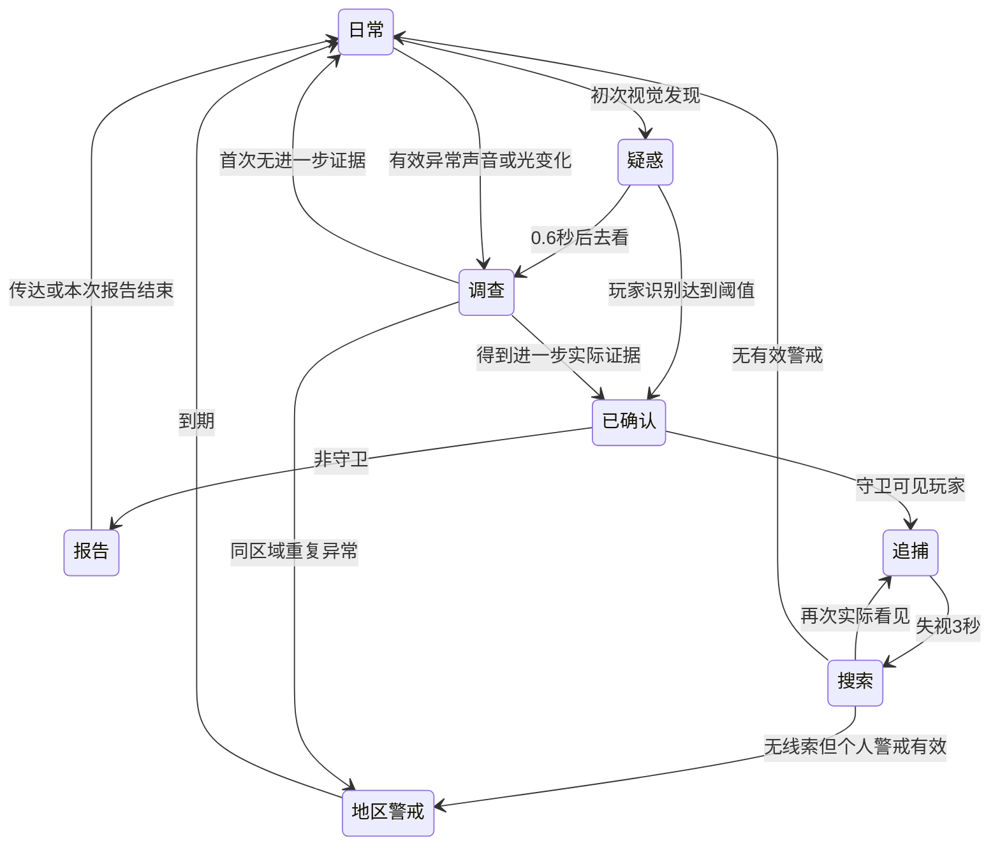

#### 12.1 疑惑与调查

- 初次看见：停留疑惑约 0.6 模拟秒，朝向线索，再去实际位置检查。
- 到场观察约 3 模拟秒；没有进一步线索则结束并恢复。
- 普通调查路途上限 12 模拟秒，光源变化检查约 15 模拟秒。
- 这些调查有有限线索寿命；它们不能套用到已确认救火的长途取水任务上。
- 多次独立异常完成调查后可以提高同地区警戒；同一声源的连续脉冲不重复计为多个独立事件。

#### 12.2 普通人员报告

确认玩家后保存线索，亲自走向当前看到的守卫，或熟悉守卫岗。默认报信速度为自己的日常速度 ×1.6，呼喊间隔最多每 2 模拟秒一次。

只有实际听众获得报告。有效传给守卫、到岗等待约 4 模拟秒无结果、或报告行走累计达到 20 模拟秒后，结束本次传话并恢复生活。可保留有效见闻用于之后现场交流。

普通人员报告途中感知金币可停下；已知火灾先处理火灾。中高级报告者不使用普通报告拾币中断资格。

#### 12.3 追捕与抓捕

- 实际可见时刷新最后目击位置，并沿可达路径以默认 `3.4375U/模拟秒` 追赶。
- 默认抓捕距离 `0.5625U`，必须仍可见且持续接触 0.8 模拟秒才判抓捕。
- 失视、拾币、谈判、救人或自救时清除抓捕累计，不能在别的行为中同时抓到玩家。
- 守卫确认后向附近实际听众呼喊，持续可见时最多每 2 模拟秒再喊一次。
- 追捕者走不到目标时检查自己合法的警戒／搜索区域，不穿墙，也不把失败路线无限重复。

#### 12.4 搜索

失视 3 模拟秒后进入搜索，默认搜索总时长 8 模拟秒。

1. 实际走向最后目击／最后报告点。
2. 从该点周围约 2U 的导航空间取多个可达检查点，排除已知火和失败点。
3. 逐个实际移动；抵达或该点失效就换下一个。
4. 再看见玩家立即追捕；新的有效报告更新中心。
5. 无新线索时结束，继续个人地区警戒或恢复原日常。

搜索路线不得读取隐藏玩家位置。没有其他可达点时也需有限结束或报告路径失败，不能永久原地搜索。

#### 12.5 个人地区警戒

| 项目 | 默认规则 |
|---|---|
| 异常记忆 | 最近 120 游戏分钟，按独立线索逐条到期 |
| 强度 | 同地区独立异常数量减 1，限制为 0—3；已确认入侵至少一级 |
| 地区范围 | 基础 8U，每级再加 2U；限制在当地关联区域和连通空间 |
| 持续 | 一级 60、二级 90、三级 120 游戏分钟 |
| 移动 | 每级增加 15% 日常速度 |
| 到点观察 | 1 模拟秒 |

先回报告地区，再检查周围点。新的有效报告可更新区域和到期时间；重复转述同一 `clue_id` 不叠加异常数。

警戒是个人认知结果，不是一条全洞穴报警开关；未目击、未听到的人维持原生活。

### 13. 金币、谈判与贿赂

#### 13.1 地面金币的吸引

- 只追实际看见的金币，或先调查有效金币声。默认目视兴趣范围 `4U × (0.5 + greed ×0.5)`，仍受朝向、遮挡和路径限制。
- 实际走到金币处才把它从世界移除，自己的钱包增加 1；同一枚只能被一方拿走。
- 追捕、搜索和普通传话让位于拾币，保存原响应类型与最后线索。
- 钱被玩家／同伴拿走、路径失败或已经拿到后恢复原任务。
- 恢复追捕时必须再次检查真实可见性；能见就追，不能见则按原最后位置搜索，不能读取隐藏玩家位置。
- 拾币期间不抓捕、不继续呼喊举报；本人着火或已知火灾时不进入拾币候选。

#### 13.2 投币谈判的触发和顺序

资格同时满足：四种普通职业之一、没有当局受贿、本人未着火且无已知活动火灾、已确认玩家、实际感知一枚来源为玩家的投币。

“已确认”包括本人完整识别、已经进入报告／追捕／搜索，或被金币中断时保留了这些确认状态；仅疑惑不算。

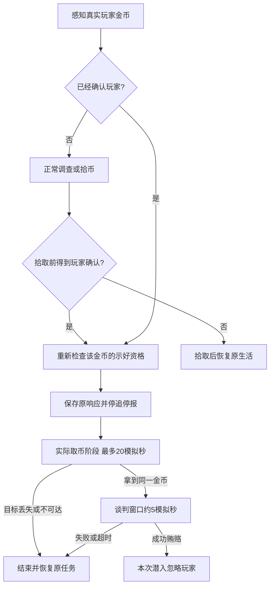

**必须重新检查感知顺序。**如果同一轮先发现钱、随后识别完成，不能让普通人捡完就恢复报信而漏开谈判。

每枚示好币只启动一次对应流程，不能每帧看见同一枚就刷新截止时间。新投出的真实金币可以启动新一轮。

#### 13.3 两类普通贿赂入口

| 入口 | 条件 | 成功效果 |
|---|---|---|
| 当局忽略玩家 | 已确认并在报告，或处于有效投币谈判；普通守卫需投币谈判 | 设置当局受贿并终止自己的玩家处理 |
| 一次搬运／开门服务 | 普通非守卫，没有危险、已有付费任务、冲突携货／补货／调查，目标可达 | 当局忽略玩家，并执行一次指定真实任务 |

第二类沿用现有服务设计，不代表未确认玩家时自动开启“投币停追谈判”。正在搬货或有任务的人不能再接受冲突的一次服务，但不应因此拒绝合法的已确认玩家谈判。

当前规则不让队长、老板、长老通过此入口被普通贿赂，也不让普通服务自动变成永久伙伴。

#### 13.4 贿赂事务

- 默认每次 4 金币、80% 成功。此前投掷的 1 枚金币是独立消耗，不包含在这 4 枚中。
- 先验证本人资格、距离、无遮挡、窗口、目标和必要路径，再检查余额、扣费、判成功。
- 玩家互动默认距离小于 `1.40625U`；正在谈判的人优先于身旁普通金币等互动目标。
- 余额不足、窗口过期、对象不合法或目标已变化时不扣费。
- 合法尝试失败消耗 4 币，不退款；追捕者需重新投币示好才能再谈。
- 打开过的 UI 不锁住时限；点击时必须再次检查当前窗口，过期面板不能扣钱。

#### 13.5 成功后“直接忽略玩家”的含义

本次潜入此 NPC：

1. 不再通过玩家视觉入口累积身份识别、疑惑、调查、报告、追捕或抓捕。
2. 忽略明确来自玩家的脚步、开门和撞击／投掷声，不因这些声音重新搜人。
3. 不接入同伴玩家举报，也不在聊天时重新恢复此类报告。
4. 清除自己的旧玩家抓捕进度、报告、搜索和对应警戒状态。
5. 仍看得见环境与同伴，仍会被实际金币吸引，仍救火、避火、吃饭、睡觉和履行已接受任务。
6. 玩家造成真正火灾或照明改变时，仍处理已感知的环境结果；“忽略玩家”不等于世界物理对其失效。
7. 不撤回已经传给别人的消息；其他人继续按自己的知识行动。
8. 新一次进洞重建该临时标记。

#### 13.6 一次受雇任务

| 任务 | 执行 | 完成或失败 |
|---|---|---|
| 开普通门 | 走到门边，实际操作 0.6 模拟秒 | 门已被他人打开则结束；被危险中断后仍可继续 |
| 搬指定食材 | 占用目标 → 走近拿取 → 搬到 `player.staging` 实际卸货 | 原物不存在／无法领取则结束；已携货时保留；玩家仍需拾取并撤离 |

不能直接把世界食材写入玩家长期库存；NPC 卸货不等于玩家撤离成功。

### 14. 火灾、自救、救助与连续处理

#### 14.1 环境输入

本系统接收真实物品火、失控落地燃烧器物、身体火、烟和火灾报告。环境层默认规则：

- 可燃木料、布料、食材可被点燃；石头和金属不按可燃材质扩散。
- 材料火默认每 6 模拟秒尝试相邻蔓延；同一源不能因高帧率加速蔓延。
- 食材燃烧约 5 模拟秒后损坏；材料火约 120 模拟秒自然燃尽，留下烧痕。
- 用水扑灭后本局浸湿，避免马上被相邻火重新点燃。
- 正常墙火把和正常摆放火盆不是失控火灾；投掷落地火把、翻倒火盆及材料火需按实际状态处理。
- 身体火与地面火分别清除，不能用清除一格地面火假装同伴已经获救。

新地图更改材质、物件形状或环境物理实现时，需要继续提供上述结果与合法操作面；NPC 不能知道未感知的所有火点。

#### 14.2 物品灭火动作链

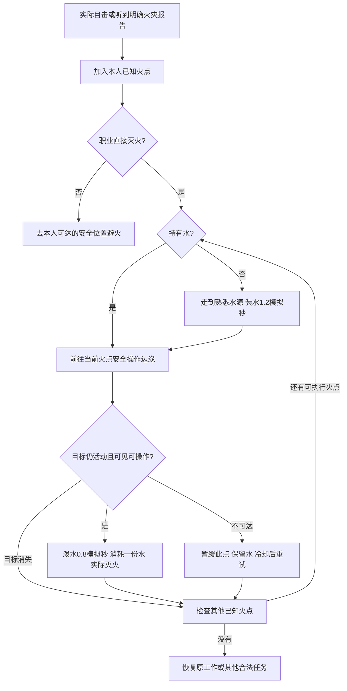

四种普通职业和守卫队长直接灭火；老板、长老避火。

必须满足：到火边、与火源无遮挡、自己不站在已知火点中、实际操作范围内。原 Demo 最大泼水距离约 `1.625U`，安全操作点通常位于目标外缘约 `1.25U` 内。

多格家具选择可达外缘，不走进实体；一次合法泼水可以按同一物件边界扑灭和浸湿相连区域。不能隔墙扑灭另一间屋的独立火源。

#### 14.3 取水路上不能忘记

- 确认并接手后保存火点、阶段、已持水情况和未完成工作。
- 取水、走回火场本身不按普通调查线索超时结束。
- 原火被别人扑灭时检查本人其他已知火点，而不是丢水或重新取水。
- 路不可达时只暂缓本次无法处理的火点，默认 20 模拟秒后重试；还有其他已知可行火点就处理其他点。
- 全部已知火点结束后恢复原任务；不能为了延长链路自动知道其他房间起火。
- 途中看到新的实际火、听到报告或与同伴交流，才可以扩展后续处理链。

#### 14.4 自己身体着火

所有职业都处理，优先级最高。

| 条件 | 行为 |
|---|---|
| 已经持水 | 实际自救 1.2 模拟秒，消耗水并清除身体火 |
| 可达水源 | 以约 1.2 倍日常速度前往，实际自救；不能在路上自动变成没着火 |
| 近处持水同伴实际接应 | 先离开点燃位置，在安全可见位置短暂停下配合泼水 |
| 到不了水边且无有效接应 | 先离开已知火源，在安全位置实际扑打 4 模拟秒 |

着火时可发局部求救；保留原任务和身体着火前响应。灭火后短期记住接触危险，不能立即走回同一落地火把而反复着火。当前没有生命值、死亡或受伤情绪系统。

#### 14.5 同伴身体着火

1. 亲眼看到或听到局部求救，记住对象和最后位置；仅听求救时先到场确认。
2. 接手时申请同一目标的救助占用；已有持水目击者可以接替仍在取水的空手救助者。
3. 无水则走水源装水，再返回最后实际获知位置；途中不会因默认 15 秒见闻到期自动忘记已确认救助。
4. 再次看到时更新位置；未看到时按旧位置搜寻，不读取同伴当前隐藏位置。
5. 距离约不超过 1.5U、无遮挡、真实身体仍着火时，泼水 1.2 模拟秒，消耗一份水，清除其身体火。
6. 目标已经获救则结束，不能重复耗水；确认后回到旧位置仍找不到，现场搜寻最多 20 模拟秒后结束。
7. 救助完成释放占用并恢复任务；自己着火立即自救。

### 15. 对同伴行为、环境变化和道路的反应

#### 15.1 同伴响应表

| 现场线索 | 本人资格 | 行为结果 |
|---|---|---|
| 同伴身体火／求救 | 普通职业；其他人已有水也可以 | 第 14 节救助 |
| 守卫正在疑惑／调查／追捕／搜索／警戒 | 自己是空闲守卫，实际看见对方，未受贿，无冲突携货、训练或睡眠 | 走近至约 1.5U 并交流 0.8 模拟秒，接收对方真实已有线索 |
| 同伴没有已确认报告，只有疑惑线索 | 已完成现场询问 | 去检查该线索，不直接抓捕隐藏玩家 |
| 同伴娱乐或实际发出邀请 | 邀约有效、需求／钱包／岗位允许 | 安全节点比较赴约候选，保留原工作 |
| 巡逻伙伴返回或失散 | 6U 内且无遮挡 | 重新队形配合，不共享追捕知识 |
| 队长正在监督训练 | 实际到站位并与队长无遮挡 | 才累计训练时间 |

同伴询问／救助默认一次由一个响应者占用。响应失败后默认冷却 20 模拟秒，避免双方反复无限互相追问。

#### 15.2 光源变化与工作补光

实际看见局部变暗／突然变亮，可以产生约 15 模拟秒的光源检查任务；不能因为远处全图照度缓存变化，让所有人同时调查。

工作点照度不足 0.22 时：

1. 只在到达实际岗位后检查；路上黑不直接把未到岗者拉去补光。
2. 查看工作点附近约 3.5U 内、与工作点有照明关联的熟悉墙挂点。
3. 走到挂点现场检查。原墙火把熄灭就点亮；原挂点空了，寻找现场可见、可达的实际火把，默认局部寻找约 6U。
4. 不挪走其他工作处仍正常燃烧的墙灯；取实物时保留同一器物 ID，使用 NPC 手持归属。
5. 走回墙挂点，真实挂墙，再点亮 1.5 模拟秒。
6. 火把和挂点分别占用，不能两人同时安装；不写入玩家的手持槽。
7. 本人知道自己在搬灯／点灯，不反过来把自己的光变化当成未知异常。
8. 目标被玩家拿走、点被占用、无火把、无挂点或路径失败：结束并释放占用，30 模拟秒后可重试，继续原工作。
9. 被火灾、金币、追捕等中断：释放未完成补光占用；携带中的火把若脱手，作为同一落地物保留，不删除或复制。

主动安装火把只能挂在墙上。投掷／意外脱手后可以有落地实体，但不能把地面火把当成完成了工作处固定照明。

**工作速度保持正常。**只在实际岗位加工、分拣、服务、整理或站岗监督等有效工作时计额外暗处疲惫；去取火把、走路、休息、吃饭、搜人和救火不计这项工作加成。原活动、货物和已完成加工量保留。

#### 15.3 门与路径阻塞

- 普通可操作门关闭时，导航可以比较开门时间与绕路成本；不能把所有关门视为永久墙。
- 走到门边实际开门 0.6 模拟秒，门状态更新通行、光照和声音传播。
- 门口被中断后恢复任务重新检查门；不能靠旧路径缓存假设门仍开着。
- 没有路径立即返回失败；实际连续撞住约 3 模拟秒才判停滞，长途正常行走不算失败。
- 记住失败目的地并冷却 20 模拟秒；可以处理其他任务，随后重新尝试。
- 关闭门时应避免夹住已经在门框通行的人。
- 单纯发现某门已打开不等于预设“入侵事件”；须有实际声光线索、任务条件或进一步玩家证据。

#### 15.4 物品损失、缺料、缺席和聚集

| 变化 | 当前实际反应 |
|---|---|
| 厨房原料被拿走或烧掉 | 厨师到现场发现数量减少，符合补货需要时呼叫附近搬运者；供给断了则无法做饭 |
| 原料／金币／贡品目标被他人取走 | 领取或运输任务检查失效，释放占用，重选；不能创建替代副本 |
| 餐厅无饭 | 等待不满足饥饿，结束本次尝试并按用餐重试规则继续生活 |
| 酒馆无酒／老板忙 | 饮酒不能成功，老板可正常酿造，顾客有限等待 |
| 祭祀有人未交贡品 | 长老按已知名单去熟悉住所呼叫，不定位失踪者的真实全图位置 |
| NPC 因救火或赌博聚集 | 由各自任务产生；没有一个默认“异常聚集”全图剧本 |

未实现的偷盗归因、完整财产权、长期失踪调查、惩罚／流放不可凭这一表自动补入。

### 16. 每晚祭祀与聚餐

这是本基线唯一的固定共同特殊活动；赌博邀约、救火和询问由普通局部行为形成。

#### 16.1 阶段和推进条件

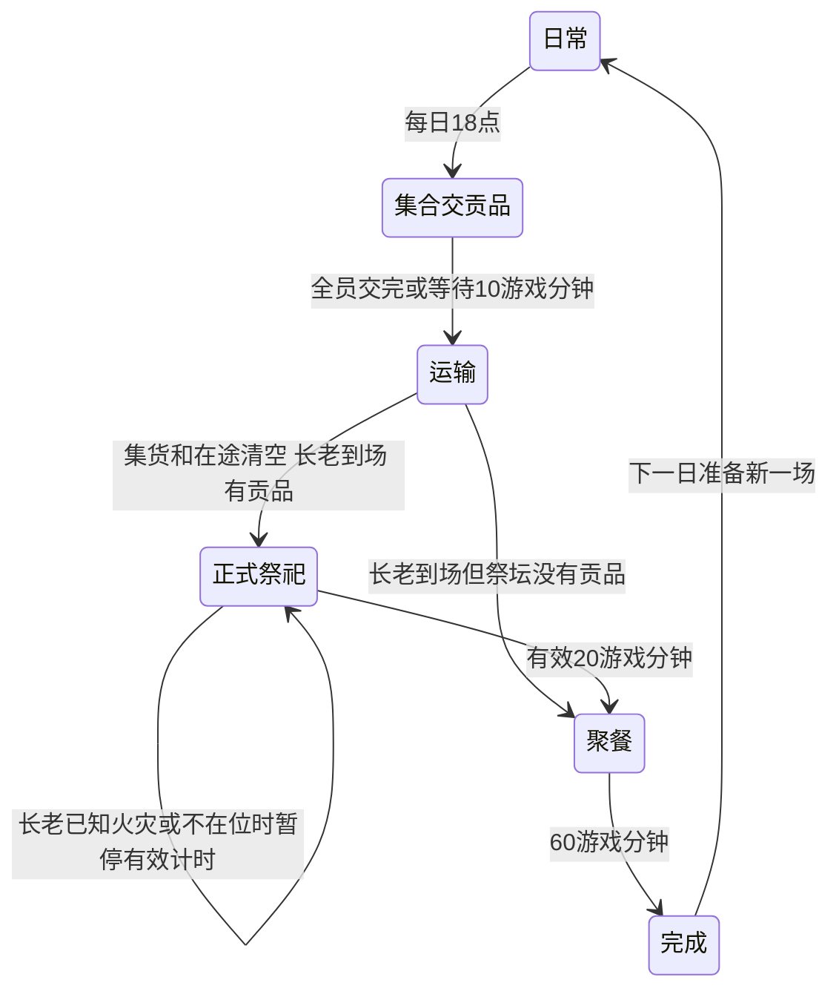

| 阶段 | 行为和事务 |
|---|---|
| 集合 | 每人实际走到 `ritual.deposit`，交自己的 1 件贡品一次；当前贡品由仪式供给创建并登记，不重复生成 |
| 运输 | 搬运工在交付阶段结束后从集货点取贡品，每批最多 4 件，运到祭坛；维护真实集货、在途和祭坛数量 |
| 长老缺席呼叫 | 根据没交贡品名单去熟悉住所，发局部集合消息；值勤守卫不被列为催促对象 |
| 正式祭祀 | 长老实际在祭坛约 1.875U 内，且没有已知活动火灾、报告或睡眠；否则暂停有效仪式时间 |
| 聚餐 | 使用实际熟食库存，搬运饭菜、到餐位消费；每人同一场吃成功一次，不凭空开席生成食物 |
| 完成 | 恢复各自未完成日常；次日重置仪式当日记录 |

当前守卫固定岗继续值守，夜班睡眠资格仍有效；巡逻带队者先交，伙伴继续巡逻，看到带队者实际回来后才轮流去交。进入正式仪式后守卫恢复职责。聚餐时守卫仍用日常需求安排吃饭，厨师继续提供饭菜，厨房搬运者先运菜后再吃。

这个守卫例外必须由明确共同活动规则表达，不能由地图上刚好有几人没寻路成功来“自然形成”。

#### 16.2 防卡住与物资边界

- 集合最多等 10 游戏分钟，不能永久等待正在救火或值勤的人。
- 交贡品点和祭坛不是同一个操作：居民交给集货点，搬运工再运到祭坛。
- 取走或烧毁贡品导致祭坛为空时，长老到场后转聚餐，不假造贡品补齐。
- 贡品运输中断保留真实携带批次；在途数量只在领取／交付事务中变化。
- 长老只根据已知火灾暂停仪式，不根据隐藏房间的全图火源自动暂停。
- 一场未完成就不在午夜重复开第二场；结束后才初始化新日期活动。

### 17. 资源事务、任务中断与恢复

#### 17.1 占用不等于拿到，拿到不等于交付

同一实物在任意时刻只能归属于一个世界库存、一个角色或一个已开始的加工批次。预约只限制其他人领取，不改变实物归属。

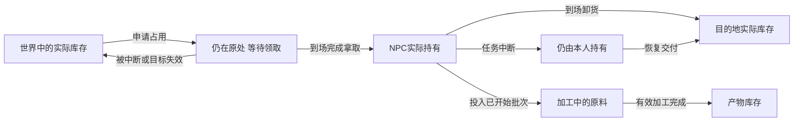

| 资源／记录 | 唯一负责结算者 | 事务边界 |
|---|---|---|
| 地面金币 | 世界物品系统 | 实际取走同一 ID 后，拾取者钱包 +1；两人竞争只有一人成功 |
| 食材批次 | 世界库存／持有者 | 领取时原处减量、本人加量；交付时本人减量、目的地加量 |
| 熟食 | 社会供给系统 | 做饭完成才产出；送餐只转移；吃成功才扣除 |
| 酒 | 社会供给系统 | 酿造完成产出；服务成功同时扣库存、付钱、降低需求 |
| 一局赌博 | 同一个社交会话 | 完成一次才转移 1 币；两人不能分别结算 |
| 水 | NPC 持水状态与灭火操作 | 实际到源装水才获得；合法泼水成功后消耗一次 |
| 贡品 | 共同活动系统 | 按当场登记创建一次；交付、在途、祭坛分别转移 |
| 火把 | 世界器物系统 | 挂墙、落地、手持是同一个器物的归属变化 |
| 贿赂 | 互动事务 | 点击时校验 → 支付 → 抽签 → 记录结果；UI 不另结算 |

当前水源可以持续取水，不要求新增有限蓄水量或可携带水桶物品。持有的一份水仍是操作资源，不能一次取水无限泼洒。

当前允许种植产出和每日仪式供给作为明确的资源来源，允许燃烧损坏、饮食消费作为资源去向。“资源守恒”不是禁止生产，而是所有变化都有来源、去向和一次结算记录。

#### 17.2 中断恢复表

| 被中断行为 | 保留内容 | 立即释放／停止 | 恢复条件与结果 |
|---|---|---|---|
| 尚未领取原料 | 职责与需求；可保留已知来源 | 未领取物的占用、拿取计时、旧路线 | 重新选合法来源，再申请、到场领取 |
| 携原料／熟食／贡品运输 | 同一批货物、数量、岗位、目的地语义 | 当前路线、未完成开门动作 | 重新检查路线和目的地；到场交同一批货 |
| 做饭／分拣／酿造／种植 | 已开始批次、已完成有效工作量 | 有效加工计时 | 回合法工作点继续余量，不重复扣原料或生成产物 |
| 正在吃饭／喝酒 | 活动和已完成动作量；未满足需求 | 不可继续服务时停止服务计时 | 重新验证库存、服务者和到场；成功才结算 |
| 赌博／聊天 | 未满足需求；日常恢复上下文 | 整个未完成双方会话 | 重新建立合法会话，从新一局开始，不保留半局输赢 |
| 原料补货／一次受雇服务 | 已接受任务、已持有批次 | 无效占用、旧路线 | 目标仍合法则恢复；未领取且目标消失则结束 |
| 物品救火 | 接手火点、本人其他已知火点、水、任务阶段 | 无效路线、不能继续的局部操作计时 | 取水和返回继续；到场再检验，不因长途自动忘记 |
| 同伴救助 | 接手目标、最后已知位置、持水 | 当前无效路线；救助结束时释放占用 | 有新目击则更新；未目击仍去旧位置，现场有限寻找 |
| 报告被金币打断 | 已确认线索、原响应、实际报告进度 | 移动报信与呼喊 | 失败／超时恢复；成功贿赂清除本人的玩家处理 |
| 追捕被金币／危险打断 | 最后目击位置、确认线索、原响应 | 抓捕累计与呼喊 | 可见才能恢复追捕；不可见用旧位置搜索 |
| 补光 | 原日常工作量；真实器物归属 | 未完成补光占用和操作 | 再次尝试遵循补光冷却；手持器物脱手仍保留同一物件 |
| 训练／祭祀 | 原职责；当日已经实际完成的记录 | 无效训练／仪式计时 | 窗口仍有效则继续；窗口结束恢复职责，不补算未发生的参与 |
| 疲惫睡眠 | 睡前活动、目的地、工作量、货物 | 原工作推进 | 真醒来才恢复；睡眠路程不能恢复疲惫 |

不要每次切换活动都清空所有字段；也不要为保留任务而无限保留预约，阻止其他人正常取料。

恢复前必须重新判断当前更高优先事项、任务合法性、到场条件和目的地路径。恢复的是未完成职责，不是强制跳回一个已经失效的状态。

#### 17.3 失败、冷却和有限等待

1. **目标被拿走／烧掉：**未领取则取消领取；已经持有的独立批次不受原地库存消失影响。
2. **路线不存在：**马上返回不可达结果；连续不能前进才按 3 模拟秒停滞规则处理。
3. **交付点不可达：**保留货物，记录失败地点，默认 20 模拟秒后再试；等待中仍能处理符合资格的其他行为。
4. **缺饭／酒／社交伙伴：**按生活动作的有限等待结束，不满足需求；随后回职责，按游戏分钟冷却重试。
5. **同一目标竞争失败：**不消费资源；释放自己的无效占用，比较其他合法候选。
6. **救火暂时失败：**暂缓该已知火点，不清空全部火灾知识；允许处理其他已知可行火点。
7. **消息过期：**普通临时线索到期可移除；已确认接手的救火、救助按任务阶段结束，不能套用线索过期规则。

这些结果必须能从日志区分。不能用一个通用“失败就恢复日常”分支抹掉携货和已经接手的救助。

### 18. 同一次探索跨日与重新进洞

#### 18.1 同一次探索的午夜

时间从 23:59 进入下一日时，NPC 不重新生成、不传送、不恢复满库存。

| 状态 | 午夜规则 |
|---|---|
| 本人位置、职业、钱包、需求 | 继续保留并正常推进 |
| 在途货物、水、加工量、付费任务 | 继续保留；不在午夜自动交付 |
| 活动火、门、物品、熟食和酒库存 | 保留真实结果，继续环境模拟 |
| 当局受贿 | 本次探索持续有效，午夜不失效 |
| 警戒、线索、失败冷却 | 按各自期限自然到期，不统一清空 |
| 午／晚饭、娱乐、训练记录 | 用日期判断下一日资格，避免旧日记录挡住新日活动 |
| 当日收获计数 | 重置每日生产计数，已收获食材保留 |
| 当场祭祀记录 | 现有场次先结束，之后初始化下一日；不能午夜复制未交／在途贡品 |

日程错过窗口时不强制补演整段活动。饥饿、疲惫和社交未满足仍保留，后续安全节点继续按需求选择。

#### 18.2 结束后重新进入洞穴

当前基线采用“新一次探索重建洞穴活动，保留玩家长期进度”。

| 数据 | 重新进入时 |
|---|---|
| 玩家剩余金币 | 保留；已投／已花的钱不退 |
| 已成功入库食材、图鉴 | 保留 |
| 已登记烧痕 | 保留视觉痕迹，不等于保留活动火 |
| 本次采集背包、手持物 | 清空；撤离成功才已转入长期库存 |
| 洞穴时间 | 新一次从第 1 天 12:00 开始 |
| 普通人口、需求、钱包、临时任务 | 按配置重新生成 |
| 当局受贿、个人警戒、临时线索 | 清空，重新建立 |
| 活动火、身体火、浸湿和物品临时归属 | 重新初始化；不能把上局任务引用带入新局 |
| 普通食材、熟食、酒、器物、门 | 按关卡初始配置重建 |
| 永久特殊伙伴 | 当前未实现，不要求保存招募关系 |

烧痕若换图，需要由地图层提供可定位的稳定标识；不能把旧地图坐标当作新地图位置。此规范不要求读取旧 Demo 存档格式，新项目可定义自己的存储结构。

主动“重置全部进度”和“再次探索”是两种操作，前者会清空长期进度并恢复初始预算，不能在重新进洞时误调用。NPC 行为模块不直接操作玩家长期存档。

### 19. 参数配置与单位清单

以下默认值用于复现当前行为。改变人数、距离或供给后，应重新执行对应验收；仅修改地图设施 ID 和坐标不应改变这些规则。

#### 19.1 统一参数

| 类别 | 参数 | 默认值／单位 |
|---|---|---|
| 时钟 | 开始时间；游戏时钟速率 | 第 1 天 12:00；48 游戏秒／模拟秒 |
| 移动 | 守卫／队长 | 2.1875U／模拟秒 |
| 移动 | 搬运／厨师 | 2.3125U／模拟秒；2U／模拟秒 |
| 移动 | 种植／两位老板；长老 | 1.9375U／模拟秒；1.71875U／模拟秒 |
| 移动 | 追捕；普通报信倍率 | 3.4375U／模拟秒；日常速度 ×1.6 |
| 感知 | 视觉周期；最大视距；视野角 | 0.15 模拟秒；7U；100° |
| 感知 | 黑暗门槛；黑暗近距可见 | 0.22；1.5U |
| 感知 | 火源可见上限；听力上限 | 8U；6U |
| 感知 | 呼喊半径；金币基础视距 | 5U；4U，另乘贪财系数 |
| 感知 | 声音有效强度；关门透过率 | 0.12；0.25 |
| 识别 | 满值；参考距离／照度 | 1.5；3U／0.55 |
| 识别 | 每级警戒增长系数；潜行系数 | 0.5；0.65 |
| 调查 | 疑惑；到场观察；普通路途上限 | 0.6／3／12 模拟秒 |
| 调查 | 光变化检查期限 | 15 模拟秒 |
| 追捕 | 抓捕距离；持续接触 | 0.5625U；0.8 模拟秒 |
| 追捕 | 失视转搜索；搜索时长 | 3／8 模拟秒 |
| 警戒 | 异常记忆；一级时长 | 120／60 游戏分钟 |
| 警戒 | 二／三级时长；半径 | 90／120 游戏分钟；8U + 每级 2U |
| 警戒 | 每级日常速度增幅；到点观察 | 15%；1 模拟秒 |
| 执行 | 开门；拿取 | 各 0.6 模拟秒 |
| 执行 | 连续停滞；失败路线重试 | 3／20 模拟秒 |
| 报告 | 最大途程；到岗等待 | 20／4 模拟秒 |
| 同伴 | 见闻记忆；救助到场无结果上限 | 15／20 模拟秒 |
| 同伴 | 询问交流；失败重试 | 0.8／20 模拟秒 |
| 邀约 | 发出间隔；声源范围；社交门槛 | 8 模拟秒；3.5U；50 |
| 金币 | 实际拾取评分 | `920 + greed ×20` |
| 谈判 | 取币阶段；拿币后窗口 | 20／5 模拟秒 |
| 贿赂 | 费用；成功率；玩家互动距离 | 4 币；80%；小于 1.40625U |
| 火灾 | 蔓延间隔；材料火燃尽 | 6／120 模拟秒 |
| 火灾 | 食材损坏；装水；泼物品火 | 5／1.2／0.8 模拟秒 |
| 身体火 | 用水自救／救人；安全扑打 | 1.2／4 模拟秒 |
| 灭火 | 物品最大操作距；救人距 | 约 1.625U；约 1.5U，均需无遮挡 |

#### 19.2 日常、供给与照明

| 类别 | 参数 | 默认值／单位 |
|---|---|---|
| 人口 | 守卫／搬运／厨师／种植／中级／长老 | 24／15／4／6／3／1 |
| 守卫 | 每班固定岗；普通同时离岗上限 | 2；2 |
| 守卫 | 扫视；路点观察；队形间距；等队友 | 40°／模拟秒；1 秒；1.2U；3 秒 |
| 训练 | 集合开始；正式训练窗口 | 16:00；17:00—17:30 |
| 需求 | 每游戏小时饥饿／疲惫／社交增长 | 9／5／7 |
| 需求 | 饥饿用餐；疲惫休息门槛 | 55；70 |
| 需求 | 吃饭降低；喝酒降低；赌／聊天降低 | 饥饿 48；社交 20；社交 24 |
| 休息 | 疲惫恢复；一段时长 | 0.35／模拟秒；12 模拟秒 |
| 睡眠 | 疲惫恢复；强制睡／醒门槛 | 1.8／模拟秒；90／60 |
| 睡眠 | 阴暗点寻找半径；最大照度 | 6U；0.22，合法睡点需低于门槛 |
| 光醒 | 强光门槛；持续照射；一次概率 | 0.55；3 模拟秒；50% |
| 光醒 | 再睡冷却 | 20 模拟秒 |
| 用餐社交 | 一次动作；现场社交最长等待 | 6／24 模拟秒 |
| 用餐社交 | 吃饭／社交失败后重试 | 各 60 游戏分钟 |
| 烹饪 | 每批原料；产量；有效加工 | 1 件；8 份；18 模拟秒 |
| 熟食 | 社会目标；餐厅目标；送餐批次 | 60 份；36 份；最多 6 份 |
| 种植 | 每批有效工作；产量；每日上限 | 40 模拟秒；2 件；40 件 |
| 搬运 | 原料批次；厨房运输间隔 | 最多 2 件；60 模拟秒 |
| 分拣供货 | 分拣工作；分拣／酒馆供货间隔 | 6 模拟秒；40 模拟秒 |
| 酒馆 | 初始酒；目标酒；目标原料 | 24 杯；30 杯；6 件 |
| 酿酒 | 原料；产量；有效加工 | 1 件；6 杯；30 模拟秒 |
| 补光 | 工作暗处门槛；额外疲惫 | 0.22；每游戏小时 +5 |
| 补光 | 挂点关联半径；局部找火把半径 | 3.5U；6U |
| 补光 | 点亮；失败重试 | 1.5／30 模拟秒 |
| 光源 | 火把；火盆 | 半径 4U；3×3 格覆盖，受实际遮挡 |
| 仪式 | 集合时刻；最大集合等待 | 18:00；10 游戏分钟 |
| 仪式 | 正式时长；聚餐时长；贡品批次 | 20／60 游戏分钟；最多 4 件 |

日常评分见第 8.3 节，上层响应评分见第 7.1 节。不得把两层评分直接混入一个数值表，导致普通吃饭分数意外覆盖追捕。

#### 19.3 配置责任与随机性

- 行为参数集中维护，UI 和调试工具读取同一份值；不得在动作函数另写不同的魔法数。
- 地图配置负责地点、操作面、容量、路线、岗位绑定和距离单位映射。
- 人口及岗位分配在重新生成人口时应用；运行中不能只改人数变量而保留旧配对和床位。
- 调整动作时长、范围和增长速率后，下一次相关判定使用新值；已存在实物不得被参数编辑复制或删除。
- 概率仅用于已定义的贿赂、赌博输赢、强光唤醒等规则。不能用随机数替代可达性、真实资源和身份资格。
- 测试应能固定随机种子或指定随机结果，分别检查成功与失败；运行时无需把 NPC 每帧随机改主意。

### 20. 涌现链路、调试与地图适配

#### 20.1 玩家操作如何产生连锁变化

以下是通用规则可能组合出的结果，用于解释和验收，**不是需要写进代码的固定剧情**。地图、感知、库存或任务不同，具体参与者和后续结果也会不同。

| 玩家操作 | 局部第一反应 | 后续行为形成的变化 | 玩家可利用之处 |
|---|---|---|---|
| 点燃仓库可燃物 | 实际看到／收到报告的普通职业去取水，老板避火 | 搬运暂缓 → 厨房补给减少 → 厨师现场发现缺料、请求补货 | 行走路线、岗位空档和现场聚集发生变化 |
| 追捕中投金币 | 看到真币的追捕者停追取币 | 已确认 + 示好 → 拿币后谈判；成功受贿只改变本人 | 利用短窗口逃跑或接近谈判，其他守卫可能仍追 |
| 报信路上投金币 | 普通报告者暂停传话、实际拾币 | 取币失败／未受贿恢复报告；成功受贿终止本人举报 | 延迟附近守卫获知消息 |
| 拿走工作处墙灯 | 附近发现光变化；岗位实际变暗 | 工作者取真火把、挂墙点亮；失败继续工作但更易疲惫 | 视野变化、补光路程、疲惫和睡眠位置改变 |
| 引燃同伴身上 | 局部求救、本人自救 | 已持水者优先救人；空手普通职业取水返回 | 原灭火／工作／追捕任务被重排 |
| 关门堵住送餐路线 | 搬运者到门口开门，或比较绕路 | 确实不可达则保货冷却 → 餐桌可能缺饭 → 居民需求不满足 | 利用物流延迟及重新尝试路线 |
| 赌博时在附近制造危险 | 实际感知危险者中断会话 | 未完成赌局不转账，另一人等待后回职责 | 赌博聚集被打散，后续路线改变 |
| 祭祀期间制造火灾 | 得知火灾的人按职责处理 | 长老已知火灾则暂停有效仪式；未得知者不自动离场 | 用局部传播改变活动推进和参与位置 |

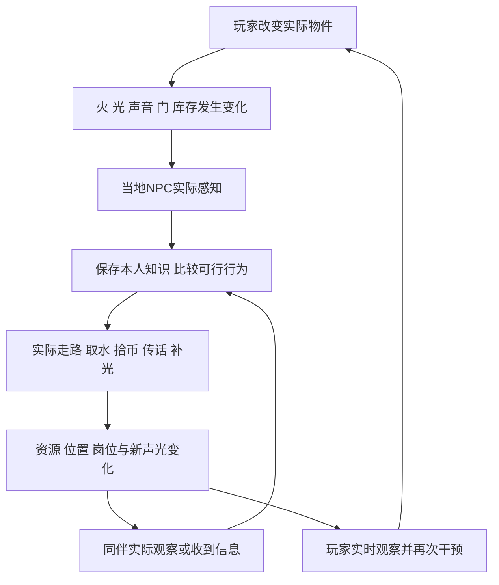

一条链可以继续较长：救完一个已知火点后，途中看到另一处火、听到同伴报告或发现供给缺失，可以启动下一项行动。继续的依据必须是新证据或未完成职责，不能自动全图扫描“下一个事故”。

#### 20.2 必须能解释 NPC 为什么这么做

观察工具至少能查看：

| 项目 | 内容 |
|---|---|
| 身份与职责 | 职业、岗位、班次、绑定语义设施 |
| 当前行为 | 响应模式、日常活动、当前阶段、目标 ID／最后已知位置 |
| 决策原因 | 选中候选、优先分、资格；关键候选未选中的原因 |
| 知识来源 | 亲眼／听声／谁传话、线索 ID、获得时间、是否确认 |
| 任务上下文 | 中断前职责、已有有效加工量、恢复去向 |
| 资源 | 本人钱包、持水、货物、熟食、器物 ID 与占用 |
| 时限与失败 | 窗口剩余时间、停滞原因、重试时间、路径结果 |
| 社会操作 | 实际听众、救助者、会话参与者、真实结算结果 |

记录状态转换、关键结算和失败即可，不要求每帧打印全体数据。观察者面板不能通过查看 NPC 让它取得玩家位置或修改行为。

玩家可见反馈应与事实一致：有识别进度、报信／取水／等赌伴／谈判等活动状态，真实泼水动作和火源变化。显示“灭火成功”前必须已改变环境火源。

#### 20.3 新地图接入步骤

1. 确定 `U` 与目标引擎世界单位的映射。
2. 配置第 5 节设施、操作点、容量、连通区域和巡逻路线。
3. 绑定八种身份的岗位、床位、用餐和娱乐去向，生成合法巡逻队。
4. 接入真实物资、门、火、光、声音和导航接口。
5. 执行地图载入检查，先验证正常一天的工作和供给。
6. 在新地图分别执行第 21 节的单项与组合验收。
7. 对长路径、单入口房间、窄门、多人共用操作面增加场景检查。

地图扩大可能增加取水、报信和送餐路程。先检查设施布置、默认速度和明示的任务时限，不用缩短路程的瞬移或全图共享掩盖问题。已经接手的救火不因地图更大就套用普通调查超时。

地图调参不保证所有具体路线与旧图相同；要求相同的是感知条件、身份资格、任务过程、资源结果和恢复规则。

### 21. 验收用例

#### 21.1 测试约定

- 测试可设置初始时间、需求、对象和随机结果，但推进必须经过正式行为、感知与世界操作；不能只修改标签后断言标签相等。
- 使用新地图的语义设施建立场景，不依赖旧坐标或固定 NPC 编号。
- “未收到消息”须确保超出有效声场或被遮挡；“没有看见”须确保真实视线、朝向或距离条件不满足。
- 对随机成功／失败分别给确定输入，不以偶然抽到一次结果作为验收。
- 断言行为阶段、实际移动、资源变化和最终恢复，不只检查屏幕文字。
- 本节定义**交付时需要验证的行为**，不表示本文件编写时重新运行过这些测试。

#### 21.2 日常工作与生活

| 编号 | 前置和操作 | 必须观察到的结果 |
|---|---|---|
| A01 正常一天 | 无玩家干预，有初始库存与合法设施，连续推进一天 | 八种职业执行相应职责；用餐、睡眠、娱乐通过实际到场发生；没有全员同刻传送 |
| A02 做饭守恒 | 厨师取得 1 件原料，实际加工一批 | 原料扣一次，厨房增加 8 份；走路和中断时不算加工 |
| A03 出锅运饭 | 厨房有熟食，餐桌不足，厨房搬运者空手 | 先领取最多 6 份，再交餐桌；三处总量在搬运中保持一致 |
| A04 缺料 | 拿走厨师尚未领到的全部原料 | 不能出饭；本地补货请求仅影响实际听众；能重选生活或后续工作 |
| A05 工作中断 | 做饭／酿酒／分拣进行一部分后，用实际危险打断并解除 | 保留批次和加工量；回岗位完成余量，无重复生产／扣料 |
| A06 每日收获 | 种植者工作至每日上限，再跨午夜 | 当日总量不超过 40；次日可继续生产，旧库存未清空 |
| A07 真吃饭 | 有／无餐厅熟食分别完成用餐尝试 | 有饭扣 1 份并降饥饿；没饭不降需求，有限等待后回职责 |
| A08 单人赌博 | 一名有钱赌客到赌场，其他人没到 | 等赌伴，不扣钱、不降社交；有限等待后离开 |
| A09 双人赌博 | 两名合法赌客到场，随后分别测试完整一局和中途打断 | 完成一局仅转移 1 币、双方社交 -24；打断无转账、无双重计时 |
| A10 出发前邀约 | 发起者在岗位决定去赌，附近同伴听到邀请 | 邀请目的地是赌场；受邀者到安全节点决定，路上不开赌 |
| A11 值勤与训练 | 推进白／夜班、普通需求和 16:00—17:30 | 固定岗／巡逻按配置；普通离岗上限有效；到场且队长监督才计训练；结束恢复原任务 |
| A12 严重疲惫 | 无危险，疲惫达到 90，附近有阴暗安全点 | 实际走到睡点才恢复；到 60 或以下醒；货物和工作量保留 |
| A13 强光唤醒 | 睡眠者分别受到短照、弱照、持续强照；指定两种概率结果 | 只有强光连续 3 秒才判断一次；失败不每帧再抽；成功有 20 秒再睡冷却 |

#### 21.3 感知、警戒、金币与贿赂

| 编号 | 前置和操作 | 必须观察到的结果 |
|---|---|---|
| B01 可见性 | 分别让玩家在背后、隔墙、远暗处和近处合法视野出现 | 前三项不越界识别；合法可见时先疑惑，得到持续证据才确认 |
| B02 识别倍率 | 固定其他条件，分别改变距离、玩家照度、个人警戒、潜行 | 增速符合第 11.2 节；照亮守卫自身不冒充照亮玩家 |
| B03 声音认知 | 制造未知动静，但玩家保持不可见 | 检查声源过去位置，不直接确认隐藏玩家 |
| B04 无证据恢复 | 短暂露面后隐藏且不提供新线索 | NPC 实际调查，无结果后回职责；重复独立异常才加强当地警戒 |
| B05 局部报告 | 普通职业确认玩家，向附近一名守卫传话；另有远处守卫 | 实际听众取得确认信息；远处未听到者不追捕 |
| B06 呼喊援军 | 追捕者呼喊，附近守卫分别可见／不可见玩家 | 可见者直接追捕；不可见者移动搜索报告位置；不重新从疑惑读条开始 |
| B07 抓捕边界 | 玩家处于抓捕距离但只接触短于 0.8 秒，随后失视 | 不被抓；重新接触重新计时，拾币或谈判时不结算抓捕 |
| B08 移动搜索 | 追捕后失视 3 秒，周围有多个可达点 | 搜索实际移动，未读取隐藏位置；无结果有限结束 |
| B09 金币打断 | 对追捕者、搜索者和普通报信者分别投实际可感知金币 | 钱优先；本人暂停原响应；丢失目标或拾取完成后按任务规则恢复 |
| B10 同轮顺序 | 普通职业先感知玩家金币，随后同轮确认玩家 | 重新检查示好资格，实际拿币后出现 5 秒谈判，不能捡完立即漏开谈判 |
| B11 未确认投币 | NPC 未确认玩家，仅看到金币 | 可正常拾币，不凭空进入停追谈判 |
| B12 谈判期限 | NPC 拿币后靠近，分别在窗口内和过期后尝试贿赂 | 窗口从拿到币后计算；合法支付 4 币；过期／余额不足／对象非法不扣 |
| B13 贿赂失败 | 指定失败随机结果，合法尝试一次 | 扣 4 币，无当局忽略；原响应恢复；普通追捕谈判需新投币再试 |
| B14 贿赂成功 | 指定成功结果，再用玩家露面、脚步、开门、同伴举报、聊天交换刺激 | 本人忽略所有玩家处理入口；仍拾币、救火和生活；不撤回别人已有信息 |
| B15 同币争抢 | 两名 NPC／玩家竞争一枚币 | 仅一方拿到且 +1；另一方处理目标失效，不复制币或开启无实物谈判 |
| B16 服务边界 | 空闲普通非守卫接受一次搬货；携货或中高级尝试同入口 | 合法者实际搬到卸货点；冲突／非法者不收款；不能直接入玩家长期库存 |

#### 21.4 火、同伴、照明与地图恢复

| 编号 | 前置和操作 | 必须观察到的结果 |
|---|---|---|
| C01 真正灭火 | 点燃可燃物，普通职业在当地确认，水源可达 | 实际走水源装水、返回操作面、泼水；持水消耗，环境火真正熄灭 |
| C02 长途取水 | 路程超过普通见闻寿命，已接手救火 | 不在路上忘任务；回场继续，不凭空取水 |
| C03 多火与失效 | 已知两处火，去取水时一处被别人扑灭 | 保留水，处理另一处已知火；不自动得知第三处隐藏火 |
| C04 不可达火点 | 火在实体／单入口后，堵住合法操作面 | 不走进实体或隔墙泼水；暂缓失败点，能处理其他目标或恢复职责 |
| C05 身体自救 | 各身份分别身体着火；再使水源不可达 | 有水合法自救；不可达时离开火后扑打 4 秒；货物和旧职责不丢 |
| C06 持水救同伴 | 持水者有其他响应，附近同伴真正身体着火 | 若本人未着火，优先实际泼水救人；清身体火，消耗水；地面火独立处理 |
| C07 救助走失 | 空手者确认救助后取水，目标进入不可见区域 | 去最后已知位置找；路程不忘；到场无结果最多找 20 秒，不远程跟踪 |
| C08 守卫询问 | 空闲守卫看到同伴调查但自己没有玩家确认 | 接近交流后才收到真实线索；仅疑惑线索不直接抓隐藏玩家 |
| C09 补墙灯 | 工作点变暗，有可用墙挂点及真实火把 | 实际取物、挂墙、点亮；器物 ID 不变；完成后继续工作 |
| C10 无灯可补 | 没有火把／墙挂点／通路，保持工作点暗 | 结束补光尝试并冷却，工作正常速度；有效暗处工作疲惫比亮处积累快 |
| C11 争用与抢走 | 两人补同一挂点，或玩家拿走待取火把 | 一人合法占用；失败者释放并恢复，无复制或永远等待 |
| C12 门与配送 | 关闭门可开，然后再制造真正阻塞并解除 | 能操作门则实际开；阻塞保货冷却；解除后交同一批，不重复拿货 |
| C13 祭祀运输 | 从集合推进到聚餐，观察交付点和祭坛 | 居民先交、搬运后运；同场一次登记；在途守恒；按当前守卫例外值勤 |
| C14 祭祀暂停 | 隐藏房间火灾，随后向长老实际传达 | 未获知时不全图暂停；获知后暂停有效时间；解除后可继续 |
| C15 空贡品与跨日 | 取走贡品使祭坛为空；另一场跨午夜仍未完 | 空坛到场转聚餐；跨午夜不复制第二场、不重置在途批次 |
| C16 重新进入 | 保留当局受贿、活动火和已登记烧痕，然后结束并重新进入 | 按第 18.2 节重建临时状态，保留长期进度；不误清全部进度 |
| C17 换地图 | 改房间坐标、路径长度、门位置和设施 ID，沿用行为参数 | 不依赖旧编号／坐标；上述资格、结算和恢复规则保持 |
| C18 倍速与暂停 | 同一场景用 1×／4×推进相同模拟时长，另测试暂停 | 移动、需求、时限单位一致；暂停不倒计时；不承诺不同步长下随机轨迹完全相同 |

#### 21.5 组合验收与持续模拟

必须至少覆盖这三条组合：

1. **报告 → 金币 → 火灾 → 恢复：**普通人确认并报信，金币中断，途中真正获知火灾；火灾关闭拾币资格，处理后重新判断旧报告／谈判是否仍合法。
2. **运输 → 自救 → 救同伴 → 交付：**搬运者携货遭遇身体火，先自救，再处理实际接手救助，最终交原批次；全程不丢货、不复制、不远程定位同伴。
3. **黑暗工作 → 补光失败 → 疲惫睡眠 → 唤醒恢复：**无可用墙灯时继续正常加工，增加疲惫，到合法睡点，再经确定强光唤醒结果恢复未完成工作。

连续模拟至少覆盖一次午夜和两场祭祀，检查供给、钱包、加工、睡眠、值勤和恢复仍能继续；是否可长期维持满供给取决于配置，库存耗尽本身不是行为卡死。

验收报告分别写“通过／失败／未验证”、使用地图、参数、随机条件和实际证据。不能把旧 Demo 的通过结果直接当作新项目已通过。

### 22. 实施顺序与交付清单

#### 22.1 建议分阶段实现

| 阶段 | 交付内容 | 进入下一阶段前的要求 |
|---|---|---|
| 1 地图和世界事实 | 时钟、设施绑定、导航、声光、实物与操作结果 | 设施检查通过；没有旧坐标；物品能合法转移 |
| 2 日常与供给 | 需求、八种职责、加工运输、吃饭睡眠、双方娱乐 | 正常一天、资源与安全节点验收通过 |
| 3 感知和玩家处理 | 疑惑、调查、报告、追捕、移动搜索、个人警戒 | 局部知识与识别倍率验收通过 |
| 4 金币与任务恢复 | 拾币优先、两类贿赂、当局忽略、中断恢复 | 顺序、窗口、支付、所有入口忽略与恢复验收通过 |
| 5 火与同伴 | 实际灭火、自救救助、询问、邀约、墙面补光 | 长途连续任务、竞争失败、照明和组合验收通过 |
| 6 共同活动与持续模拟 | 训练、祭祀、聚餐、跨日、新局重建、调试 | 所有相关验收和持续模拟通过；提交已知限制 |

这是实施顺序建议，不要求把现有正常工作的系统全部重写。已有项目应先找到各规则所有者，再补齐不满足本规范的部分。

#### 22.2 最终交付内容

- 可运行场景和地图语义配置。
- 集中的行为参数及明确单位。
- 八种身份的日常、突发响应、任务恢复实现。
- 局部感知、消息和真实资源结算。
- 查看阶段、线索、资源、失败和决策原因的调试入口。
- 对应第 21 节的测试、结果和未验证项。
- 说明怎样新增地图、绑定设施和调整人口；不需要新增职业框架。
- 明确第 0.2 节未纳入的规划仍未实现。

#### 22.3 当前工程的参考位置

这一节用于当前工程查证和维护。移植到新引擎时不用复制文件组织，也不用依赖这些路径。

| 职责 | 当前代码 | 可参考的已有测试 |
|---|---|---|
| 参数／人口绑定 | `scripts/npc_tuning.gd`、`scripts/cave_population.gd` | `test_patrol_density.gd`、`test_patrol_routes.gd` |
| 需求／日程／睡眠／训练 | `scripts/goblin_life.gd` | `test_schedule.gd`、`test_exhaustion_sleep.gd`、`test_guard_training.gd` |
| 上层资格与评分 | `scripts/goblin_decision.gd` | `test_adaptive_decisions.gd`、`test_greed_priority.gd` |
| 感知／警戒／报告／追捕 | `scripts/goblin.gd`、`scripts/cave_senses.gd` | `test_recognition_rate.gd`、`test_guard_callout.gd`、`test_search_movement.gd`、`test_alert_patrol.gd` |
| 金币／谈判／贿赂 | `scripts/goblin.gd`、`scripts/cave_world.gd` | `test_bribe_negotiation.gd`、`test_report_distraction.gd`、`test_report_bribe.gd`、`test_coin_pursuit.gd` |
| 食材／熟食／酒／会话 | `scripts/cave_society.gd` | `test_supply.gd`、`test_gambling_rules.gd`、`test_daily_interactions.gd` |
| 同伴响应 | `scripts/goblin_peers.gd` | `test_peer_reactions.gd`、`test_fire_rescue.gd` |
| 火灾与实际灭火 | `scripts/goblin.gd`、`scripts/cave_world.gd` | `test_object_fire.gd`、`test_fire_commitment.gd`、`test_fire_multisource.gd`、`test_npc_burning.gd` |
| 光场／工作补光 | `scripts/cave_light_field.gd`、`scripts/goblin_lighting.gd` | `test_light_spread.gd`、`test_work_lighting.gd`、`test_npc_lighting.gd` |
| 门／寻路／恢复 | `scripts/goblin.gd` | `test_door_progress.gd`、`test_task_execution.gd`、`test_life_recovery.gd` |
| 仪式／新局／连续模拟 | `scripts/cave_world.gd`、`scripts/run_state.gd` | `test_feast.gd`、`test_restart.gd`、`test_ecology_day.gd`、`test_ecology_multiday.gd` |

当前测试位于 `tests/`，统一运行入口为 `tests/run_tests.py`。此表是已有代码的查找入口，不声称每个文件单独覆盖对应规则的所有边界。

### 23. 可直接复制给 AI 的开发指令

复制下方指令，并附上本文件全文及目标工程／地图信息。如果因输入长度仅提供第二部分，必须包含本部分第 0—23 节的全部内容；第一部分用于理解整体意图，附录地图坐标仅作示例。不要只给 AI 一张优先级表或几句背景。

```text
请按照所附《NPC每日生活与行为逻辑总览·开发规范版》实现或适配 NPC 行为系统。

目标：地图可以改变，八种身份的日常活动、现场感知、突发响应、
金币贿赂、真实资源结算和中断恢复必须符合规范。

先探索：
1. 阅读目标工程说明和适用的 AGENTS.md，查找现有 NPC、时钟、
   导航、门、声光、物资、互动和存档模块，确认实际接口与调用关系。
2. 区分已有能力、缺失能力和与规范冲突的行为，不凭猜测重写系统。
3. 建立地图语义绑定和 U 的单位映射；不要复制旧地图坐标或 NPC 编号。
4. 无法从工程确认的关键规则或设施缺口，列出明确问题询问我。
   可独立完成的探索和实现继续推进；不要擅自编造新玩法或旧版兼容。

实现要求：
- 第一部分用于理解架构和设计意图，第二部分第 0—23 节是精确实施规格。
  逐项检查资格、时钟、执行、结算、退出和恢复，不用概览示例替代完整规则。
  第 0.2 节规划项不属于本次实现。
- 运行时用条件、状态与评分决策，不要求接入大语言模型。
- 先筛选资格，再比较优先级；一个周期只执行一个主要行为。
- NPC 仅依赖实际视觉、听觉、现场交流和自己的记忆。
  报告保留线索 ID 与过去位置，不共享隐藏目标的实时位置。
- 所有拿取、加工、付款、赌博、交付、灭火都操作真实资源并仅结算一次。
- 取水和回场不能让已接手救火遗忘；持水优先救着火同伴；搜索实际移动。
- 金币优先于追捕和普通传话；投币停追谈判须已确认玩家。
  同轮先感知币后确认也要检查，谈判从实际拿币后计算 5 模拟秒。
- 贿赂成功统一阻断本人所有玩家处理入口，其他环境反应保持有效。
- 黑暗不降低工作速度，实际工作加疲惫；补光使用真火把并挂墙，失败继续工作。
- 保存批次、工作量和恢复上下文；释放未领取占用，重新检验路径与目标。
- 使用统一模拟时钟，明确模拟秒、游戏分钟和 U；正确处理暂停与倍速。
- 在拥有共同规则或状态的层次修改，完整检查相关入口。
  不堆重复兜底，不新增无关框架，不把玩家操作组合写成固定事件剧本。

实施与验证：
1. 参考第 22 节分阶段实现；优先复用目标工程已有能力。
2. 按第 21 节建立可复现用例，固定随机条件测试成功与失败。
3. 在实际目标地图验证正常一天、单项突发、组合中断、午夜和重新进入。
4. 通读受影响函数和调用处，检查命名、状态所有者、结算和恢复流程。
5. 提供代码、地图绑定、参数、调试入口、验收报告与已知限制。
   清楚区分通过、失败和未验证，不能用旧项目结果冒充新项目已通过。

如果目标工程已存在不同规则，指出具体冲突及影响；按本规范完成已明确
的规则。涉及未确认的新增玩法时先问我，不自动实现第 0.2 节右列规划。
```

**规格完成标准：**开发者无需依赖历史聊天，就能绑定新地图、实现合法状态转换、说明 NPC 决策原因，并用第 21 节验证可观察行为与资源结果。

## 附录 A：当前 Demo 的 53 人作息与地图绑定示例

**以下坐标和内部 ID 仅是当前 Demo 示例，不属于新地图必须沿用的行为规则。**新地图按第 5 节绑定自己的设施和路线，不复制这些坐标。

以下两表由当前 `CaveLayout.build()`、默认参数资源及 `CavePopulation.build()` 实际生成。ID可用于定位代码与测试；昵称省略，避免昵称重复造成歧义。

**作息表说明：** 午饭与娱乐列是个人候选开始时间，仍受前文条件约束。白班睡眠用“入睡—次日起床”表示；夜班睡眠是同一日的白天窗口。偏好是初始偏好，实际也可选择聊天。表中的钱包是初始金额，不是固定余额。

| ID | 身份／岗位 | 班次 | 睡眠窗口 | 午饭候选起点 | 娱乐候选起点 | 偏好 | 初始金币 |
|---|---|---|---|---|---|---|---:|
| `guard_0` | 守卫·固定岗 | 白班 | 22:00—次日06:00 | 13:00 | 14:00 | 喝酒 | 8 |
| `guard_1` | 守卫·固定岗 | 白班 | 22:10—次日06:20 | 13:11 | 15:01 | 赌博 | 11 |
| `guard_2` | 守卫·白1队 | 白班 | 22:20—次日06:40 | 13:22 | 16:02 | 喝酒 | 14 |
| `guard_3` | 守卫·白1队 | 白班 | 22:30—次日06:00 | 13:33 | 14:03 | 赌博 | 17 |
| `guard_4` | 守卫·白2队 | 白班 | 22:00—次日06:20 | 13:44 | 15:04 | 喝酒 | 20 |
| `guard_5` | 守卫·白2队 | 白班 | 22:10—次日06:40 | 13:55 | 16:05 | 赌博 | 10 |
| `guard_6` | 守卫·白3队 | 白班 | 22:20—次日06:00 | 13:06 | 14:06 | 喝酒 | 13 |
| `guard_7` | 守卫·白3队 | 白班 | 22:30—次日06:20 | 13:17 | 15:07 | 赌博 | 16 |
| `guard_8` | 守卫·白4队 | 白班 | 22:00—次日06:40 | 13:28 | 16:08 | 喝酒 | 19 |
| `guard_9` | 守卫·白4队 | 白班 | 22:10—次日06:00 | 13:39 | 14:09 | 赌博 | 9 |
| `guard_10` | 守卫·白5队 | 白班 | 22:20—次日06:20 | 13:50 | 15:10 | 喝酒 | 12 |
| `guard_11` | 守卫·白5队 | 白班 | 22:30—次日06:40 | 13:01 | 16:11 | 赌博 | 15 |
| `guard_12` | 守卫·固定岗 | 夜班 | 10:00—16:00 | 13:12 | 14:12 | 喝酒 | 18 |
| `guard_13` | 守卫·固定岗 | 夜班 | 10:00—16:00 | 13:23 | 15:13 | 赌博 | 8 |
| `guard_14` | 守卫·夜1队 | 夜班 | 10:00—16:00 | 13:34 | 16:14 | 喝酒 | 11 |
| `guard_15` | 守卫·夜1队 | 夜班 | 10:00—16:00 | 13:45 | 14:15 | 赌博 | 14 |
| `guard_16` | 守卫·夜2队 | 夜班 | 10:00—16:00 | 13:56 | 15:16 | 喝酒 | 17 |
| `guard_17` | 守卫·夜2队 | 夜班 | 10:00—16:00 | 13:07 | 16:17 | 赌博 | 20 |
| `guard_18` | 守卫·夜3队 | 夜班 | 10:00—16:00 | 13:18 | 14:18 | 喝酒 | 10 |
| `guard_19` | 守卫·夜3队 | 夜班 | 10:00—16:00 | 13:29 | 15:19 | 赌博 | 13 |
| `guard_20` | 守卫·夜4队 | 夜班 | 10:00—16:00 | 13:40 | 16:00 | 喝酒 | 16 |
| `guard_21` | 守卫·夜4队 | 夜班 | 10:00—16:00 | 13:51 | 14:01 | 赌博 | 19 |
| `guard_22` | 守卫·夜5队 | 夜班 | 10:00—16:00 | 13:02 | 15:02 | 喝酒 | 9 |
| `guard_23` | 守卫·夜5队 | 夜班 | 10:00—16:00 | 13:13 | 16:03 | 赌博 | 12 |
| `carrier_0` | 搬运工·厨房运输 | 日间作息 | 22:00—次日06:00 | 13:24 | 14:04 | 喝酒 | 15 |
| `carrier_1` | 搬运工·厨房运输 | 日间作息 | 22:10—次日06:20 | 13:35 | 15:05 | 赌博 | 18 |
| `carrier_2` | 搬运工·厨房运输 | 日间作息 | 22:20—次日06:40 | 13:46 | 16:06 | 喝酒 | 8 |
| `carrier_3` | 搬运工·厨房运输 | 日间作息 | 22:30—次日06:00 | 13:57 | 14:07 | 赌博 | 11 |
| `carrier_4` | 搬运工·厨房运输 | 日间作息 | 22:00—次日06:20 | 13:08 | 15:08 | 喝酒 | 14 |
| `carrier_5` | 搬运工·厨房运输 | 日间作息 | 22:10—次日06:40 | 13:19 | 16:09 | 赌博 | 17 |
| `carrier_6` | 搬运工·仓库分拣 | 日间作息 | 22:20—次日06:00 | 13:30 | 14:10 | 喝酒 | 20 |
| `carrier_7` | 搬运工·仓库分拣 | 日间作息 | 22:30—次日06:20 | 13:41 | 15:11 | 赌博 | 10 |
| `carrier_8` | 搬运工·仓库分拣 | 日间作息 | 22:00—次日06:40 | 13:52 | 16:12 | 喝酒 | 13 |
| `carrier_9` | 搬运工·仓库分拣 | 日间作息 | 22:10—次日06:00 | 13:03 | 14:13 | 赌博 | 16 |
| `carrier_10` | 搬运工·仓库分拣 | 日间作息 | 22:20—次日06:20 | 13:14 | 15:14 | 喝酒 | 19 |
| `carrier_11` | 搬运工·酒馆供货 | 日间作息 | 22:30—次日06:40 | 13:25 | 16:15 | 赌博 | 9 |
| `carrier_12` | 搬运工·酒馆供货 | 日间作息 | 22:00—次日06:00 | 13:36 | 14:16 | 喝酒 | 12 |
| `carrier_13` | 搬运工·酒馆供货 | 日间作息 | 22:10—次日06:20 | 13:47 | 15:17 | 赌博 | 15 |
| `carrier_14` | 搬运工·酒馆供货 | 日间作息 | 22:20—次日06:40 | 13:58 | 16:18 | 喝酒 | 18 |
| `cook_0` | 厨师 | 日间作息 | 22:30—次日06:00 | 13:09 | 14:19 | 喝酒 | 8 |
| `cook_1` | 厨师 | 日间作息 | 22:00—次日06:20 | 13:20 | 15:00 | 赌博 | 11 |
| `cook_2` | 厨师 | 日间作息 | 22:10—次日06:40 | 13:31 | 16:01 | 喝酒 | 14 |
| `cook_3` | 厨师 | 日间作息 | 22:20—次日06:00 | 13:42 | 14:02 | 赌博 | 17 |
| `civilian_0` | 种植者 | 日间作息 | 22:30—次日06:20 | 13:53 | 15:03 | 喝酒 | 20 |
| `civilian_1` | 种植者 | 日间作息 | 22:00—次日06:40 | 13:04 | 16:04 | 赌博 | 10 |
| `civilian_2` | 种植者 | 日间作息 | 22:10—次日06:00 | 13:15 | 14:05 | 喝酒 | 13 |
| `civilian_3` | 种植者 | 日间作息 | 22:20—次日06:20 | 13:26 | 15:06 | 赌博 | 16 |
| `civilian_4` | 种植者 | 日间作息 | 22:30—次日06:40 | 13:37 | 16:07 | 喝酒 | 19 |
| `civilian_5` | 种植者 | 日间作息 | 22:00—次日06:00 | 13:48 | 14:08 | 赌博 | 9 |
| `civilian_6` | 酒馆老板 | 日间作息 | 22:10—次日06:20 | 13:59 | 15:09 | 喝酒 | 12 |
| `civilian_7` | 赌场老板 | 日间作息 | 22:20—次日06:40 | 13:10 | 16:10 | 赌博 | 15 |
| `guard_captain_0` | 守卫队长 | 日间作息 | 22:30—次日06:00 | 13:21 | 14:11 | 喝酒 | 18 |
| `elder_0` | 长老 | 日间作息 | 22:00—次日06:20 | 13:32 | 15:12 | 喝酒 | 8 |

**地点表说明：** 坐标为地图格。床位是床边可用位置；工作点是实际操作／岗位点，不一定是房间中心。巡逻守卫的工作点是路线首点，后续按第4节循环。训练点只对守卫和队长有日常训练意义。酒馆、赌场和生活街点是默认个人目的地，实际邀请可使娱乐目的地改为同伴附近。

所有人的日常路线可按“床 → 工作路线 → 个人餐位／娱乐／休息点 → 原工作路线 → 床”读取，再叠加训练、祭祀与现场反应。

| ID | 床位 | 工作／首路点 | 训练点 | 餐位 | 酒馆位 | 赌场位 | 生活街位 |
|---|---|---|---|---|---|---|---|
| `guard_0` | (12,8) | (31,61) | (28,59) | (52,28) | (23,71) | (54,71) | (34,19) |
| `guard_1` | (13,8) | (98,39) | (27,59) | (52,32) | (26,72) | (57,72) | (35,20) |
| `guard_2` | (14,8) | (31,61) | (29,59) | (53,28) | (31,71) | (67,71) | (35,21) |
| `guard_3` | (15,8) | (31,61) | (28,60) | (53,32) | (35,82) | (54,74) | (35,22) |
| `guard_4` | (16,8) | (63,79) | (27,60) | (54,28) | (34,81) | (53,73) | (36,23) |
| `guard_5` | (17,8) | (63,79) | (26,59) | (54,32) | (25,74) | (67,74) | (34,20) |
| `guard_6` | (18,8) | (63,38) | (30,59) | (55,28) | (30,71) | (55,71) | (34,21) |
| `guard_7` | (19,8) | (63,38) | (29,60) | (55,32) | (32,73) | (57,73) | (34,22) |
| `guard_8` | (20,8) | (31,61) | (26,60) | (56,28) | (34,80) | (64,72) | (35,23) |
| `guard_9` | (21,8) | (31,61) | (30,60) | (56,32) | (24,74) | (55,74) | (33,20) |
| `guard_10` | (12,13) | (63,79) | (28,61) | (57,28) | (29,71) | (65,71) | (33,21) |
| `guard_11` | (13,13) | (63,79) | (29,61) | (57,32) | (32,72) | (68,72) | (33,22) |
| `guard_12` | (12,8) | (32,61) | (31,59) | (51,29) | (37,79) | (56,71) | (34,23) |
| `guard_13` | (13,8) | (99,39) | (25,59) | (58,29) | (23,74) | (65,74) | (36,19) |
| `guard_14` | (14,8) | (31,61) | (27,61) | (51,30) | (22,73) | (64,73) | (37,20) |
| `guard_15` | (15,8) | (31,61) | (30,61) | (58,30) | (31,74) | (56,74) | (37,21) |
| `guard_16` | (16,8) | (63,79) | (26,61) | (51,31) | (36,79) | (66,71) | (37,22) |
| `guard_17` | (17,8) | (63,79) | (25,60) | (58,31) | (38,81) | (68,73) | (35,19) |
| `guard_18` | (18,8) | (63,38) | (28,62) | (68,28) | (22,72) | (53,72) | (36,20) |
| `guard_19` | (19,8) | (63,38) | (27,62) | (68,32) | (30,74) | (66,74) | (36,21) |
| `guard_20` | (20,8) | (31,61) | (32,59) | (69,28) | (35,79) | (54,71) | (36,22) |
| `guard_21` | (21,8) | (31,61) | (24,59) | (69,32) | (38,80) | (57,72) | (34,19) |
| `guard_22` | (12,13) | (63,79) | (29,62) | (70,28) | (25,71) | (67,71) | (35,20) |
| `guard_23` | (13,13) | (63,79) | (31,61) | (70,32) | (29,74) | (54,74) | (35,21) |
| `carrier_0` | (14,13) | (62,57) | — | (71,28) | (28,73) | (53,73) | (35,22) |
| `carrier_1` | (15,13) | (65,59) | — | (71,32) | (37,82) | (67,74) | (36,23) |
| `carrier_2` | (16,13) | (68,61) | — | (72,28) | (24,71) | (55,71) | (34,20) |
| `carrier_3` | (17,13) | (71,57) | — | (72,32) | (26,73) | (57,73) | (34,21) |
| `carrier_4` | (18,13) | (74,59) | — | (73,28) | (28,72) | (64,72) | (34,22) |
| `carrier_5` | (19,13) | (62,61) | — | (73,32) | (36,82) | (55,74) | (35,23) |
| `carrier_6` | (20,13) | (65,54) | — | (67,29) | (23,71) | (65,71) | (33,20) |
| `carrier_7` | (21,13) | (66,61) | — | (74,29) | (26,72) | (68,72) | (33,21) |
| `carrier_8` | (12,18) | (72,61) | — | (67,30) | (31,71) | (56,71) | (33,22) |
| `carrier_9` | (13,18) | (76,55) | — | (74,30) | (35,82) | (65,74) | (34,23) |
| `carrier_10` | (14,18) | (60,60) | — | (67,31) | (34,81) | (64,73) | (36,19) |
| `carrier_11` | (15,18) | (65,61) | — | (74,31) | (25,74) | (56,74) | (37,20) |
| `carrier_12` | (16,18) | (68,57) | — | (52,35) | (30,71) | (66,71) | (37,21) |
| `carrier_13` | (17,18) | (71,59) | — | (52,39) | (32,73) | (68,73) | (37,22) |
| `carrier_14` | (18,18) | (74,61) | — | (53,35) | (34,80) | (53,72) | (35,19) |
| `cook_0` | (19,18) | (98,61) | — | (53,39) | (24,74) | (66,74) | (36,20) |
| `cook_1` | (20,18) | (104,61) | — | (54,35) | (29,71) | (54,71) | (36,21) |
| `cook_2` | (21,18) | (110,61) | — | (54,39) | (32,72) | (57,72) | (36,22) |
| `cook_3` | (12,23) | (112,61) | — | (55,35) | (37,79) | (67,71) | (34,19) |
| `civilian_0` | (13,23) | (93,85) | — | (55,39) | (23,74) | (54,74) | (35,20) |
| `civilian_1` | (14,23) | (12,52) | — | (56,35) | (22,73) | (53,73) | (35,21) |
| `civilian_2` | (15,23) | (102,85) | — | (56,39) | (31,74) | (67,74) | (35,22) |
| `civilian_3` | (16,23) | (11,52) | — | (57,35) | (36,79) | (55,71) | (36,23) |
| `civilian_4` | (17,23) | (92,85) | — | (57,39) | (38,81) | (57,73) | (34,20) |
| `civilian_5` | (18,23) | (10,52) | — | (51,36) | (22,72) | (64,72) | (34,21) |
| `civilian_6` | (19,23) | (27,78) | — | (58,36) | (30,74) | (55,74) | (34,22) |
| `civilian_7` | (20,23) | (66,74) | — | (51,37) | (35,79) | (65,71) | (35,23) |
| `guard_captain_0` | (21,23) | (31,60) | (31,60) | (58,37) | (38,80) | (68,72) | (33,20) |
| `elder_0` | (99,6) | (96,5) | — | (51,38) | (25,71) | (56,71) | (33,21) |
