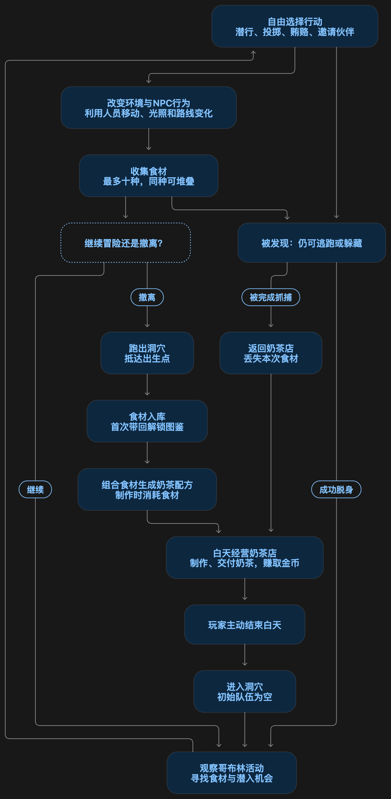

# 游戏基础背景

我本来是一个被快招公司诈骗登上勇哥直播间的屌丝老板，正准备好好告个别的时候发现我的奶茶店居然连通了异世界。就此便开启白天摇奶茶，晚上闯荡的无休生活，奶茶店的饮品也逐渐开始走上一条不归路。

## 哥布林巢穴的背景设计

在这个世界的哥布林生活在洞穴之中，这个洞穴中曾经存在这一个强大的生物，长期接受哥布林们的上供并给予他们保护，但实际上这个强大的魔物但是只有最上层的长老们知道这些事情，每次上供金币和食物都被长老们自己独吞。因此长老们需要维护自己的威严，由此整个巢穴中的前后辈压迫非常严重，后辈哥布林不敢反抗前辈们的指令，同时还担负着巨额的上供压力，但是由于自身的弱小无法去欺压别的种族，唯一的出路便是熬过头混成前辈或者是通过赌博暴富成为上层。由此整个哥布林巢穴中充满的对于金钱的渴望与对霸凌的压力

## 游戏基本循环（搜打撤➕潜入+模拟经营）

玩家前往异世界去收集食材但是没有金手指也没有强大的能力，玩家唯一有的能力就是有钱。

玩家通过金币可以去贿赂关卡中的特殊敌人和普通敌人，让他们忠诚于你，利用他们的特殊能力来为你的潜入之路填色增彩，同时也让你的跑路之路更加顺畅。

敌人的设计模仿合金装备系列的设计。

整个游戏一共存在三种不同的关卡哥布林巢穴，幽灵之地，天空城。每个地域存在性格各异的敌人npc以及不同的可交互环境设计，以及各式各样的食材。

## 游玩视角

类似于饥荒的俯视视角

## 目前欠缺的设计循环

关于奶茶店的模拟经营，以及金币用途过于单一化的情况，地图的设计

## 玩家能力

1. 蹲伏
2. 利用被驯服敌人的能力，或者操作被驯服敌人
3. 跑步
4. 跳跃
5. 投掷（投掷金币火把等）

## 特殊哥布林能力设计

| 名称 | 能力 |
| --- | --- |
| 画皮者 | 伪装或改变外观，帮助玩家处理身份问题 |
| 大力者 | 搬动重物、投掷重物，改变场景结构 |
| 听声者 | 帮助发现敌人位置等声音信息 |
| 哭泣者 | 用哭声吸引敌人，改变敌人移动方向 |

## 普通哥布林身份设计

| 身份 | 设定 |
| --- | --- |
| 搬运哥布林 | 搬运食材、矿物、贡品、货物、饭菜 |
| 厨师哥布林 | 做饭、处理食材，关注厨房和食材状况 |
| 守卫哥布林 | 巡逻和站岗；祭祀期间岗位几乎空缺 |
| 普通哥布林 | 有自己的生活，设计两种日常行为类型 |
| 祭司／长老 | 唯一高级哥布林身份，主持祭祀 |
| 酒吧老板 | 圆滑、八面玲珑，掌握大量可传播情报 |
| 赌场老板 | 狠、贪财，以金币和赌博为核心 |
| 守卫小队长官 | 欺压部下，看重威严和脸面 |
