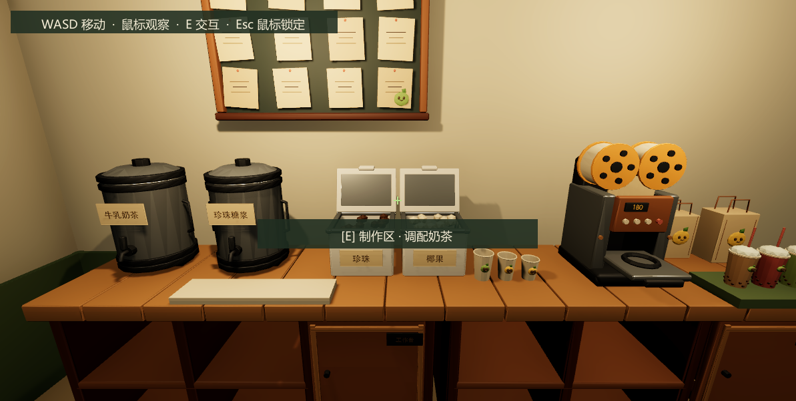
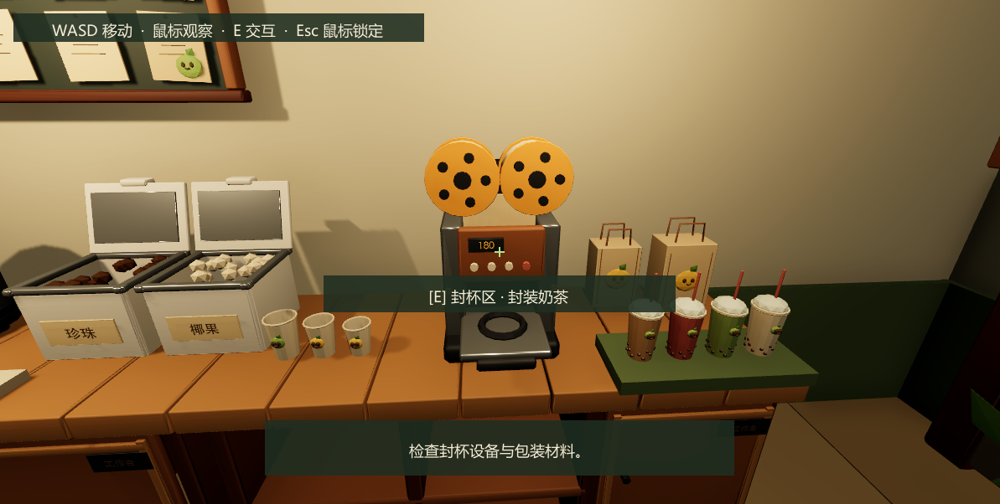
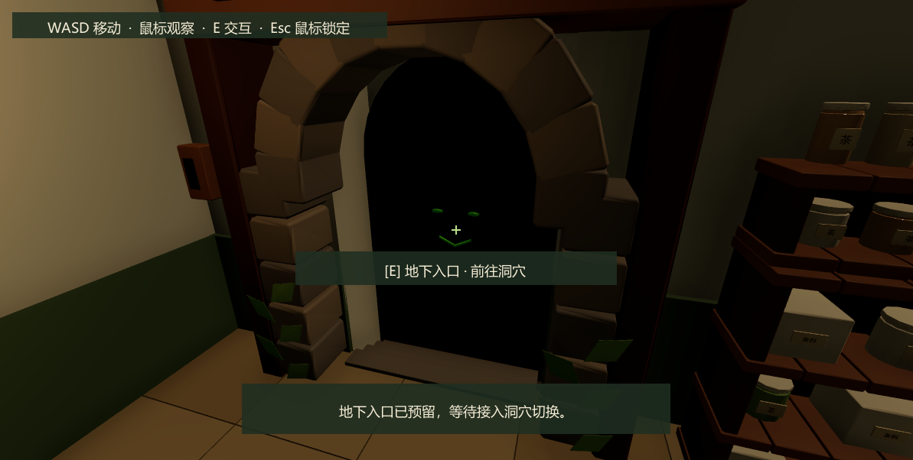
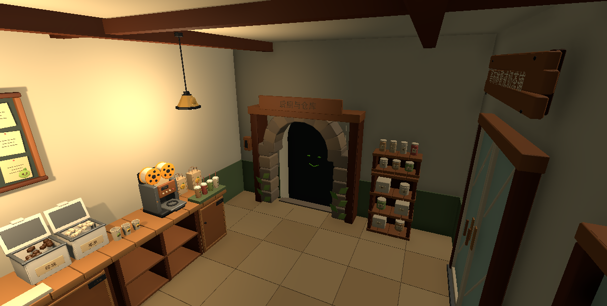

# Bussiness 比赛版奶茶店交付

打开 `Assets/Scenes/Bussiness.unity`，进入 Play Mode。WASD 移动、鼠标观察、E 交互、Esc 释放或恢复鼠标。

## 已执行的精简

- 主室内从 8 × 9 米缩到 **5.8 × 4.4 米**，面积从 72 降到 25.52 平方米，约减少 65%；净高仍为 3.2 米。地下门后局部增加约 0.56 米深的封闭阶梯凹室，用于容纳原模型的下行台阶。
- 删除两套餐桌椅、长凳、三张多余柜台、独立收银台、水槽、落地箱袋、重复窗户、植物和装饰。店门、一个窗口及招牌保留店铺暗示。
- 后墙两张原尺寸工作台组成约 3.6 米连续台面：左侧两种茶底与小料，中间空杯，右侧封杯机、包装袋和出杯托盘。所有设备操作面朝玩家。
- 订单板在制作区上方，仓储柜在右侧近处，地下入口在右后侧。中央空间保持通畅，没有独立就餐区或仓库房间。
- 出生点朝 +Z，眼位 1.65 米、初始俯角 15°、FOV 65°，准星直接识别制作区。
- 吊灯由五处减为两处。制作主光、封杯补光配合较弱室内环境光，保留奶油白、浅木、抹茶绿和已有 URP 材质。

环境保存为独立 `bussiness_shop_competition_room.prefab`。原 8 × 9 米环境 Prefab、原道具与模型保留，地下城场景和控制器没有改动。改造前的场景备份位于忽略目录 `Logs/BussinessCompetition/before_compaction.unity`。

## 地下入口衔接修正

原模型包含下降到 -0.28 米的阶梯，导出时以最低点作为地面锚点，造成门框在店内浮高约 28 厘米；整面侧墙及额外黑门板也遮住了通道。现已：

1. 将模型放置在 `(2.695,-0.280,0.550)`，Y 轴旋转 90°，恢复门框底部与店内地面齐平，并让木框后缘嵌入侧墙约 2 厘米。
2. 将右墙和护墙板拆成门洞两侧及顶部，门洞宽 1.28 米、高 1.93 米；补齐通道侧壁、底板和顶部，避免看到室外背景或虚空。
3. 移除遮挡模型的额外黑门板和整块包围盒碰撞，改为门柱、顶部、四级阶梯及洞内阻挡碰撞。恢复原模型的石拱、下行台阶和绿色眼睛提示。

地下入口当前仍触发占位反馈和系统事件，**没有执行洞穴场景加载**。模型自带“后厨与仓库”木牌文字保留，交互提示明确显示“地下入口 · 前往洞穴”。

## 核心站点与动线

| 稳定 ID | 玩家接近位置 (X,Y,Z) | 功能接口 |
|---|---|---|
| `PlayerSpawn` | (-0.65,0.025,0.15) | 面向制作区出生 |
| `PreparationStation` | (-1.00,0.025,0.45) | 制作 |
| `OrderBoard` | (-0.65,0.025,0.45) | 查看订单 |
| `SealingStation` | (0.45,0.025,0.45) | 封杯 |
| `DeliveryPoint` | (1.05,0.025,0.45) | 出杯 |
| `StoragePoint` | (1.65,0.025,-1.15) | 仓储 |
| `DungeonEntrance` | (1.20,0.025,-0.10) | 地下流程入口 |

动线为抬头看订单 → 正前方制作 → 向右横移封杯 → 右端出杯；补货转向右侧，地下目标位于右后侧。保留店门附近 `CustomerSpawn` 标记，但没有新增顾客系统。

复用既有 FPS、中心射线与 `ShopStation` / `ShopSceneBindings`，保留六个稳定 ID 和 `StationRequested` / Inspector UnityEvent。移除比赛场景的 `OrderCounter`、`WaterStation` 引用；没有删除或重排枚举，也没有修改其他场景的控制方式。公共工作台与设备站点分离，出杯托盘有独立碰撞，避免整条台面误触同一个交互点。

当前所有交互仍是占位反馈；本次没有实现订单状态、配方、扣料、金币或洞穴切换。

## 检查结果

通过已配置的本机 Unity MCP stdio 服务连接 `Untitled@9ae68d59`，执行编译刷新、Editor 菜单改造、场景保存、Play Mode 检查、API 状态查询和截图。没有更换 Package 或执行完整构建。

- Unity 2022.3.62f3c1 编译通过，收尾 Console 无错误；无缺失脚本或站点引用。
- 房间根节点比例为 `(1,1,1)`，玩家和道具保持原米制尺寸；主工作台数量为两张。
- 首轮 **20 项运行检查通过**：出生中心射线、六个站点的连续行走、六次射线识别、六次 E 反馈和绑定事件，以及店门边界阻挡。相邻站点实际行走耗时约 0.08–0.59 秒。
- 入口衔接修正后只复测受影响部分：**6 项检查通过**，包括出生朝向、从出生到地下入口约 0.64 秒、入口射线、E 反馈与事件、到达门槛及洞内阻挡。阻挡时玩家位置约 `(2.930,0.052,0.517)`。
- 行走使用现有控制器处理注入的 W 键；朝向由临时 Editor 检查脚本控制。路线没有使用传送，交互使用现有射线组件和 E 键。
- 临时检查脚本与测试键盘已移除，后台输入设置已恢复，Play Mode 已退出，Scene 和比赛版环境 Prefab 已保存。

记录：[核心检查](bussiness-shop-competition/core_play_checks.txt)、[入口复测](bussiness-shop-competition/entrance_checks.txt)。

## 实际画面

以下三张是 Play Mode 中的第一人称 Game 截图，包含运行时准星与交互提示。制作和封杯截图来自首轮检查；地下入口截图来自衔接修正后的复测。

下图是通过 Unity MCP 定位摄像机取得的最终布局检查图。

## 修改文件与人工验收

| 文件 | 内容 |
|---|---|
| `Assets/Scenes/Bussiness.unity` | 比赛版环境实例、FPS 出生朝向、六站点引用，场景 GUID 保留 |
| `Assets/Prefabs/BussinessShop/bussiness_shop_competition_room.prefab` 及 `.meta` | 可编辑的紧凑环境、家具、碰撞、灯光、站点和点位 |
| `Assets/Editor/MilkTeaShop/BussinessCompetitionLayout.cs` 及 `.meta` | 显式一次性改造菜单，以及入口对齐操作；运行时不重建布局 |
| `docs/BussinessShop-Competition.md` 与 `docs/bussiness-shop-competition/` | 交付报告、四张截图及两份检查记录 |
| `docs/BussinessShop.md`、`docs/BussinessShop-CompetitionPlan.md` | 标明旧布局与规划状态，链接当前交付 |

1. 从出生点查看制作区，抬头看订单、横移封杯和出杯，确认操作台前的站位和视觉手感。
2. 转向右侧仓储和右后地下入口按 E，检查正确反馈，走到门槛确认门框与地面衔接、通道内有阻挡。
3. 检查操作区相对背景的亮度，尝试店门与侧墙边界，确认玩家无法离开店铺。
