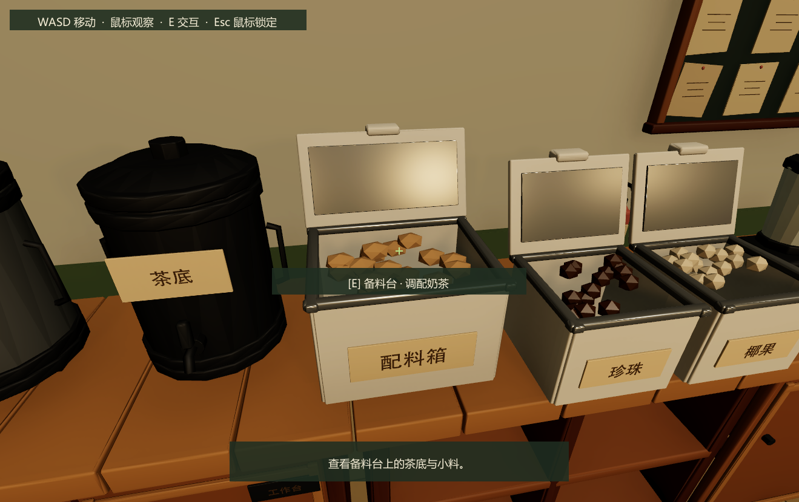
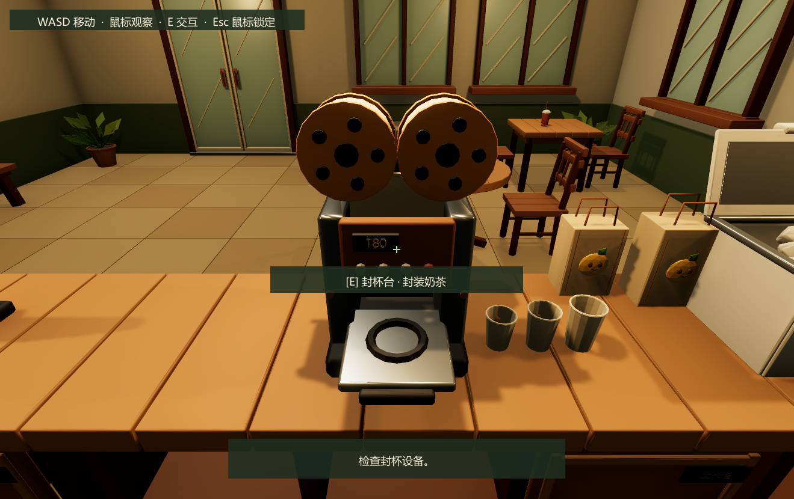
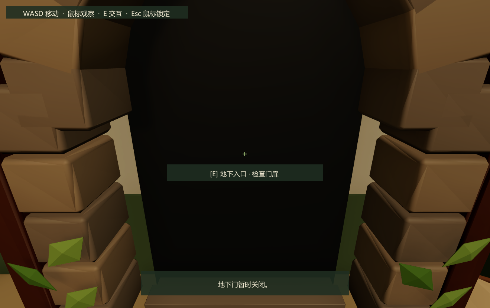
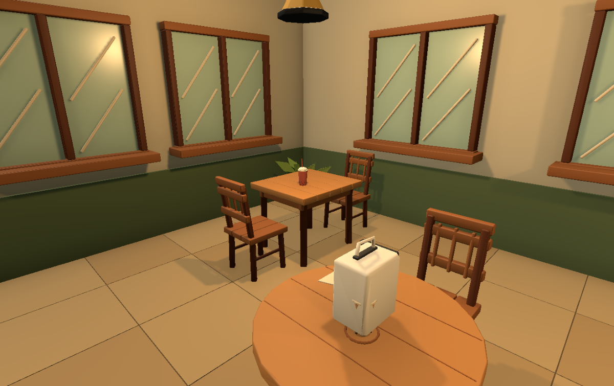

# Bussiness 奶茶店场景交付

## 打开与操作

打开 `Assets/Scenes/Bussiness.unity`，进入 Play Mode，聚焦 Game 视图。WASD 移动、鼠标观察、E 交互、Esc 释放／恢复鼠标。玩家在柜台后的员工区出生，眼位高 1.65 米，移动速度 2.8 米/秒。外围墙体和展示门将活动范围限制在奶茶店内。

本次通过 Unity MCP 查询场景、编译状态、执行场景组装、调整 Prefab、进入 Play Mode、获取截图和保存结果。没有修改 `MilkTeaShop` 或地下城场景，也没有接入跨场景切换或完整经营流程。

## 空间与美术

- 室内净尺寸 8 × 9 × 3.2 米，XZ 为地面，Y 为高度，1 Unity 单位 = 1 米。
- 前部为两个餐桌组合、靠墙长凳、顾客入口及盆栽；中央为接单、封杯和取餐台；后方为茶底、小料、搅拌和清洗区域；右后部为仓储柜及地下入口。
- 中央台与后备料台之间约留 2.1 米员工通道，柜台右端约留 2.1 米入口通道，仓储道具所在区域保留可通行路径。
- 采用浅木色台面、奶油色墙面、抹茶绿护墙板，搭配深色木梁、暖色吊灯、木框窗和植物。使用独立场景 Volume Profile，保留现有项目渲染设置。
- 来自 `D:/codex/game_test/demo/MilkTeaShop_Package.zip` 的道具导出为 41 个 FBX 与对应 Prefab；未使用的传单和边桌未导入。模型与文字均为实际网格，材质重建为 URP/Lit，无外部字体或贴图引用。
- 原包中两套餐桌的椅子朝外。本次修正四把椅子，使座面朝桌、靠背朝外，并同步更新碰撞尺寸；原 ZIP 和 Blender 文件未修改。
- 封杯机、杯架和 POS 操作面转向员工侧，小料盒与杯具分别摆放。门窗和地下门保持关闭，以便当前阶段只在店内活动。

## 精确布局与站点

下表为玩家站立／接近位置，交互组件挂在相应设备组。所有坐标都是米。

| 点位 / 稳定 ID | 坐标 (X,Y,Z) | 接入用途 |
|---|---|---|
| PlayerSpawn | (-0.75,0.025,2.15) | 第一人称员工出生 |
| CustomerSpawn | (1.65,0.025,-3.70) | 后续顾客生成 |
| OrderCounter | (0.65,0.025,1.75) | 接单、收银 |
| OrderBoard | (0.45,0.025,2.75) | 待办／订单列表 |
| PreparationStation | (-1.70,0.025,2.75) | 茶底、小料、调配 |
| SealingStation | (-0.75,0.025,1.75) | 封杯、包装 |
| DeliveryPoint | (1.40,0.025,1.75) | 取餐、交付 |
| StoragePoint | (2.80,0.025,2.25) | 原料仓储 |
| WaterStation | (-2.65,0.025,2.20) | 取水、清洗 |
| DungeonEntrance | (2.10,0.025,2.90) | 地下入口 |

## 系统接入接口

复用既有 `ShopFirstPersonController` 与 `ShopRaycastInteractor`，没有另建一套玩家控制或修改输入资产。

`ShopStation` 继承现有 `RaycastInteractable`。每个站点保存稳定 `StationId`、`Kind`、`ApproachPoint`，并提供两种事件接口：

- C# `Requested(ShopStation)`：供程序订阅。
- Inspector `onRequested` UnityEvent：供场景绑定后续行为。

场景根对象 `BussinessShop_SystemBindings` 上的 `ShopSceneBindings` 通过序列化引用保存玩家、出生点和八个站点；可使用 `GetStation(id)` 查询。它将站点请求汇总为 `StationRequested(ShopStation)`，并在 Enable/Disable 时配对订阅与退订。

后续订单、仓储、制作或昼夜服务可以通过 Inspector 引用 `ShopSceneBindings`，在自身启用时订阅 `StationRequested`，停用时退订，再按 `StationId` 或 `Kind` 处理。无需寻找场景内部 Transform 路径，也无需把业务逻辑加入玩家控制器。

当前 E 键仅提供检查／查看反馈和接口事件，没有实际扣料、生成奶茶、完成订单或增加金币。地下门不会切换场景。

## 资产与修改范围

| 路径 | 内容 |
|---|---|
| `Assets/Scenes/Bussiness.unity` | 保存的经营场景，原场景 GUID 保留 |
| `Assets/Prefabs/BussinessShop/bussiness_shop_room.prefab` | 可编辑环境、站点、灯光和点位 |
| `Assets/Prefabs/BussinessShop/` | 41 个道具 Prefab，家具保持嵌套引用 |
| `Assets/Art/Models/BussinessShop/` | FBX、米制尺寸及材质来源清单 |
| `Assets/Art/Materials/BussinessShop/` | 独立 URP 材质 |
| `Assets/Settings/BussinessShopPresentation.asset` | 场景后处理配置 |
| `Assets/Scripts/Gameplay/MilkTeaShop/ShopStation.cs` | 可扩展交互站点 |
| `Assets/Scripts/Gameplay/MilkTeaShop/ShopSceneBindings.cs` | 场景系统引用和事件入口 |
| `Assets/Editor/MilkTeaShop/BussinessShopBuilder.cs` | 一次性 Editor 组装入口及点位检查 |

所有新增 Unity 资产均包含 `.meta`。运行时不会自动重建场景。原始 Bussiness 场景已备份至 `Logs/BussinessShop/before_assembly.unity`；其他场景、既有 FPS Prefab、Packages、Build Settings 和共享数据系统保持原样。

## 验证

- Unity 2022.3.62f3c1，URP 14.0.12；脚本编译无错误。
- 41 个模型在 Unity 中按米制尺寸检查通过，餐桌座椅修正后的尺寸和碰撞同步更新。
- 八个站点与两个出生点的玩家胶囊空间检查通过。
- 一次针对性的 Play Mode 验证：11 个连续行走检查点通过，覆盖全部员工站位、右侧通道及顾客入口；没有使用传送绕过这段路线。
- 八个站点分别通过中心射线识别与 E 键交互检查，确认反馈及 `ShopSceneBindings.StationRequested` 事件。共 27 项运行检查通过，见 [play_checks.txt](bussiness-shop/play_checks.txt)。交互检查使用受控站位与注入的 Input System 输入。
- 临时检查脚本已移除，测试设备及后台输入设置已恢复；场景已保存，Play Mode 已退出。没有执行完整构建。
- 收尾时 Editor 已切至另一个正在编辑的 `Adventure`，有未保存改动；保留该编辑状态。Console 新出现 `AdventureCaveImporter` 的 Vector3 JSON 自引用运行错误，属于并行的洞穴导入工作，本次未改动该工具或其文件。

## 实际画面

以下三张为 Unity Play Mode 中截取的第一人称 Game 画面，包含运行时准星、提示和交互反馈。

下图为 Unity 中检查椅子朝向时的视角。

## 人工验收

1. 从员工出生点走到备料、清洗、封杯和取餐区域，确认距离与操作手感。
2. 对准订单板、仓储柜和地下门按 E，确认提示和反馈；尝试走出门外，应受到阻挡。
3. 进入顾客区，确认方桌、圆桌的椅子均面向桌面，并检查整体配色与灯光。
