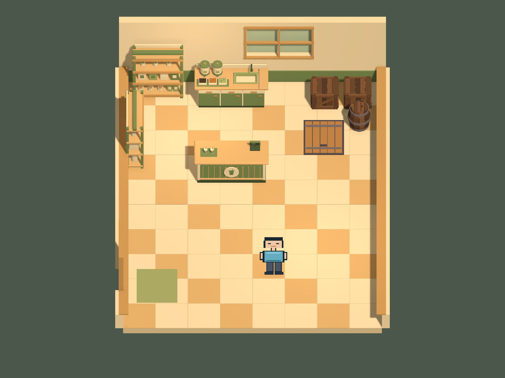

# Day 1 奶茶店场景交付

## 打开与编辑

- 场景：`Assets/Scenes/MilkTeaShop.unity`。双击打开，或菜单 `Untitled > Milk Tea Shop > Open Day 1 Scene`。
- 可直接编辑 Hierarchy 中的建筑、家具实例、灯光与预留点。场景运行时不会重建或覆盖布局。
- Play Mode 使用 WASD、方向键或手柄左摇杆移动。没有新增订单、经营、剧情或场景切换逻辑。
- `Develop`、`Cave`、`Adventure`、`Bussiness` 及其他既有场景均未修改；没有改 Build Settings 或 Packages。

## 项目检查与资产来源

Unity `2022.3.62f3c1`，URP `14.0.12`，Input System `1.14.2`，以项目版本文件与清单为准。任务开始时 Git 工作区干净。

使用 `D:/codex/blender/02_Projects/GoblinCave/Day1_Assets/FBX` 内五个现有模型，原始 Blender 与导出文件未修改。项目模型目录为 `Assets/Art/Models/MilkTeaShop`，五个对应 Prefab 位于 `Assets/Prefabs/MilkTeaShop`；源材质按原有纯色配色重建为 URP/Lit，保存于 `Assets/Art/Materials/MilkTeaShop`。

1 Unity 单位 = 1 米，Y 向上，XZ 为移动平面。模型默认正面朝 -Z，根 Transform 比例为 (1,1,1)，底部原点贴地；左侧货架实例绕 Y 旋转 -90°，面向室内。Unity 导入实测外包围尺寸如下，包含收银机、茶桶等固定附属物：

| 模型 | 宽 X / 高 Y / 深 Z（米） |
|---|---|
| 收银柜台 | 2.3000 / 1.3664 / 0.9715 |
| 奶茶制作台 | 2.2800 / 1.5110 / 0.8830 |
| 货架 | 1.5700 / 1.9950 / 0.5510 |
| 木箱 | 0.8710 / 0.7000 / 0.8545 |
| 木桶 | 0.7320 / 0.9000 / 0.7320 |

## 空间、控制与预留位置

室内净地板 8 × 10 米，X 范围 [-4,4]，Z 范围 [-5,5]，地板碰撞面 Y=0。地板使用简单方块 Mesh，装饰地砖高于碰撞面 4mm。后墙 2.8 米高，带真实窗洞、木框与关闭的窗面；两侧墙以 0.65 米高切面展示，保留完整高度边界碰撞。左侧为关闭的门，前侧省略可见墙体以保持视野，前沿仍有阻挡。

柜台在中部，制作台与货架沿后墙和左墙布置，右后部存放木箱、木桶，右侧地面预留封闭地下入口。建筑、家具均有静态 BoxCollider；地下入口是贴地的关闭盖板，下面仍是完整地板。

复用 `PixelPerson64Placeholder` 视觉、`CaveBlockoutPlayer` 移动与重力、`SpriteBillboard` 视觉朝向，以及 `CameraController`。玩家 CharacterController 高 1.8 米、半径 0.28 米，移动速度 2.8 米/秒。摄像机固定跟随场景焦点，俯角 50°，正交尺寸 5.85；没有玩家跟随位移。暖色主光与两盏室内补光均为实时光，无烘焙依赖。

预留点位于 `04_ReservedPoints_NoGameplay` 下，都是可编辑 Transform，不包含交互行为：

| 点位 | 世界坐标 (X,Y,Z) |
|---|---|
| PlayerSpawn | (0.65,0.02,-2.85) |
| CustomerStand_01 | (-0.65,0.02,0.18) |
| CustomerStand_02 | (-0.65,0.02,-1.02) |
| CustomerStand_03 | (-0.65,0.02,-2.22) |
| MilkTeaInteraction_PlayerSide | (-0.65,0.02,3.24) |
| CashierInteraction_PlayerSide | (-0.65,0.02,2.35) |
| UndergroundEntrance_Approach | (2.20,0.02,1.50) |
| ShopEntrance_ClosedForDay1 | (-3.15,0.02,-3.30) |

地下盖板中心为 (2.20,0.02,2.70)，约 1.25 × 1.40 米。柜台两侧可绕行，柜台后方到制作点保留员工操作空间。

## 实际截图

下图由当前保存场景的 Unity URP 主摄像机实际渲染，1600 × 1200；不是 Blender 预览或概念图。摄像机姿态与试玩一致。

## 已做检查与问题报告

- Unity 脚本编译、模型米制尺寸、五个 Prefab、场景脚本与材质引用检查通过；八个预留点的玩家胶囊碰撞检查通过。
- 一次针对性的 Play Mode 输入检查，共七项全部通过：自由移动、柜台阻挡、后墙阻挡、左边界、右边界、前边界，以及员工通道横向通行。边界停止位置约 X=±3.695、Z=±4.695；柜台前停止位置 Z=0.459，符合玩家胶囊半径与 skin width。检查通过现有 Input Actions 和现有控制器执行，临时检查脚本已移除。
- 第一张截图发现地板与装饰地砖共面闪烁；已将地砖表面抬高 4mm，修正后的截图无此问题。整间店、玩家出生位置、柜台、制作台、地下盖板均在画面内，前墙与屋顶不遮挡主视野。
- 场景已保存，Play Mode 已退出。未执行完整构建。

当前阶段的限制：玩家使用现有像素占位图；门与地下盖板保持关闭，尚未接通场景切换；预留点不显示顾客或交互提示。两侧低墙和前沿不可见阻挡是固定镜头下的切面展示方式，后续改变镜头需要重新检查遮挡。柜台、制作台采用完整包围盒阻挡，不支持贴入凹槽。

## 人工验收（最多三项）

1. 打开 `MilkTeaShop` 后进入 Play Mode，用 WASD 绕柜台两侧走到制作台，确认移动速度与操作空间。
2. 尝试走向地板边缘、柜台、木箱及木桶，确认阻挡，观察固定镜头下角色与家具的可见性。
3. 退出 Play Mode，在 Hierarchy 选择预留点和家具 Prefab 实例，确认布局、配色及暖色照明符合 Day 1 预期。
