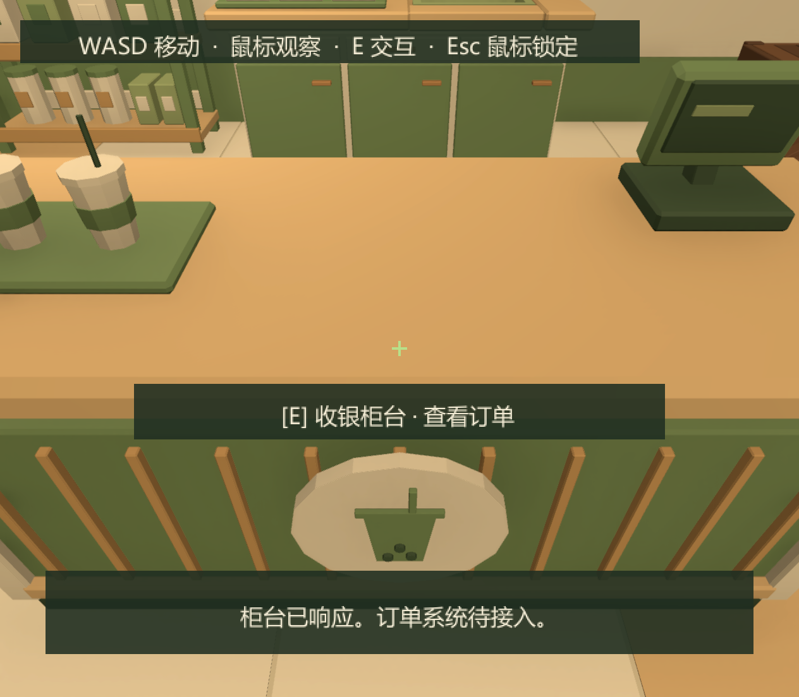
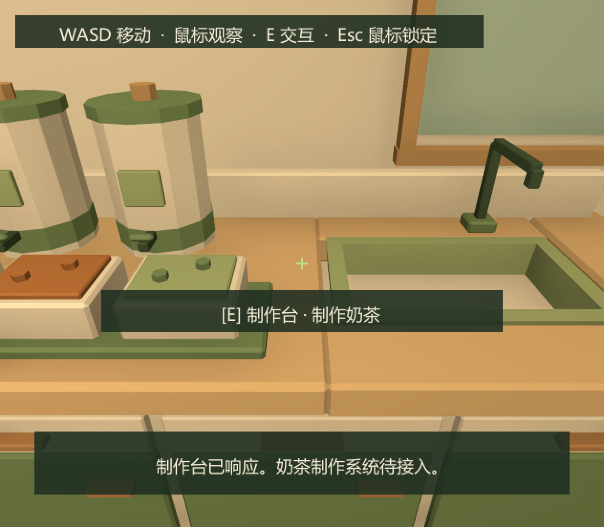
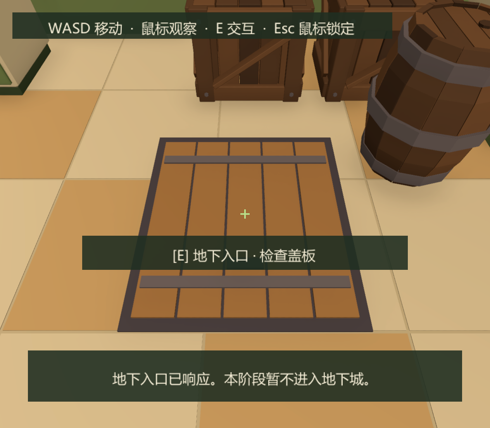

# Day 1 奶茶店 · 第一人称交付与测试报告

## 打开与操作

打开 `Assets/Scenes/MilkTeaShop.unity`，进入 Play Mode，并聚焦 Game 视图。

- WASD：相对当前朝向移动，速度 2.8 米/秒。
- 鼠标：水平转向、上下观察，俯仰限制 ±80°。
- E：对准物体后执行交互；准星变绿并显示对应提示。
- Esc：切换鼠标锁定。释放鼠标时暂停移动、观察和交互，重力继续生效；失焦后释放鼠标，重新聚焦再按 Esc 恢复。

不包含跳跃、冲刺或射击。本场景已保存，验证结束后退出了 Play Mode。

## 场景与 Prefab

沿用已导入的柜台、制作台、货架、木箱、木桶，保持米制比例与原有纯色 URP 材质。Blender 源资产和项目 FBX 均未改动。室内净空间 8 × 10 米，Y 为高度，地板位于 XZ 平面。

将奶茶店前版的切面墙改为四面完整墙体及天花板，保留后墙窗户和左侧顾客入口。配色为奶油白、浅木色、抹茶绿，保留暖色室内照明；地板、墙体、门、家具与地下盖板都有合理的实体碰撞。

- `Assets/Prefabs/MilkTeaShop/milk_tea_shop_room.prefab`：环境、家具、点位和灯光，家具保持嵌套 Prefab 引用。
- `Assets/Prefabs/MilkTeaShop/milk_tea_shop_player.prefab`：独立 FPS 玩家、CharacterController、眼位摄像机和射线交互。
- 原有五个家具 Prefab 继续复用，其中柜台和制作台增加占位交互组件。

玩家胶囊高 1.8 米、半径 0.28 米，眼位在脚底以上 1.65 米，透视 FOV 65°。FPS 玩家放在 Unity 内置 `Ignore Raycast` 层，中心射线使用默认射线层掩码以排除自身；该层仍参与与环境的实体碰撞。

转换前已把 Editor 中尚未保存的奶茶店内容保存为 `Logs/MilkTeaShop/before_first_person.unity` 备份，并保留已有家具摆放。奶茶店场景 GUID 保持不变。没有修改地下城地形、第三人称控制器、像素角色 Prefab、既有场景、Packages 或 Build Settings。

## 组件与输入架构

`ShopFirstPersonController` 只负责 FPS 移动、重力、鼠标观察和锁定；`ShopRaycastInteractor` 只负责摄像机中心射线、E 输入和简单 HUD。两者分别拥有自己的 Input Actions 实例，只启用各自需要的 Action，在 Disable/Destroy 时禁用并释放。

新增 `Shop` Action Map，包含 `Move`、`Look`、`Interact`、`ToggleCursor`。定义来自 `Assets/Input/InputActions.inputactions`，C# wrapper 由 Unity importer 生成，没有手改。原有 Action Map、绑定和 Control Scheme 的数据对比保持一致；地下城仍使用原有输入和独立表现。

交互使用 `RaycastInteractable` 抽象契约。`ShopPlaceholderInteractable` 提供可编辑提示、反馈与 Inspector UnityEvent，后续可以替换为具体业务组件或绑定事件。射线最远 2.6 米，只接受最近的实体碰撞物；墙体与其他实体可遮挡目标，不会穿墙选择。

- 柜台：显示“查看订单”提示，执行后显示柜台响应占位反馈。
- 制作台：显示“制作奶茶”提示，执行后显示制作台响应占位反馈。
- 地下入口：显示“检查盖板”提示，执行后显示入口响应反馈，不切换场景。

没有在 FPS 控制器中硬编码家具行为，也没有提前开发订单、物品、金币、制作流程或剧情状态。本场景不需要启动现有游戏 Manager；后续共享数据可以通过独立服务接入交互组件。

## 可到达的预留点

环境 Prefab 下的 `04_ReservedPoints` 保存以下可编辑 Transform。点位表示玩家或顾客站立的位置，交互组件挂在对应家具或盖板上。

| 点位 | 世界坐标 (X,Y,Z)，米 |
|---|---|
| PlayerSpawn | (0.65,0.02,-2.85) |
| CustomerSpawn | (-3.15,0.02,-3.30) |
| OrderCounter | (-0.65,0.02,2.35) |
| PreparationStation | (-0.65,0.02,3.24) |
| DeliveryPoint | (0.90,0.02,1.25) |
| DungeonEntrance | (2.20,0.02,1.50) |

另保留三个顾客排队站位。地下盖板中心为 (2.20,0.02,2.70)。柜台两侧可绕行，柜台后方可走到制作台；这些点位均通过连续行走与胶囊空间检查。

## 第一人称实际游玩截图

以下截图来自 Unity Play Mode 的 Game 画面，包含运行中的准星、射线提示和 E 键交互反馈。由 Play Mode 中的 ScreenCapture 截取；验证输入通过测试脚本注入。

## 检查结果与修复

Unity 版本 `2022.3.62f3c1`，URP `14.0.12`，Input System `1.14.2`。任务开始时 Git 工作区干净，但奶茶店 Editor 场景有未保存状态，转换前已备份和保存。

- Unity 脚本编译、场景引用、材质与五个模型尺寸检查通过；六个指定点位胶囊空间检查通过。
- Play Mode 通过 Input System 注入输入，验证实际 FPS 和交互组件。最终 29 个检查项均通过，完整结果见 [play_mode_checks.txt](milk-tea-shop/play_mode_checks.txt)。
- 检查覆盖 1.65 米眼位、WASD 移动、落地重力、鼠标 yaw/pitch、俯仰限制、Esc 释放与恢复、释放时暂停操作、连续行走路线、三种物体的中心射线提示及 E 反馈、超距不选中、实体墙遮挡与前墙碰撞。
- 连续行走从出生点出发，经柜台右侧进入员工区域，到达订单点和制作点，再经地下入口、交付点走至顾客入口。13 个路线检查点全部到达，没有使用传送绕过路线障碍。
- 首轮制作台检测失败，定位到中心射线近端碰到玩家自身胶囊；已将 FPS 玩家及其 Prefab 配置为 `Ignore Raycast`，三类交互、距离、遮挡及碰撞复查通过。首轮鼠标角度结果受到窗口激活输入影响，隔离后的检查得到 yaw 36°、pitch -12°，与输入和灵敏度一致。
- 临时 Play Mode 检查脚本已移除，测试设备和临时输入后台设置已恢复；交付不包含测试框架或运行时自动重建逻辑。
- 场景已保存，完整构建未运行。

当前限制：门与地下盖板是关闭的占位模型，尚无顾客生成、开门和地下城跳转；交互只给出占位反馈。HUD 使用简单 IMGUI，中文字体在 Windows Editor 中已验证。材质、灯光和鼠标灵敏度可在 Inspector 中继续调整。

## 修改文件列表

| 文件或目录 | 修改内容 |
|---|---|
| `Assets/Scenes/MilkTeaShop.unity` | 改为环境 Prefab 与独立 FPS 玩家实例，保留场景 GUID |
| `Assets/Scripts/Gameplay/MilkTeaShop/ShopFirstPersonController.cs` | 新增 FPS 移动、观察、重力和鼠标锁定 |
| `Assets/Scripts/Gameplay/MilkTeaShop/ShopRaycastInteractor.cs` | 新增中心射线、E 输入、准星、提示及反馈 |
| `Assets/Scripts/Gameplay/MilkTeaShop/RaycastInteractable.cs` | 新增可扩展交互契约 |
| `Assets/Scripts/Gameplay/MilkTeaShop/ShopPlaceholderInteractable.cs` | 新增可配置占位交互及 UnityEvent |
| `Assets/Input/InputActions.inputactions` | 新增独立 Shop Action Map |
| `Assets/Input/InputActions.cs` | Unity importer 重新生成的 wrapper |
| `Assets/Prefabs/MilkTeaShop/milk_tea_shop_room.prefab` | 新增完整室内环境 Prefab |
| `Assets/Prefabs/MilkTeaShop/milk_tea_shop_player.prefab` | 新增独立第一人称玩家 Prefab |
| `Assets/Prefabs/MilkTeaShop/milk_tea_counter.prefab` | 增加柜台占位交互组件 |
| `Assets/Prefabs/MilkTeaShop/milk_tea_workbench.prefab` | 增加制作台占位交互组件 |
| `Assets/Editor/MilkTeaShop/MilkTeaShopBuilder.cs` | 新建入口生成第一人称配置，并检查新点位 |
| `Assets/Editor/MilkTeaShop/MilkTeaShopFirstPersonSetup.cs` | 一次性场景转换与环境／玩家 Prefab 组装 |
| `docs/MilkTeaShop-Day1.md`、`docs/milk-tea-shop/` | 更新报告、第一人称截图与最终检查结果，移除旧斜俯视截图 |

所有新增资产均包含对应 `.meta`；现有资产 GUID 保留。

## 人工验收

1. Play 后用 WASD 和鼠标移动观察，按 Esc 释放并恢复鼠标，确认速度与灵敏度合适。
2. 绕过柜台到制作台，再走到右侧地下盖板，对准物体按 E，确认提示和占位反馈。
3. 退出 Play Mode，在环境 Prefab 中检查六个预留点、顾客入口与家具摆放。
