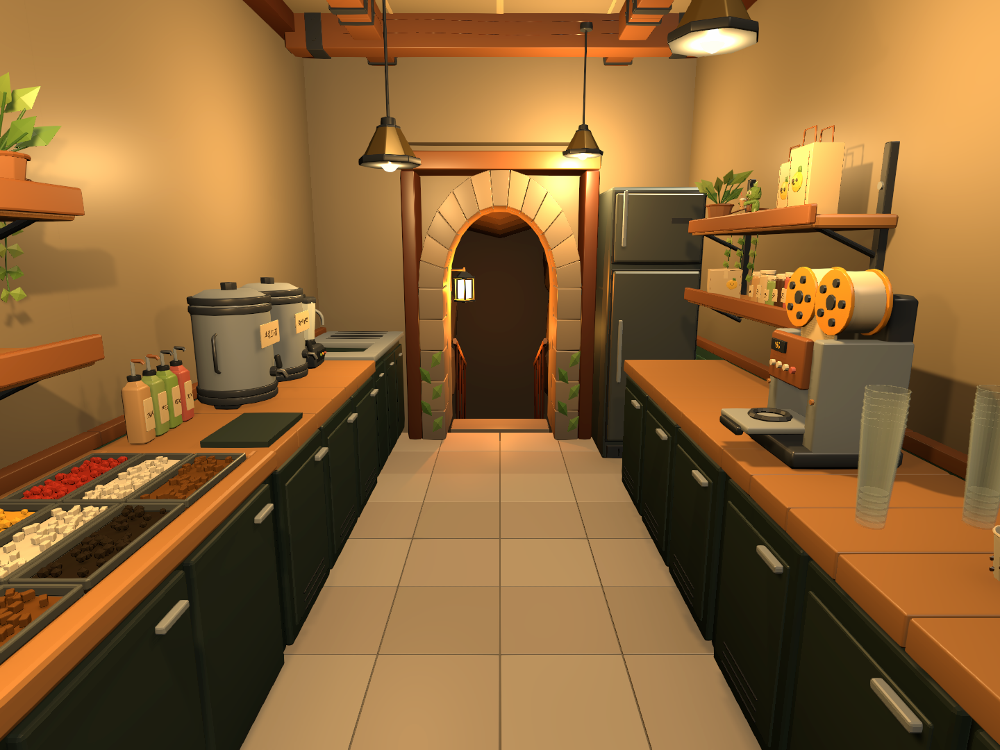
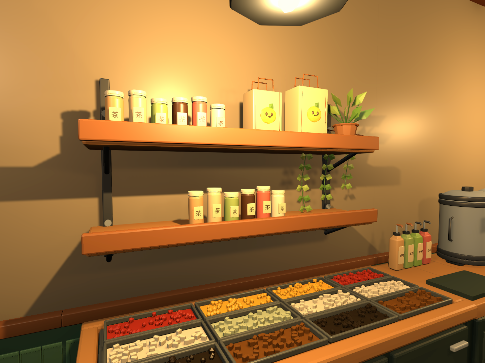
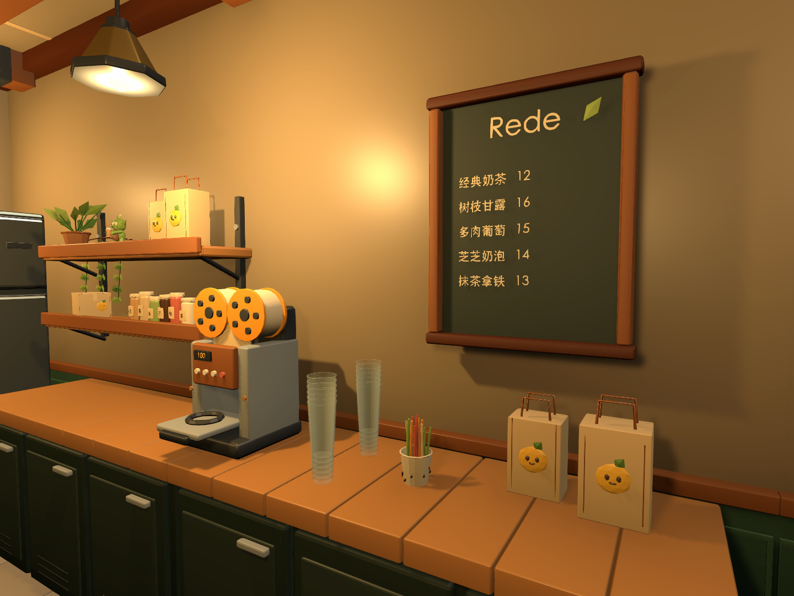

# 奶茶店参考场景

打开 `Assets/Scenes/MilkTeaShopReference.unity`，或使用菜单 **Untitled → Milk Tea Shop → Open Reference Interior**。场景已经保存在 Unity 中，当前处于编辑模式。

WASD 移动，鼠标观察，E 交互，Esc 释放或恢复鼠标。玩家出生在柜台内侧；前台左侧留有员工通道，可走到开放的顾客平台。

预览由 Unity 场景摄像机渲染，运行时使用现有的准星与交互提示。

## 布局与资源

- 后厨宽约 3 米、深约 5.6 米，净高 3.2 米；中央工作走道约 1.6 米宽。工作台高约 0.9 米，前台高约 1.05 米。接待台外侧移除封闭墙面，并延伸为约 5 米宽的顾客平台；地板边界有碰撞阻挡。
- 左侧依次为无遮挡的十二格小料台、糖浆瓶与调配垫、茶桶、搅拌机和清洗区；右侧为朝向员工的封杯机、空杯、包装备料与冰箱。植物移到上层收纳和顾客区，操作台上保留备料空间。
- 接待台分为收银终端、成品取餐托盘、纸巾吸管区；三联饮品菜单悬挂在前口上方，面朝顾客。顾客生成和排队逻辑尚未接入。
- 后方保留石拱洞口、岩壁、阶梯、扶手与灯笼。修正拱石、内衬的反向面，分开拱石、内衬、封边和岩顶；透明杯堆改为六只带杯底和内壁的套杯。
- 两扇窗已移除。两组双层收纳架的架面分别高约 1.33 米、1.75 米，层距 42 厘米；收纳物品随架子一起降低。
- 右侧收纳架移到封杯机后方，移除原来的独立杯架，空杯和吸管放到机器前方。右侧墙面增加饮品小黑板，上层架面增加原包的奶茶吉祥物，包装袋保留在小黑板下方的备料台。
- 玩家胶囊沿用现有配置；本场景眼位为脚底以上 1.6 米，透视 FOV 为 64°。未修改共享玩家 Prefab、输入定义或其他场景。

使用用户提供的 `D:/download/MilkTeaShop_Package_v2/MilkTeaShop_V2/MilkTea_Assets_49.blend`，原文件保持原样。独立 Blender 库包含 34 种模型；收银终端和小黑板另外复用项目中已有的 `BussinessShop/pos_terminal.prefab`、`BussinessShop/menu_blackboard.prefab`。

| 文件 | 用途 |
|---|---|
| `tools/art/milk_tea_reference.blend` | 可编辑的 Blender 资产库，保留分件模型和资产预览实例 |
| `tools/build_milk_tea_reference.py` | 从原资产库导出并补建本场景模型的脚本，使用 Blender 后台模式执行 |
| `Assets/Art/Models/MilkTeaReference/` | 米制 FBX、来源与材质清单 |
| `Assets/Art/Materials/MilkTeaReference/` | 本场景独立的 URP 材质 |
| `Assets/Prefabs/MilkTeaReference/` | 模型 Prefab 与完整房间 Prefab |
| `Assets/Settings/MilkTeaReferencePresentation.asset` | 暖色灯光表现使用的后处理配置 |
| `Assets/Editor/MilkTeaShop/MilkTeaReferenceBuilder.cs` | 显式创建新场景的入口；已有场景需直接编辑，不自动覆盖 |

房间 Prefab 按建筑、点位、工作站、收纳装饰、灯光分组。运行时读取保存的摆放，没有自动重建布局。

## 检查与范围

- Blender 导出时将直接复用模型与原包标注的尺寸对照；Unity 导入后检查 FBX 的米制尺寸与材质映射。
- Blender 中修正了洞口的 26 个反向封闭网格和菜单插画的 3 个反向封闭网格；本次处理的四类资产检查后没有反向封闭网格。
- Unity 脚本编译通过。出生点、前台左侧至洞口的四段胶囊通道、八个工作站射线、顾客侧开口和地面检查通过；小料台没有与菜单、植物、糖浆瓶或杯堆相交，备料设备之间的包围盒也不相交。
- 本轮检查确认窗子已移除、两组架子高度正确，右侧架子不与封杯机、空杯和吸管相交，收纳物品之间不相交，小黑板不与包装袋相交；完成正前、左侧和右侧三向编辑器摄像机预览。
- 本轮只改资源与摆放，未重新运行 Play Mode 或完整构建。前一轮 Play Mode 中玩家落地正常，八个站点都返回反馈并各触发一次场景绑定事件；经营流程尚未实现。
- 复用 `ShopFirstPersonController`、`ShopRaycastInteractor`、`ShopStation` 和 `ShopSceneBindings`。备料、菜单、清洗、封杯、出杯、仓储、洞口和前台均有可编辑的交互引用。
- 交互仍是现有的提示、反馈和事件接口；订单、扣料、金币与洞穴场景切换没有在本次实现。

## 人工验收

1. 查看两侧收纳架，确认不需要大幅抬头就能看见原料和包装。
2. 查看右侧小黑板、吉祥物和封杯台，确认摆放与操作空间合适。
3. Play 后移动、转身并对准工作站按 E，确认原有交互提示与反馈。
