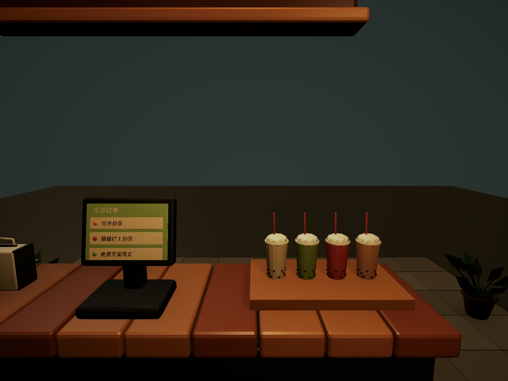
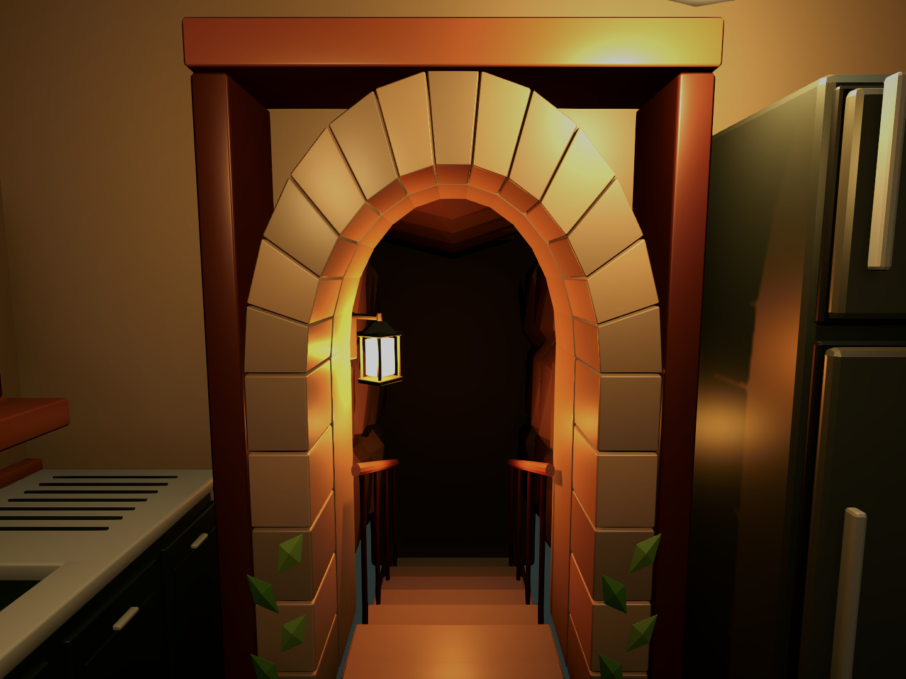

# 奶茶店参考场景

打开 `Assets/Scenes/MilkTeaShopReference.unity`，或使用菜单 **Untitled → Milk Tea Shop → Open Reference Interior**。场景已经保存在 Unity 中，当前处于编辑模式。

WASD 移动，鼠标观察，E 交互，Esc 释放或恢复鼠标。玩家出生在柜台内侧；前台左侧留有员工通道，可走到开放的顾客平台。

预览由 Unity 场景摄像机渲染，运行时使用现有的准星与交互提示。

## 布局与资源

- 后厨宽约 3 米、深约 5.6 米，净高 3.2 米；中央工作走道约 1.6 米宽。工作台高约 0.9 米，前台高约 1.05 米。接待台外侧移除封闭墙面，并延伸为约 5 米宽的顾客平台；地板边界有碰撞阻挡。
- 左侧依次为无遮挡的十二格小料台、糖浆瓶与调配垫、茶桶、搅拌机和清洗区；右侧为朝向员工的封杯机、空杯、包装备料与冰箱。植物移到上层收纳和顾客区，操作台上保留备料空间。
- 接待台分为收银终端、成品取餐托盘、纸巾吸管区；三联饮品菜单悬挂在前口上方，面朝顾客。顾客生成和排队逻辑尚未接入。
- 后方保留石拱洞口、岩壁、阶梯、扶手与灯笼。修正拱石、内衬的反向面，分开拱石、内衬、封边和岩顶；透明杯堆改为六只带杯底和内壁的套杯。
- 两扇窗抬高，窗台下沿为 1.555 米，高于茶桶盖约 8.7 厘米；茶桶保持台内落位，出液口前留出接杯空间。
- 玩家胶囊沿用现有配置；本场景眼位为脚底以上 1.6 米，透视 FOV 为 64°。未修改共享玩家 Prefab、输入定义或其他场景。

使用用户提供的 `D:/download/MilkTeaShop_Package_v2/MilkTeaShop_V2/MilkTea_Assets_49.blend`，原文件保持原样。独立 Blender 库包含 33 种模型；收银终端另外复用项目中已有的 `BussinessShop/pos_terminal.prefab`。

| 文件 | 用途 |
|---|---|
| `tools/art/milk_tea_reference.blend` | 可编辑的 Blender 资产库，保留分件模型和资产预览实例 |
| `tools/build_milk_tea_reference.py` | 从原资产库导出并补建本场景模型的脚本，使用 Blender 后台模式执行 |
| `Assets/Art/Models/MilkTeaReference/` | 米制 FBX、来源与材质清单 |
| `Assets/Art/Materials/MilkTeaReference/` | 本场景独立的 URP 材质 |
| `Assets/Prefabs/MilkTeaReference/` | 模型 Prefab 与完整房间 Prefab |
| `Assets/Settings/MilkTeaReferencePresentation.asset` | 暖色灯光表现使用的后处理配置 |
| `Assets/Editor/MilkTeaShop/MilkTeaReferenceBuilder.cs` | 显式创建新场景的入口；已有场景需直接编辑，不自动覆盖 |

房间 Prefab 按建筑、点位、工作站、收纳装饰、灯光分组。运行时读取保存的摆放，没有自动重建布局。

## 检查与范围

- Blender 导出时将直接复用模型与原包标注的尺寸对照；Unity 导入后检查 FBX 的米制尺寸与材质映射。
- Blender 中修正了洞口的 26 个反向封闭网格和菜单插画的 3 个反向封闭网格；本次处理的四类资产检查后没有反向封闭网格。
- Unity 脚本编译通过。出生点、前台左侧至洞口的四段胶囊通道、八个工作站射线、顾客侧开口和地面检查通过；小料台没有与菜单、植物、糖浆瓶或杯堆相交，备料设备之间的包围盒也不相交。
- 窗台与茶桶、糖浆瓶、搅拌机的八组包围盒避让检查通过。
- Play Mode 中玩家落地正常，八个站点都返回反馈并各触发一次场景绑定事件，Console 未发现错误或警告；结束后退出并保存场景。未进行完整构建，也未模拟完整的经营流程。
- 复用 `ShopFirstPersonController`、`ShopRaycastInteractor`、`ShopStation` 和 `ShopSceneBindings`。备料、菜单、清洗、封杯、出杯、仓储、洞口和前台均有可编辑的交互引用。
- 交互仍是现有的提示、反馈和事件接口；订单、扣料、金币与洞穴场景切换没有在本次实现。

## 人工验收

1. Play 后查看小料台和封杯机，再走近洞口，检查操作视野与拱石表面。
2. 转身查看接待台，从左侧通道走到顾客平台，确认柜台外侧开放、菜单朝向和取餐位置。
3. 对准小料台、封杯机、收银终端等位置按 E，确认提示与反馈。
