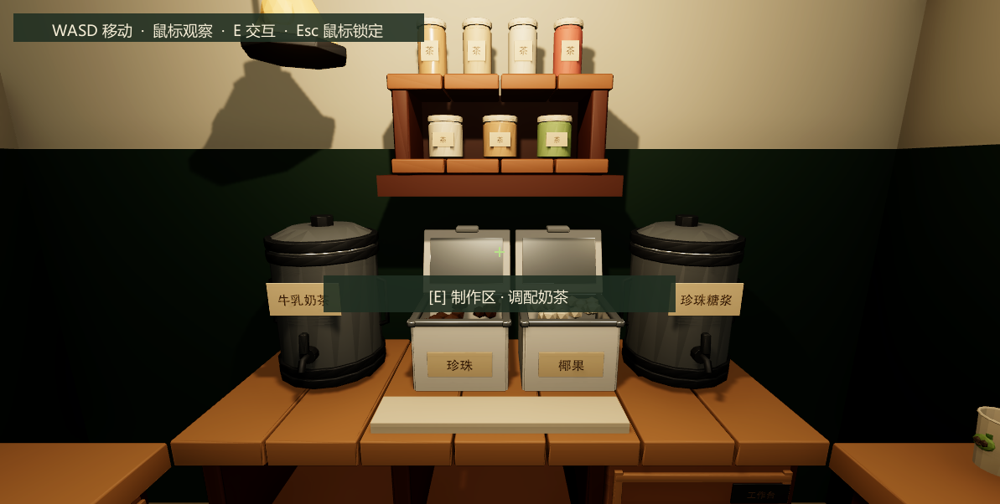
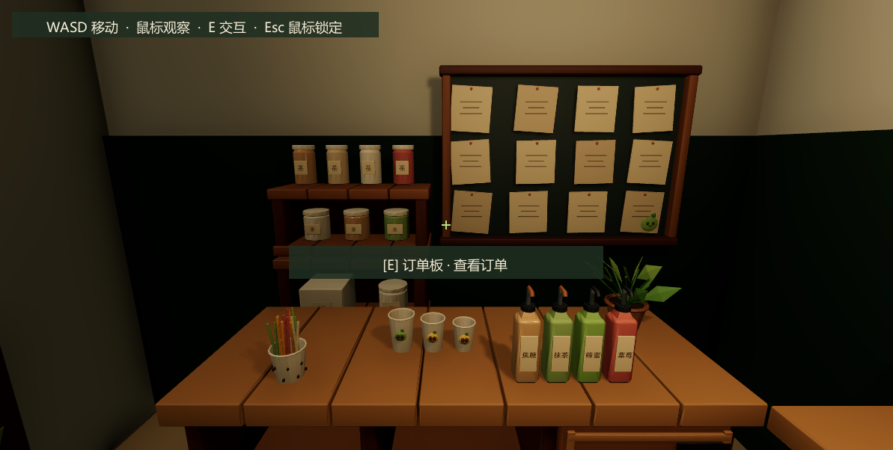
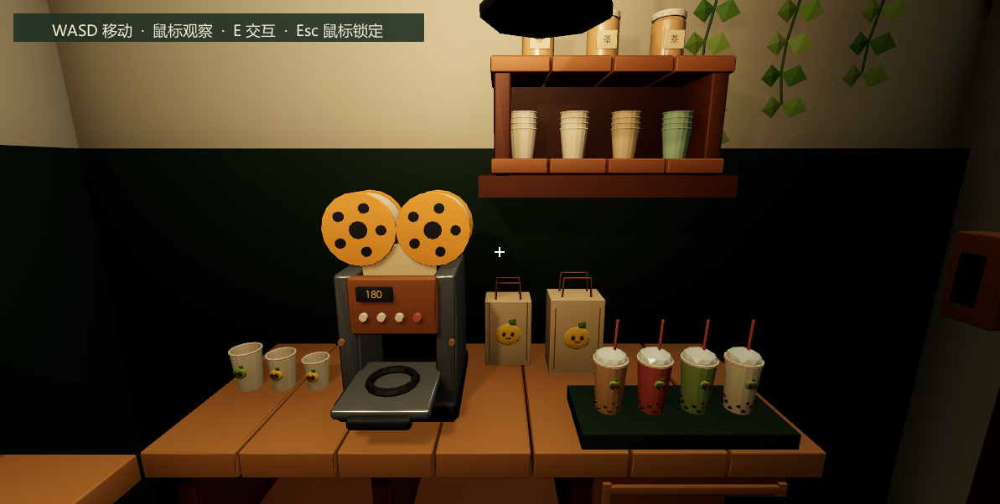
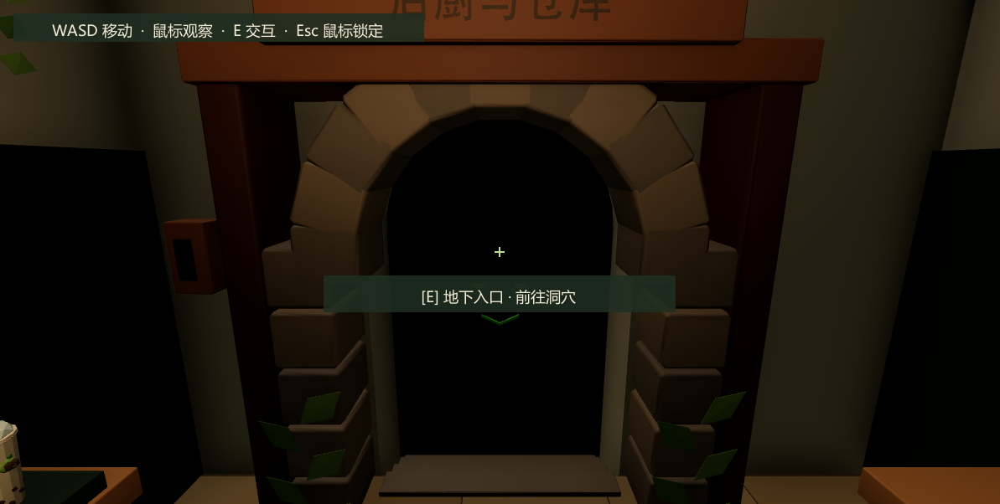

# 第一人称奶茶工作站交付

打开 **`Assets/Scenes/BussinessWorkstation.unity`** 后进入 Play Mode。WASD 移动，鼠标观察，E 交互，Esc 释放或恢复鼠标。Unity Editor 当前已打开这一独立场景；原 `Bussiness.unity` 保留用于对照。

## 问题与最终布局

旧版本虽然缩小了房间，但制作、封杯沿单面墙排列，仓储在另一侧，中央地面仍承担找设备和往返的用途。本次以玩家站位组织设备，复用三张现有工作台组成 U 型，去掉独立顾客区、店门展示区与宽走道。

- 主空间净尺寸约 **3.65 × 3.55 米，约 13 平方米**，净高 2.85 米；洞口后保留约 0.56 米深的封闭阶梯凹室。
- U 型台内侧净宽约 **1.78 米**。保留 CharacterController 高 1.8 米、半径 0.28 米、skinWidth 0.025 米，模型与房间根节点保持原米制比例。
- 玩家位于 `(0,0.025,-0.05)`，朝 +Z；眼睛相对脚底高 1.6 米，世界眼位约 1.625 米，初始俯角 12°，FOV 65°。台面高 0.9 米。
- 正前方是两种茶底、小料、调配垫与原料搁架；左侧是订单板、仓储架与备料瓶；右侧是封杯机、空杯、包装袋、出杯托盘和墙面杯架；后方是地下入口。
- 参考用户后补图片，加入少量盆栽、藤蔓、吸管、墙面收纳和第二盏暖色吊灯。制作主光较强，侧台补光较弱，维持深绿色与暖木色。

关键物体落位如下，坐标为米：

| 对象 | 位置 (X,Y,Z) | Y 轴朝向 |
|---|---|---:|
| 正前工作台 | (0,0,1.22) | 0° |
| 左工作台 | (-1.2275,0,-0.006) | -90° |
| 右工作台 | (1.2275,0,-0.006) | 90° |
| 订单板 | (-1.86,1.12,0.55) | -90° |
| 仓储柜 / 上方收纳架 | (-1.75,0,-0.50) / (-1.75,1.125,-0.50) | -90° |
| 封杯机 | (1.20,0.90,0.25) | 90° |
| 出杯托盘 | (1.03,0.922,-0.55) | 朝玩家侧 |
| 地下门模型 | (0,-0.28,-1.695) | 180° |

台面接缝依据 Blender 原模型 Worktop 尺寸微调，没有整体缩放设备。地下门保留已修正的地面锚点、墙体门洞、下行阶梯和洞内阻挡，门框没有浮空。

## Game View 检查与局部修正

以下四张均为 Unity **Play Mode 的实际 Game View 截图**，使用同一个出生位置，只有视角朝向变化，包含现有准星和交互提示。

| 方向 | 第一人称视觉判断 |
|---|---|
| 正前 | 茶桶、小料和调配垫占据中央主要区域；准星直接显示制作提示。小料目标归一化屏幕位置约 `(0.515,0.487)`，接近画面中心。 |
| 左侧 | 订单板完整可见，仓储架和原料瓶在近距离范围；移除了曾遮住订单下沿的高杯架。 |
| 右侧 | 封杯机操作面朝玩家，空杯、包装与出杯托盘同屏；上方杯架和暖光提供收纳层次，不遮挡操作设备。 |
| 后方 | 石拱、洞口、下行台阶及地下提示可见。原模型木牌保留“后厨与仓库”文字，上沿在默认俯视角中有裁切；识别入口不依赖该木牌。 |

截图后的修正包括：降低前方原料架的位置，使其进入默认视野；移走遮挡订单板的杯架；移开与收纳架视觉重叠的吊灯；拉远主灯，减少原料罐过曝；将侧台轻微前移并调整横向位置，接上 U 型转角；最后加入参考图中的近距离收纳与小道具。最终画面没有大块空地进入主要操作视野，制作循环无需跨房间行走。

## 交互与验证

复用现有 `ShopFirstPersonController`、`ShopRaycastInteractor`、`ShopStation` 和 `ShopSceneBindings`。六个稳定 ID 保持为 `PreparationStation`、`OrderBoard`、`StoragePoint`、`SealingStation`、`DeliveryPoint`、`DungeonEntrance`；继续通过 `StationRequested` 与 Inspector UnityEvent 接入系统。没有把物品逻辑加入玩家控制器。

- 最终收纳与灯光调整后，**13 项原地检查通过**：出生中心射线，以及六个站点各一次射线识别、E 键反馈和场景事件。期间玩家 XZ 位移不超过 5 毫米；站点瞄准俯角约 1.5°–20.4°，无需大幅低头或后退。
- U 台接缝调整后，**8 项移动／碰撞检查通过**：七个连续 WASD 路径点覆盖 U 台内侧、左右站位、返回操作中心与地下门前，以及地下边界阻挡。之后加入的参考图装饰不带 Collider，未改变这些移动边界。
- 四向截图经过实际目视检查，物体、灯光和构图的判断不是仅依据脚本执行结果。
- 无缺失脚本、材质或站点引用；Scene 与环境 Prefab 已保存，Play Mode 已退出。临时检查脚本与测试输入设备已移除，后台输入设置已恢复；收尾编译完成，Unity Console 无错误。
- 检查通过临时 Editor 脚本控制观察朝向、注入 W / E 输入；移动由现有 FPS Controller 处理，没有通过传送完成路线。没有执行完整构建。

记录：[原地交互检查](milk-tea-workstation/stationary_checks.txt)、[移动与边界检查](milk-tea-workstation/movement_checks.txt)。

本次通过已配置的 Unity MCP stdio 服务查询现场、执行布局菜单、更新 Prefab、进入 Play Mode、读取 Console 并保存场景。原场景快照另存于忽略目录 `Logs/MilkTeaWorkstation/before_redesign.unity`。

当前制作、订单、仓储和洞穴交互仍是原有占位反馈与事件接口。完整制作流程、订单状态、扣料、金币与洞穴场景加载没有在本次空间重设计中实现。

## 文件与人工验收

| 文件 | 内容 |
|---|---|
| `Assets/Scenes/BussinessWorkstation.unity` 及 `.meta` | 独立可试玩场景、第一人称配置和六站点绑定 |
| `Assets/Prefabs/BussinessShop/milk_tea_workstation_room.prefab` 及 `.meta` | U 型工作台、设备、围合、灯光、碰撞和点位 |
| `Assets/Art/Materials/BussinessShop/workstation_deep_green.mat` 及 `.meta` | 本场景独立的深绿色材质 |
| `Assets/Editor/MilkTeaShop/MilkTeaWorkstationLayout.cs` 及 `.meta` | 显式创建独立场景与添加参考收纳的菜单，不在 runtime 重建布局 |
| `docs/MilkTeaWorkstation.md`、`docs/milk-tea-workstation/` | 报告、四向 Game View 截图及两份检查记录 |

原 `Bussiness`、地下城场景、现有玩家 Prefab、模型资源、输入资产和共享玩法代码没有修改。

1. 在出生点前后左右观察，对准六个站点按 E，确认能原地完成全部交互。
2. 在 U 型台内侧移动、转身并走到地下门槛，确认正常碰撞与镜头距离。
3. 检查制作区亮度、左侧订单可读性及右侧封杯操作面，按个人习惯确认视角与鼠标手感。
