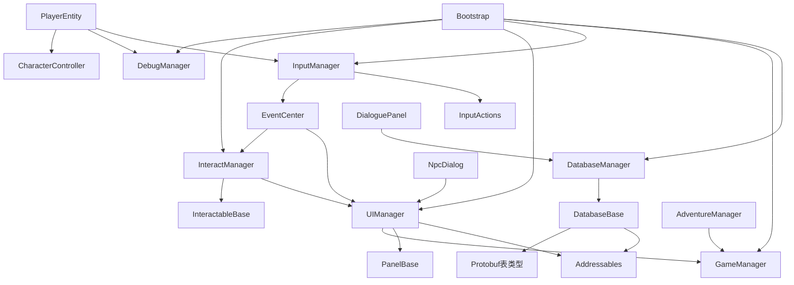

# Untitled 架构审查与 P1 几何去重

本轮以实际源码为依据，完成六个 Demo 的几何算法提取；运行时发现的问题列为后续独立步骤。目标是保持现有行为，不改玩法、资源布局或场景组装方式。

## 项目与代码边界

- 项目版本已由 `ProjectVersion.txt` 和 Package 清单核实：Unity 2022.3.62f3c1、URP 14.0.12、Input System 1.14.2、Addressables 1.22.3。
- `Assets/Scripts` 是运行时自研代码，包含 Core、Data、Gameplay、UI、Debug、Levels；`Assets/Editor` 是场景制作和资源编辑工具。
- `Assets/Scripts/Data/Generated` 是 protoc 生成代码；`Assets/Input/InputActions.cs` 明确标记为 Input System 自动生成。输入源为 `.inputactions`。
- `Assets/StylizedWater2`、`Assets/TileWorldCreator`、`Assets/TextMesh Pro`、`Assets/Plugins` 下的外部库和 `Packages` 下的依赖属于第三方边界。本轮未修改第三方、生成代码或 Package。
- README 的经营 / 冒险循环是目标玩法。实际 `AdventureManager` / `BussinessManager` 仍含结算 UI、进入下一阶段的占位注释，不能据 README 推断流程已经接通。
- README 的“目前只有 Item 一张表”已落后于源码：`DatabaseManager.Initialize` 还注册 Bubble、Dialog、DialogOption。本轮以实际注册链为准。

## 实际依赖

`Bootstrap.Awake` 按 Database → Game → Input → UI → Interact → Debug 初始化纯 C# Manager。`ManagerBase<T>` 只保存静态实例。Input 将 ESC、交互和滚轮输入转成全局事件；UI 用面板栈控制 `GameManager.SetPaused`；Interact 检查 UI 栈再调用交互对象。Database 同步加载 Addressables 二进制并建立内存索引。Gameplay 的移动、交互、对话和冒险结算分别使用这些服务。

Levels/Cave 负责地图、出生点及洞穴专属行为；`CaveLevelEntry` 通过 Inspector 引用地图和 CharacterController。CameraController 通过目标 Transform 跟随；渲染组件负责视觉，不属于几何生成链。本轮没有调整这些运行时依赖。

## 重复代码核实

比较时移除空白，并排除外层 Builder 类型名称；同时逐个比较方法体。

| 方法 / 数据结构 | 实际结果 | 本轮处理 |
| --- | --- | --- |
| vertices、normals、uv、按 int 排序的 triangles | 六份一致 | 由公共构建器持有 |
| Face、Box、Beam、Lathe、Ring、Rock、ToMesh | 六份方法体完全一致 | 提取为一份 |
| SectorSide | Casino、Tavern、Training、ElderRoom 四份一致；其余两份没有 | 提取算法，保留原有入口范围 |
| RoundPlanks | 上述四份一致，但包含 Oak / OakLight / OakDark 材质策略 | 公共算法接收三个材质槽，适配层传入本场景枚举值 |
| Bolt | 上述四份一致，但固定使用本场景 Iron | 留在四份适配层，仍调用 Rock |
| Finish、palette、家具尺寸与布局 | 场景定义不同；Kitchen / RitualHall 的材质编号与其他场景也不同 | 保留在各自 Builder 中 |

不存在六套不同的 Box 或 Rock 算法。此前的重复结论在这些方法上成立，但不能把场景材质枚举、布局和资源保存逻辑一起强行合并。

## 重构后的职责

`Assets/Editor/Geometry/ProceduralMeshGeometry.cs` 是独立、密封的 Editor Mesh 构建器：

- 接收几何参数和 int 材质槽，不引用任何 Demo Builder、场景路径、AssetDatabase 或 palette。
- 只负责累计顶点、法线、UV、三角形，并生成 Mesh。
- `UsedMaterials` 与 `ToMesh` 都按同一 SortedDictionary 顺序输出，继续匹配各 Builder 的 `palette[i]`。

六份 `*DemoGeometry.cs` 保留原有私有 Geometry 类型，通过组合调用公共构建器。现有家具和场景代码继续使用同样的 Finish、方法签名、可选参数和调用方式。这里保留少量转发，是为了维持各场景的材质类型边界；无需泛型材质注册、公共材质枚举或 Builder 继承树。

`partial class` 对同一个 Builder 的 Furniture、Scene、Layout、Shell、Presentation、PixelProps 文件拆分是合理的：这些文件共享场景配置，完成同一次离线制作流程。问题是把跨场景的算法也当作每个 Builder 的私有实现复制。此次将算法移出 partial，保留场景组装职责。Tavern 的主文件还包含较多家具制作方法，可在后续确有维护需要时按职责拆文件，本轮没有为文件数量继续拆分。

## 兼容性与验证

- 六份已有脚本及其 `.meta` 路径和 GUID 保留；没有更改序列化字段、MonoBehaviour 类型、材质枚举数值或运行时脚本。
- Face 的去重、退化面过滤、法线朝向、扇形三角化、UV 投影和 `0.55f` 缩放均保持原算法。
- 倒角限制、旋转、分段数、Rock 的 seed 公式、圆木板裁剪及间隙均保持原算法。
- `ToMesh` 继续在顶点数超过 65535 时使用 UInt32，其余使用 UInt16；子网格保持按材质编号排序。
- 没有调用 Demo Build、重新保存场景或重新生成 Mesh / 材质 / Prefab。原有已保存资源继续作为运行时来源，工作区已有的其他地图修改不属于本提交。

已完成 Unity C# 编译，并在现有 Editor 中确认公共类型已加载。使用改动前六份 Geometry 的独立基线，与改动后的六份适配层执行 **96 组 Mesh 成对比较**，全部通过。比较包含 Mesh 名称、indexFormat、顶点、法线、UV、bounds、材质槽及每个子网格的三角形索引；向量数组采用精确 Equals 比较。

覆盖空网格、默认 / 零 / 截断倒角、零尺寸、斜梁 / 零长度梁、带尖端 profile、旋转 Lathe / Ring、seed 岩石、混合材质与大网格；四个具备扩展方法的 Builder 额外覆盖 SectorSide、Bolt、RoundPlanks。测试仅创建临时内存 Mesh，结束后销毁，没有写入资源。基线与验证代码放在系统临时目录，没有向项目加入验证框架。

未执行 Play Mode 试玩或完整构建，也未验证全部家具生成路径；96 组精确对比用于证明已覆盖输入的算法兼容性，场景画面和交互仍由人工确认。

## 后续独立步骤

以下是实际代码问题或明确的触发路径，不属于本轮几何重构。

| 优先级 | 源码证据与触发条件 | 影响及下一步 |
| --- | --- | --- |
| P1 | Bootstrap 只有 Awake 注册；ManagerBase 没有清理和静态重置；InputManager 没有 Dispose / 成对退订；UIManager、InteractManager 订阅 EventCenter 后不退订，EventCenter 也没有静态清理入口 | 同一运行期重复 Bootstrap 会保留旧订阅和已启用的 InputActions；关闭 Domain Reload 后需进一步验证静态残留。先明确跨场景服务所有者，再添加幂等初始化和对称清理，分别测试正常进出 Play 与重复初始化 |
| P2 | UIManager.Open 在 ExecuteShow 后无条件 MoveToTop；DialoguePanel.OnShow / ShowNode 在无请求或无节点时调用 Close(this) | 面板自行关闭后仍可能被加入 stack，导致已隐藏面板保留 Top / 暂停状态。应单独处理 Show 期间的关闭与重入，并验证无效请求和缺失节点路径 |
| P2 | AdventureManager.EndAdventure 每次都调用 SettleItem，没有完成状态保护，也没有消费结算后的 packageData | 同一轮重复调用会重复增加仓库物品。先明确冒险状态与结算调用方，再对“一轮只结算一次”增加保护及针对性测试 |

已确认 EventCenter 具有参数签名检查、派发列表快照和单个处理器异常隔离；不能再把这些能力缺失当作当前问题。当前尚无实际性能测量支持，未引入池化、缓存框架或修改几何浮点运算来做推测性优化。

## 人工验收

1. 在 Unity Console 确认此次刷新没有 C# 编译错误。
2. 用原有 Open Scene Demo 菜单打开六个已保存 Demo，确认家具材质、轮廓和摆放正常，无需删除或重建资源。
3. 任选一个场景进入 Play Mode，确认原有移动、碰撞和交互表现正常。
