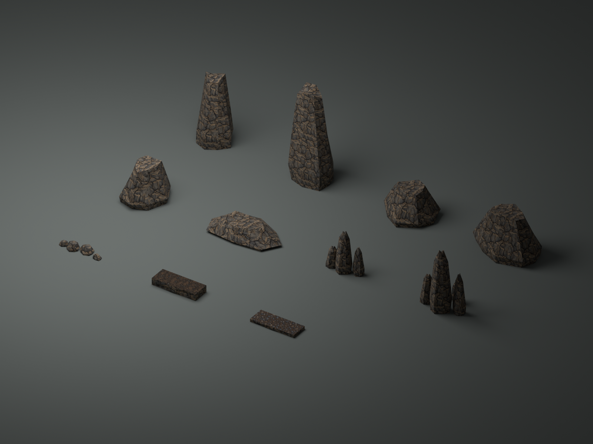
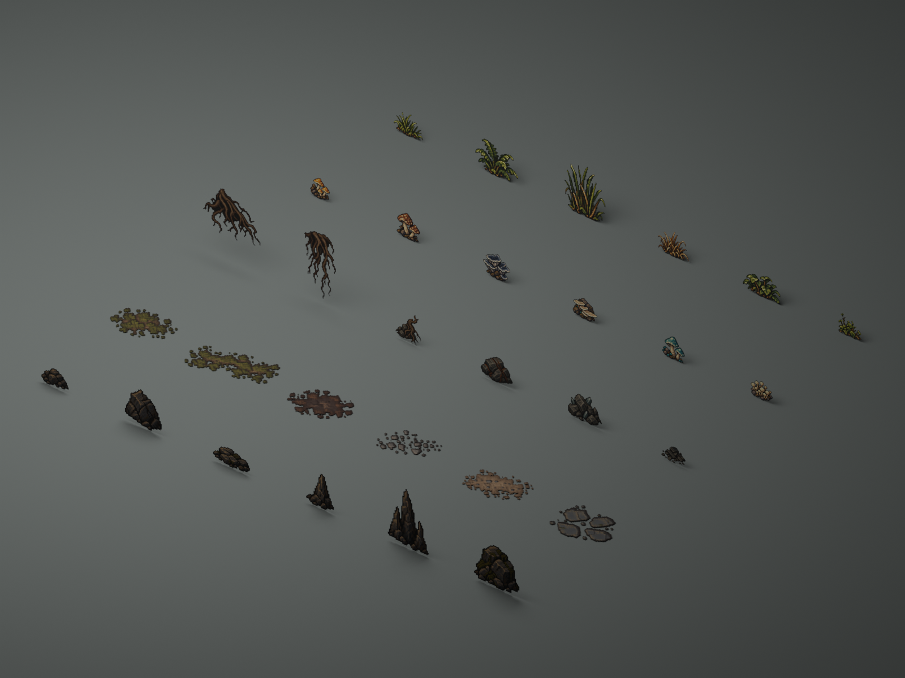

# 洞穴细节素材

本批补齐中优先级场景资源：11 个有碰撞的立体模块，以及 30 个可直接摆放、不挡路的像素装饰。沿用最新两轮的 `TerrainBasic` 地形贴图与 `CaveBasics` 图集，没有修改原图、图集导入设置或已有地图。

- Prefab：`Assets/Prefabs/Terrain/CaveDetails/`
- Mesh：`Assets/Art/Models/CaveDetails/`
- 独立装饰材质与碎石材质：`Assets/Art/Materials/CaveDetails/`
- 展示场景：`Assets/Scenes/Props/CaveDetailGallery.unity`

## 立体模块

| 文件名（省略 .prefab） | 用途与初始尺寸 |
| --- | --- |
| `cave_rock_pillar_01` / `02` | 高约 6 / 8 的独立岩柱；用于大洞窟的体量、路线分隔和地标 |
| `cave_large_boulder_01` / `02` / `03` | 三种不规则大岩块，高约 2.6 / 3.7 / 3.1；不同长宽与偏斜轮廓 |
| `cave_rock_slab_01` | 宽约 6、高约 1.2 的扁岩体；作局部围岩或背景岩层 |
| `cave_stalagmite_cluster_01` / `02` | 三根 / 四根石笋组合，最高约 3.5 / 5.2；保持实体厚度 |
| `cave_cliff_foot_rubble_01` | 长约 4 的崖脚碎岩带；遮住墙底接缝、打破规整边线 |
| `cave_cliff_top_lip_01` | 宽 4、深约 1.5 的崖顶岩土边；根节点位于顶面，向下厚 0.6，土顶与岩侧分材质 |
| `cave_river_gravel_edge_01` | 宽 4、深约 1.5、高 0.25 的低岸碎石边；碎石顶面与岩侧分材质 |

除崖顶边的顶面 pivot 外，其余模块以底部为 Y=0。岩体尺寸包含自然起伏，表中尺寸是布置参考。MeshCollider 使用实际网格、非 Convex，无 Rigidbody；石笋和碎岩组合由多个封闭岩体组成。岩柱和大岩体的轮廓需要在最终游戏镜头下判断遮挡。

## 原图集整理为独立装饰

每个物件有独立 Mesh、材质和 Prefab，材质用 `_FrameRect` 引用原图集的一块区域。根据 alpha≥0.45 的轮廓确定范围，沿透明行列分隔，不按机械等分格截断物件；原图无需裁切或切换 Sprite Mode。像素面片复用已有 `HD2D Pixel Prop` Shader，参与 3D 受光、深度与透明裁切，没有新增 runtime 行为或逐帧脚本。

| 图集 | Prefab 名称（均加 `cave_` 前缀和 `_01.prefab` 后缀） |
| --- | --- |
| 草与蕨 | `grass_tuft`、`fern_clump`、`river_reeds`、`dry_grass`、`leaf_clump`、`moss_weeds` |
| 蘑菇 | `mushroom_ochre`、`mushroom_brown`、`fungus_slate`、`fungus_bracket`、`mushroom_teal`、`mushroom_cream` |
| 根须与矿石 | `roots_tangled`、`roots_hanging`、`rooted_stone`、`iron_ore`、`crystal_rock`、`slate_rubble` |
| 地面斑块 | `moss_patch`、`moss_strip`、`wet_mud_patch`、`gravel_patch`、`dry_dirt_patch`、`stepping_stones` |
| 岩石细节 | `small_rocks`、`fractured_rock`、`river_stones`、`short_stalagmite`、`stalagmite_sprites`、`mossy_boulder` |

- 30 个装饰均不带 Collider，显示与通行分开。矿石和蘑菇只是外观资源，没有采集或交互逻辑；需要阻挡时由关卡明确添加 Collider。
- 立面装饰的视觉朝向固定，正面朝 -Z，不自动跟随相机。地面装饰平放于 XZ，面朝 +Y，视觉面位于根节点 Y+0.025，减轻与地面重合的闪烁；它们没有厚度，也不投射阴影。
- `roots_tangled`、`roots_hanging` 是顶部中心 pivot，根须向 -Y 延伸；其他立面物件采用底部中心 pivot。摆放根须时把根节点放到悬挂点。
- 立面高度初始约 0.7～2.8；地表斑块宽约 2.2～3.4。根节点统一 Scale=1，后续按角色比例整体缩放。原图分辨率与 PPU 不决定这里的世界尺寸。
- 地面斑块用不规则透明边缘覆盖泥土、碎石与苔藓接缝，是局部覆盖，不会自动混合 Terrain 材质或沿坡面贴合。在斜坡上需手动调整面片朝向与高度。
- 图片中的像素高光、配色与少量低 alpha 边缘沿用原图；材质裁掉低于 cutoff 的区域，不引入额外发光。

## 使用与编辑

展示场景按六列排列：前 11 件是立体模块，随后按上表顺序摆放五组装饰。根须样例悬挂在 Y=3。场景只展示资源，不包含玩家或交互系统；所有位置保存在 Scene。

`tools/art/cave_medium_assets.blend` 保存独立可编辑网格、两组预览设置和打包贴图。制作源是 `tools/build_cave_medium_assets.py`，复用上一批的网格序列化函数，但只导出本批资源与新展厅，不重建上一批模块或地图。已有导出物经手工编辑后，不应直接重跑制作源覆盖它们。

已检查立体网格封闭、面朝向、非退化三角面、顶点与索引缓冲、装饰 UV 范围、图集引用和碰撞配置；生成并查看 Blender 预览。没有新增 C#，未运行 Unity Editor 导入、Play Mode 或构建。实际 URP 受光、轮廓裁切和碰撞通行仍需人工验证。

1. 打开 `CaveDetailGallery.unity`，确认 11 件岩体和 30 件独立装饰正常显示，尤其检查根须和蘑菇是否完整、背景是否裁切。
2. 从 `CaveDetails` 拖入地图：崖脚碎岩遮墙底，崖顶边对齐地面 Y，地表斑块略高于地面；用实际镜头判断颗粒大小与岩柱遮挡。
3. 用真实 Player 接近岩柱、岩块和石笋，确认实体阻挡；经过草丛、菌类及地表斑块，确认它们不改变通行。
