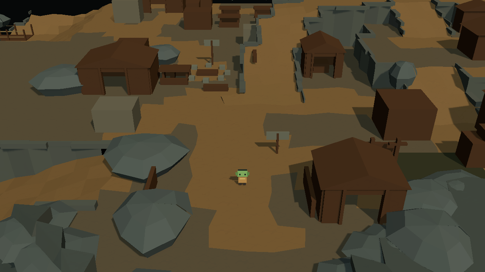
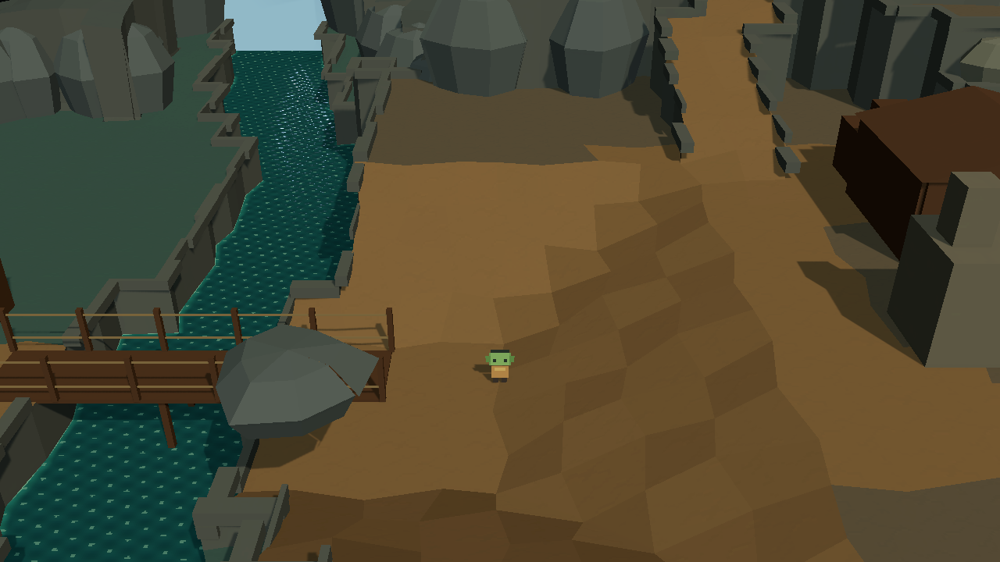
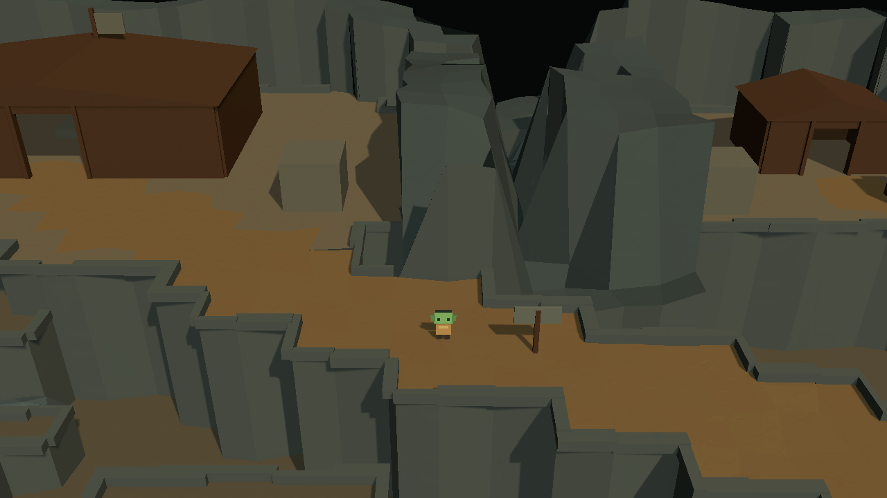

# 哥布林洞穴整图改造：多路线潜入与固定镜头探索

日期：2026-10-12。版本：V5。阶段：地图制作与静态构图检查。

实施场景为 `Assets/Scenes/CaveHD2DLocal.unity`。本轮在现有功能占位上整理路线、建筑边界、分散掩体与观察落脚面，使用自然洞穴聚落的空间组织。

**整图空间改造已制作，并完成 Edit Mode 静态构图检查；未经试玩、通行、感知或性能验证。** 静态截图只记录三个代表位置的画面，不能证明整条路线可以行走或潜行成立。

## 1. 设计依据与保留项

体验目标为「看到方向线索 → 观察与选路 → 穿越暴露段 → 到达遮挡 → 继续探索或撤退」。

《合金装备》的公开手册说明，被发现后可以逃跑或躲藏，失去玩家视线后会搜索失去目标附近。本项目据此预留转角、分散遮挡与返回环路，没有接入这些敌人行为。[官方潜行手册](https://www.konami.com/mg/mgs5/gz/webmanual/xb1/ja/p0060.html)

《八方旅人 II》开发者说明，探索使用固定镜头，并尽量让玩家想去的地点出现在同一画面内。本项目采用分段显露目标与接近路线的方式，不要求入口与真实大厅同屏。[开发者访谈](https://www.unrealengine.com/developer-interviews/octopath-traveler-ii-builds-a-bigger-bolder-world-in-its-stunning-hd-2d-style?lang=en-US)

路线、间距和具体摆放是本项目的设计推导，不是两部作品的原始关卡参数。原 [2D 功能图](images/cave_functional_plan_reference.png) 保留功能种类，[三级台地图](images/cave_settlement_reference.png) 提供区域关系，均不作为精确施工尺寸。

保留河谷、三级台地、现有角色尺度、五处住宿棚屋、四块种植床和两座桥。每格为 2 世界单位，低岸 `-4`、主层 `0`、住区 `2.4 / 4.8`、大厅与长老台地 `7.2`；水面、河床、灯光与后处理设置沿用原配置。

## 2. 本轮区域改造

坐标采用当前 LayoutGrid，第二轴向南侧增加。

| 区域 | 保存的改造 |
| --- | --- |
| 入口与军营 | 保留 `(40,50)` 入口和东侧军营。侧岩与栅栏收拢前场两翼，并避开军营门口；中央留进出空间，以火塘方向标识引导前进。 |
| 火塘与公共区 | 火塘保持 `(38,38)`，桌凳形成不完整围合。酒馆整体移到 `(33.5,39.5)`，外部桌组一起移动，释放东南换路空间；石圈使用现有较亮石材并增加集合标识。 |
| 仓库与卸货庭院 | 仓库保持 `(53,45.8)`。外围货垛移到坡口侧边，前门、侧路与回入口连接分开；卸货场边缘使用短围栏。 |
| 厨房与宴会 | 厨房保持 `(33,23)`，桌组集中在东侧。炉体移动至 `(31.1,26.8)`，占地 `4×3` 世界单位，高度 `3.4`；烟囱放在炉体靠桥一侧，作为先显露的方向线索。 |
| 住区与赌场 | 赌场整体移到 `(44.5,37.5)`。五处棚屋保留，前街通过两条上坡连接接到后巷与折返坡；建筑与掩体避开坡口。 |
| 折返坡与大厅 | 保留原高度曲线和大厅 `(42.5,9.5)`，整理正面前场与西侧接入，入口侧岩肩与方向标识组织局部层次。 |
| 长老支路 | 私库保持 `(63.5,10.5)`，独立台地和支路保留；与大厅的轮廓、入口方向在接近阶段分别显露。 |
| 河岸与工坊 | 两座桥、四块种植床和工坊保留，加入少量外侧岩肩和供给方向标识。供给桥东岸登坡延长过渡，使低岸角色与下一段坡面在静态镜头中可见。 |

西侧低地与东侧主层的闲置外沿做小范围收边；不扩大整图。岩肩集中在区域边缘和转角，近侧保持低矮、分段，后方岩体继续承担洞穴体量。

普通建筑的入口柱框移到门洞外侧，保留 `2.4` 世界单位的净开口，大厅净开口为 `3.2`。这些是保存的几何尺寸，尚未做角色通行测试。

## 3. 路线与空间职责

- **东侧主路：**入口 → 火塘东侧 → 住区前街 → 上坡连接 → 折返坡 → 大厅正面。公共区与前场较开阔，棚屋转角提供局部遮挡。
- **西侧供给路：**入口附近桥头 → 左岸工坊 → 供给桥 → 厨房后侧 → 西侧供给坡 → 大厅侧面。转角较多，两座桥保持开放穿越段。
- **换路与撤退：**火塘—厨房、火塘—住区坡口、仓库—入口，以及住区前后巷环路。返回入口不必经过大厅目标区域。

正式地面材质重新描出这些连接，物件与建筑缺口表达边界；观察标记只负责定位设计位置。主坡约 `6.4`、供给坡约 `4.8` 世界单位宽度沿用原基线，住区通巷以至少 `2.4` 的净宽为摆放约束。

桥头、坡口和转角以至少约 `3×4` 世界单位的落脚空间为制作目标，掩体放在侧边。分散掩体之间以约 `6–10` 世界单位的开放段为摆放起点，不沿整条路线铺连续遮挡墙。这些设计间距没有通过动态通行或感知验收。

入口先显露火塘及方向标识，供给桥附近先显露登坡和炉体烟囱，上坡过程中再显露大厅和私库。厨房完整体块随着接近逐渐进入画面。

不标记安全位置、发现概率、穿越时间窗口或隐蔽系数；没有守卫、巡逻、感知、导航、任务、战斗或其他新增 runtime API。

## 4. 相机与保存

Cinemachine `2.10.7` 配置保持不变：Perspective、Pitch `30°`、Yaw/Roll `0°`、FOV `34°`、Camera Distance `32`、Tracked Object Offset `(0,1.6,0)`、Screen X/Y `0.5/0.6`。三轴 Damping `0.25`；Dead Zone Width/Height `0.05`、Depth `0`；Soft Zone Width/Height `0.8`、Bias `0`。

Body 为 Framing Transposer，Aim 为 Do Nothing，Follow 玩家根节点，Look At 留空；Brain 两项更新方式均为 Late Update。旧 `CameraController` 保持禁用并保留目标引用，不新增 Confiner、变焦、旋转、震动或碰撞绕行。URP、Volume 与 `CaveWallReveal` 引用保留。

Floor/River Tilemaps 与 `CaveElevation` 是正式布局及高度来源。局部收边与桥头登坡写入该数据，再由现有保存机制更新本地派生网格；河格及其高度保持原数据。

手工建筑保存在 `Landform/MapProduction`，五处棚屋和部分旧掩体在 `StealthBlockout`。新岩肩、短围栏与方向标识位于 `15_SpatialConnections`。旧 `Architecture` 与 `PlacedProps` 保持隐藏。

普通保存与当前场景的 `Rebuild Scene Geometry` 保留手工编辑；不要使用 `Replace With Terraced Settlement Layout` 刷新，它会替换正式布局。本轮没有新增通用 Editor 框架。

## 5. 静态检查记录

在 Unity Edit Mode 使用保存的 Main Camera、Cinemachine pipeline 和 URP 输出 `1280×720` 画面。临时定位玩家后恢复出生位置与相机状态，截图位置未保存进正式场景；没有进入 Play Mode 或执行物理通行、敌人感知与性能测试。

| 检查组 | 定位点 | 静态结果 |
| --- | --- | --- |
| 入口与火塘 | `(40,48.5)` | 角色与入口中央可见，火塘方向、公共区转角及军营门口可辨认；仓库侧连接向画面右侧延伸。 |
| 供给桥东端与厨房 | `(24,25)` | 低岸角色、桥头与登坡可见，烟囱提供厨房方向线索，完整厨房位于画面右侧接近方向。 |
| 住区上坡与大厅接近 | `(53,19)` | 角色与当前坡段可见，大厅在左、私库在右，中间岩体区分两处目标，接近方向分别显露。 |

静态检查中发现并修正了桥头角色被主层边缘遮挡、军营入口与原侧岩/栅栏重叠的问题。只复查受相关修改影响的画面。

地图资源与文档分别创建本地 commit，不自动 push。当前已打开的 Unity 场景需要重新加载磁盘上的保存结果。本轮保留亮洞口材质的已有修改，不将其纳入提交。

**整图空间改造已制作，并完成 Edit Mode 静态构图检查；未经试玩、通行、感知或性能验证。** 后续根据人工反馈单独安排路线验证与玩法接入。
