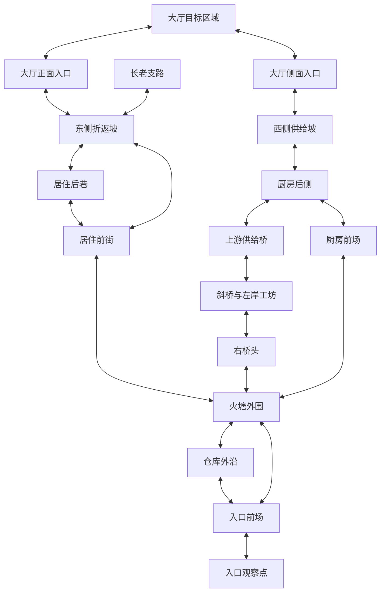
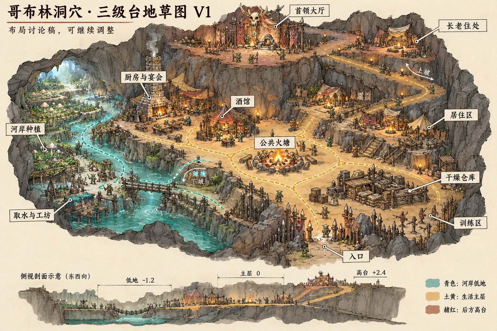
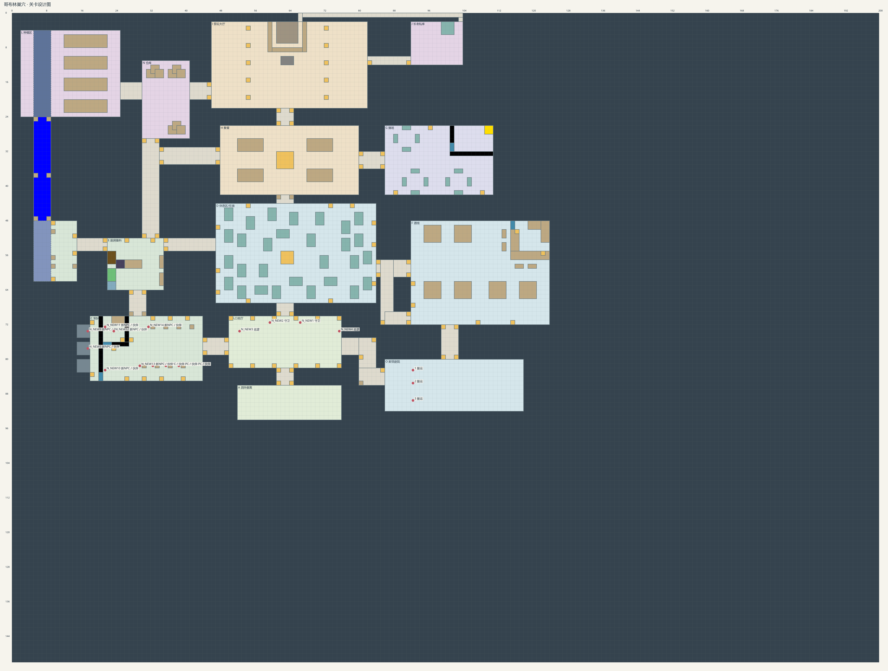
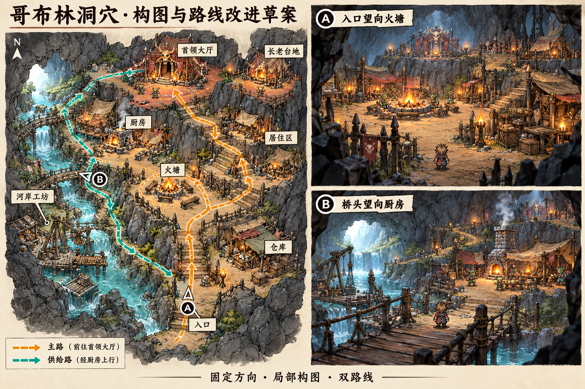

# 哥布林洞穴 HD-2D 改造方案：八方旅人构图与合金装备潜行

整理日期：2026-10-11。版本：V2。状态：设计草案，尚未实施。

本文用于后续分步改造地图、镜头和场景摆放。核心方向是保留「左侧河谷—中央生活区—后方首领高台」的骨架，用八方旅人的固定镜头组织目标、路线与空间层次，用合金装备的观察、感知反馈、失去视线后的搜索与多种潜入方式组织行动选择。最终效果从 Game Camera 判断，不能只看俯视布局或整张聚落展示图。

地图的基本体验为「观察 → 选路 → 穿越暴露段 → 到达掩护 → 判断目标与撤退方向」。目标是紧凑、可读、可重新选择路线的洞穴聚落，不把地图扩大为开放世界，也不要求一次实现合金装备的全部系统。

## 1. 依据与使用范围

- [HD-2D 场景开发经验](hd2d-scene-development.md)：尺度、固定镜头构图、自然地形、光照与后处理的依据。
- [本地 V6 地形记录](cave-hd2d-scene.md)：现有场景、路线、高度与编辑保存方式。
- [道具素材与使用边界](placeable_props.md)：已有资源、固定方向面片与碰撞边界。
- 用户提供的三级台地概念图与 2D 功能平面图，以及本次生成的构图草案，见第 8 节。

《八方旅人 II》开发团队说明，探索时采用固定镜头，并尽量让玩家想去的地方出现在同一屏幕内。本方案将其应用为：当前画面应包含清楚的脚下路线、下一处落脚点和更远的目标线索，而非让整张地图始终出现在一屏中。[开发者访谈](https://www.unrealengine.com/developer-interviews/octopath-traveler-ii-builds-a-bigger-bolder-world-in-its-stunning-hd-2d-style?lang=en-US)

### 联网核实的资料与可借鉴内容

| 资料 | 资料实际说明的内容 | 本项目的应用建议 |
| --- | --- | --- |
| [八方旅人 II 开发者访谈，2023](https://www.unrealengine.com/developer-interviews/octopath-traveler-ii-builds-a-bigger-bolder-world-in-its-stunning-hd-2d-style?lang=en-US) | 固定探索镜头，尽量同屏展示玩家想去的地点；平面角色与 3D 背景、旋转镜头的协调有专门挑战 | 同屏组织角色、当前威胁、落脚点与远处地标，保留固定方向 |
| [Acquire 开发讲稿，2018](https://www.docswell.com/s/EpicGamesJapan/KXPWY5-UE4_UFE2018_ACQUIRE_OCTOPATHTRAVELER) | 包含尺度、前景透明、后处理、格子与模块地形制作经验，详见项目经验文档 | 地形高度、角色尺寸和镜头一起判断；遮挡处理服务可读性 |
| [KONAMI：Ground Zeroes 产品说明](https://eu-support.konami.com/hc/en-gb/articles/9666086938263-Metal-Gear-Solid-V-Ground-Zeroes) | 以 Camp Omega 为潜入目标，允许玩家选择任务执行方式 | 保留一个紧凑聚落、两个大厅入口和局部横向连接；借鉴行动选择，不复制开放世界规模 |
| [KONAMI：Ground Zeroes 潜行手册](https://www.konami.com/mg/mgs5/gz/webmanual/xb1/ja/p0060.html) | 敌人对声音作出反应；发现后可以逃跑或躲藏；失去玩家视线后搜索失去目标附近 | 路线同时提供观察与脱离视线的位置；搜索围绕最后已知位置，而非持续知道玩家坐标 |
| [KONAMI：Peace Walker 守卫反应与警戒阶段](https://metalgear.konami.net/manual/mc2/mgspw/xbox/en/page11.html) | 守卫沿路线巡逻，调查异常；警报、脱离视线后搜索、保持警戒与恢复正常有不同阶段；头顶图标表达反应 | 用明确反馈和恢复过程保证玩家知道为何暴露、如何继续 |
| [KONAMI：Peace Walker 潜入与声音方向提示](https://metalgear.konami.net/manual/mc2/mgspw/xbox/en/page10.html) | 提供可见性信息与声音方向提示；后者需要装备相应物件 | 固定镜头需要补足有依据的屏外威胁信息，不依赖玩家猜测背后发生了什么 |

上述资料能证实的是具体作品的公开行为与制作经验，并未公开一份可直接套用的完整地图施工规范。下文的观察点、威胁单元、跨线连接、守卫分布和时间窗口是结合这些资料作出的本项目设计推导，不应称为合金装备原版参数或开发团队的原始地图方案。不同合金装备作品的状态名称与规则不同，本方案不将它们拼成所谓系列统一算法。

镜头数值、布局调整和实施顺序均为本项目建议，不是原作官方参数。概念图表达设计意图，不作为精确尺寸、坡度、碰撞或光照配置。

默认实施对象为 `Assets/Scenes/CaveHD2DLocal.unity`；`CaveHD2D.unity` 与 `Cave.unity` 不随本方案自动改动。实施前重新核对当前场景状态和用户已有修改。共享 Prefab、材质与脚本的修改可能影响其他场景，局部表现优先使用本地场景对象和配置。

本次仅编写方案和保存参考图，没有修改地图、镜头或 runtime，也没有重新进行 Unity 试玩。V6 的既有验证记录不等于本方案已经通过验证。

## 2. 现有基础与保留项

本地 V6 已有两条通往大厅的路线、居住区前后巷、23 处实体掩体、两座桥和河岸防跌落边界。当前没有守卫巡逻、发现判定或声音诱导系统。原建筑与道具草稿目前隐藏，实体掩体占位独立显示；概念图中的完整建筑不能当作已实现内容。

优先保留以下基础：

- 左侧河谷、中央生活主层、右侧住区、后方大厅与右后方长老台地的相对关系。
- 东侧主路和西侧供给路分别进入大厅，不合并成唯一窄口。
- 居住区可双向绕行的前街、侧巷与后巷。
- 桥头落脚平台、坡道连通、有效出生点与河岸阻挡。
- 正式布局与派生显示分离，runtime 读取保存结果。

现有尺度以 Grid 每格 2 个世界单位、角色已确认的两倍显示尺寸为基线。高度保留低岸 `Y = -4`、主层 `0`、住区 `+2.4 / +4.8`、大厅与长老台地 `+7.2`；水面 `-6.2`、河床 `-7.4`。原三级台地概念图中的 `-1.2 / 0 / +2.4` 仅是早期示意，不能直接覆盖当前高度体系。

现有大厅前沿已包含短退台，后续应改善其可见轮廓与入口构图，不重复增加同样的结构。整体缩放、高度体系和角色尺寸不作为第一轮调整项。

## 3. 区域布局改造

| 区域 | 修改方向 | 游戏画面与体验目标 |
| --- | --- | --- |
| 入口 | 保留短段收紧的岩口；出口后露出火塘与远处大厅骨旗；栅栏和前景岩石主要放两侧 | 从压迫进入开阔，建立前进方向，角色与脚下道路清楚 |
| 公共火塘 | 火塘稍微偏离道路中心；长凳、柴堆和岩石形成不完整的半围合；外围保留通行 | 像生活场所，有停留与绕行位置，避免变成对称竞技场 |
| 厨房与宴会 | 厨房靠岩壁，桌椅集中一侧；后侧货垛和供给路相连，炉体不挡路口 | 从桥头能辨认厨房，靠近后能发现通往大厅的侧路 |
| 居住区 | 棚屋错位摆放，保留前街、侧巷和后巷；用门向、布棚和生活物件区别小空间 | 进入后逐步发现连接，各条小巷仍能双向通过 |
| 首领大厅 | 利用既有退台与岩肩打断大块连续崖面；整理入口平台与两侧接入点 | 远处有权威感，近处能理解上行路线，骨旗与门洞容易识别 |
| 长老台地 | 支路入口保留在上坡转弯处；让帐篷或特殊图腾先露出一部分 | 先发现目标，再寻找支路；主路无需经过长老台地 |
| 河岸与工坊 | 按种植、取水、制作、运送组织岸线；桥头留清楚落脚点 | 河岸有生活逻辑，桥成为可记忆的方向节点 |
| 仓库与训练区 | 仓库在入口右侧提供体块与货垛；训练区靠入口外围；避免堆满通道 | 两区可区分，同时保留进入公共区的视线与道路 |

2D 功能平面图用于保留区域关系，不直接照搬矩形房间轮廓。主路可以顺着岩体弯曲，区域边界局部收窄或退让；视觉岩面的凹凸优先放在通行边界外侧。自然化不能挤掉已可通行的小巷、桥头和坡口。

每个区域增加明确的潜行空间职责：入口岩口承担初次观察，仓库外沿承担入场绕行与撤退，火塘外围承担开阔穿越，厨房后侧承担绕过正面的侧路，住区承担小环路与转角脱离视线，大厅承担两个不同方向的最终接近。长老台地承担可选探索与局部观察，不能成为看见或控制全图的万能高地。

生活逻辑与守卫布置配合，但不等于每个区域都必须有敌人。普通居民与警戒守卫应能辨认，首个样板不同时引入复杂居民作息、群体报警和所有 NPC 的感知能力。

## 4. 路线差异与探索节奏

### 东侧主路

入口 → 火塘外围 → 居住前街 → 东侧折返坡 → 大厅正面。

主路宽、方向明确，可以较早看见大厅线索。维持现有约 6.4 世界单位的上坡主路宽度作为起点，不为摆放物件主动压窄。转弯处应看见下一段落脚面，避免整条坡道被屋顶或岩肩挡住。

### 西侧供给路

从主层经右桥头和原斜桥进入左岸工坊 → 上游小桥 → 厨房后侧 → 西侧曲折登坡 → 大厅侧面。

供给路更窄、转角更多，炉体、货垛和岩肩形成分段遮挡。沿用约 3 世界单位的供给桥宽度与约 4.8 世界单位的大厅侧坡宽度作为起点。保持独立大厅入口，不在终点与主路合并为单一瓶颈。

### 分段显露目标

| 观察位置 | 应看见的信息 | 可以暂时隐藏的信息 |
| --- | --- | --- |
| 入口出口 | 火塘、大厅骨旗或入口轮廓 | 长老支路、完整供给路线 |
| 火塘外围 | 住区上坡入口、通往厨房和桥头的方向 | 住区全部后巷 |
| 居住区转弯 | 下一段坡道、长老帐篷或特殊图腾 | 长老平台的完整摆放 |
| 桥头 | 厨房炉体、清楚落脚点、供给路入口线索 | 岩肩后的全部上行路线 |

若后续接入潜行，可让主路承担「开阔但暴露」，供给路承担「有掩护但观察受限」的选择。供给路不是默认安全路线。暗处、低矮装饰和高台不自动提供隐蔽效果；实际视线遮挡由可见地形与实体掩体承担。河岸与桥侧的不可见移动边界不应被当作守卫视线掩体。

### 两条大路线与局部横向连接

仅有两条从入口一直走到大厅的路线仍容易变成开局选一次、之后没有变化的走廊。优先利用主层现有空地，在厨房前场、火塘边缘和住区下坡口之间整理可识别的横向连接；确认仓库外沿能接回入口前场。不要为这些连接新建穿河捷径或破坏台地高度。

下图是拟议的路线拓扑，不表示实际距离和坡度，也不证明这些连接已经全部可走。实施时先核对现有通行，再以最小局部改动补足。



横向连接用于在进入上坡前换路，前后巷用于局部绕行；两条大厅入口保持独立。发现风险后，可以退回原掩体，也可以转入另一条连接，不应被迫穿过目标区才能撤退。

### 将地图分成可观察的威胁单元

每个威胁单元包含观察位置、暴露段、下一处实体掩护和返回方向。观察位置只是正常巡逻下的相对低风险位置，不是警戒后永久安全的藏身点。下列单元是设计建议，先实现其中一个，其他只作为扩展目标。

| 单元 | 观察位置 | 暴露与判断 | 脱离视线或撤退 |
| --- | --- | --- | --- |
| 入口—仓库—火塘 | 岩口侧边或仓库外沿 | 看见公共区巡逻的朝向与转身，判断穿越火塘外围还是绕货垛 | 回岩口，或沿仓库外沿回入口前场 |
| 右桥头—斜桥—工坊 | 桥头实体货垛后 | 判断对岸巡逻；桥面保持开阔，不把桥中央设为必须等待的位置 | 回桥头；过桥后进工坊体块侧面 |
| 工坊—供给桥—厨房 | 工坊墙边 | 观察窄桥和厨房附近守卫的移动窗口 | 返回工坊，或进入厨房后侧实体掩护 |
| 住区前街—后巷—坡口 | 棚屋侧边 | 前街路线直接，后巷可绕行；守卫与下一处转角可辨认 | 经另一处住区连接退回火塘外围 |
| 东侧坡—大厅正面 | 折返坡岩肩侧 | 看见入口守卫转向；在暴露前能判断入口位置 | 退回坡口或住区后巷，不依赖跳下台地 |
| 厨房侧坡—大厅侧面 | 炉体或侧坡实体岩肩后 | 路窄但分段受掩护；至少能判断下一段是否可通行 | 原路回厨房，再横向换到主路 |

桥两端和长坡之间需要能站稳、能观察的落脚面。已有掩体按位置与作用调整，不用更多随机箱子填满地图；避免沿供给路连续铺设从入口到目标完全不暴露的掩体墙。

### 巡逻与时间窗口草案

守卫布置应服务局部选择，而不是平均填满每个房间。首个可玩样板仅使用三名候选守卫：G1 在火塘外围巡逻，G2 在仓库外沿巡逻，G3 在住区下坡入口附近短距离移动或定点转向。具体人数可以根据样板尺度缩减，不作为全图固定数量。

扩展后，再按实际需要增加供给桥与厨房之间的 G4、大厅入口附近的 G5，以及长老支路附近的可选 G6。G5 的位置不能同时无间断封锁两个大厅入口；高台守卫的视线必须受真实岩体、距离和视角限制。

第一版巡逻可预测，转身与停留可观察。不要让初始巡逻连续覆盖全部连接、只留下不可判断的极短窗口。按实际移动速度检查穿越关系：

```text
穿越耗时 = 暴露段实际路径长度 / 当前可用移动速度
可用窗口应覆盖穿越耗时，并留出辨认与输入余量
```

若窗口不足，调整暴露段长度、落脚掩体或巡逻停留，再评估是否需要新能力；不要默认以奔跑、翻滚、跳跃或处决守卫补救。首个样板应至少允许等待穿越和绕行两种不依赖新增道具的完成方式。

### 警戒、搜索与地图恢复

下面是本项目候选行为模型，尚未实现：

正常巡逻 → 察觉异常并调查 → 确认玩家后追击 → 失去视线后搜索最后已知位置 → 保持警戒 → 恢复巡逻。调查未找到异常时可以返回巡逻；搜索中重新看见玩家则返回追击。

地图需给「确认暴露之后」保留可继续玩的空间。实心棚屋、炉体和岩肩提供真正断开视线的转角，小环路提供另一个出口。守卫可以调查和绕到掩体后，玩家必须继续判断位置，不能钻进一个角落便永久安全。

首个原型用方向、距离、真实遮挡、可见的察觉过程和最后已知位置搜索验证地图。状态提示用图标、动作和短声音共同表达，不只靠颜色。最小原型可在确认暴露后表现追赶，不要求此时已经完成战斗、伤害或全营地增援。

声音诱导、呼叫伙伴和更复杂警戒传播是后续独立扩展；哥布林喊叫或警戒锣可作为世界观适配建议，不在本轮与地形一起实现。持续失去视线才开始脱离过程，状态超时值以试玩为准，不照抄某一代合金装备。

## 5. 镜头调整方案

本地 V6 的参数基线为透视投影、Pitch `42°`、yaw `0°`、距离 `32`、FOV `34°`、Focus Offset `(0, 1.6, 2)`。这些是方案整理时的场景基线；实施前以实际场景和相机脚本为准，不与原 `Cave.unity` 的参数混用。

| 项目 | 调整顺序 | 判断依据 |
| --- | --- | --- |
| Pitch | 首先仅比较 `42°` 与 `38°`，选择能读清守卫与路线的角度；暂不继续降低到 `36°` | 增加立面表现的同时，保证巡逻朝向、后巷与坡道落脚点可见 |
| FOV | 第一轮保持 `34°` | 避免同时改变视野和透视关系 |
| 距离 | 第一轮保持 `32`；人物仍偏小时先比较 `30`；`28` 仅作为威胁仍完整可读时的备选 | 不裁掉当前威胁与下一处落脚点，不为放大人物而丢失判断信息 |
| yaw | 保持 `0°` 的固定探索方向 | 根据镜头设计路径和建筑朝向 |
| Focus Offset | 首先保留 `(0, 1.6, 2)`；必要时小幅调整 | 尝试让人物位于画面下半部，距顶部约 60%，给前方留空间 |

以上是比较顺序，不要求最终同时采用全部候选值。若 `38°` 导致重要通道持续被遮挡，先处理局部前景与摆放；仍不合适时保留较高俯角。构图可读性优先于某个预设角度。

V2 修正了上一版「可继续降低到 36°」的建议：潜行场景中，画面里能辨认当前威胁比更低的俯角优先。默认保持固定方向跟随，第一轮不引入自由旋转、自动变焦或随威胁切换机位。

### 固定镜头下的信息公平性

一个准备穿越的局部单元，应尽量在同一游戏画面里容纳玩家、影响此次穿越的守卫或可靠提示、下一处掩护及返回方向。远处大厅只需露出地标；尚未进入决策范围的守卫不必全图透视显示。

镜头遮挡与守卫视线遮挡是两件事。`CaveWallReveal` 为玩家显露角色，不意味着守卫能穿墙看见角色，也不改变实体掩体的感知遮挡。降低前墙时，移动边界、视觉轮廓与守卫可见实体需分别检查，不能仅凭画面透明推断潜行规则。

巡逻接近屏幕边缘或转角时，先通过站位与镜头容纳范围保证可观察。确有屏外威胁时，可补充来自真实脚步或察觉事件的方向提示；这是本项目建议，不是现有功能。无法提供可信信息的位置应改路径或守卫位置，不能让玩家刚出画面就被未提示的守卫瞬间发现。视觉本就被岩石挡住时，不提供无来源的全知位置。

高低差同样不能只做平面视野扇形。后续感知要考虑眼睛高度、目标位置和真实 3D 遮挡；小地图或调试扇形只是辅助，不能把平面投影当最终发现判定。初期不加入趴伏或复杂姿态，以免同时改角色动画、碰撞和观察规则。

降低俯角时配套处理：

- 近侧岩壁分段降低视觉高度，主要在画面两侧形成框景；后墙保留体量和洞穴封闭感。
- 棚屋和货垛避开坡道入口、转弯落脚点与必须看见的路口。
- 必要位置使用已有的角色附近遮挡显露方式，保持移动与防跌落 Collider 正确。
- 保持角色根节点和碰撞体直立，Billboard 只作用于 Visual；初期不改变已确认的角色尺寸。

不在本轮引入自由旋转镜头。已有 HD-2D 道具大多是固定朝向面片，移动相机不会自动切换方向帧，从侧面观察可能变薄。根据固定 Game Camera 手动选择道具帧与摆放朝向，桥面、台地立面和主要岩体继续承担真实立体结构。

## 6. 两个样板画面与光照

### A：入口望向火塘

- 前景：入口岩口、两侧栅栏与局部暗岩，不能挡住角色和道路中央。
- 中景：稍偏离路中线的火塘、公共活动，以及右侧仓库体块。
- 后景：大厅骨旗、门洞和退台轮廓；无需看清所有建筑与路线。

正式制作时，大厅远景亮度可以比概念图更克制，让当前活动区成为视觉中心。用火塘外围道路连接住区上坡入口，避免以一大片空地承担全部过渡。

### B：桥头望向厨房

- 前景：斜桥、河水和桥头落脚面，护栏不持续遮住人物。
- 中景：厨房炉火、作业区与通往主层的接入位置。
- 后景：供给侧坡露出一段后绕到岩肩后面；远处亮洞口提供冷色空间层次。

玩家应能判断厨房可达、侧坡可继续上行，同时保留绕过岩肩后探索未知部分的兴趣。A、B 是同一固定探索镜头下的构图目标，不要求自动切换两个相机方向。

光照按冷色河谷、暖色厨房与火塘、具有识别度的大厅入口组织。火把集中在桥头、岔路、坡道入口等节点，不沿全部道路平均铺满。暗部保留道路与墙面的必要轮廓。

火光首先用于空间与方向识别，第一版不把灯光强度或水声自动转为隐蔽系数。角色是否暴露由明确的感知规则决定，玩家可从反馈理解；不能画面变黑就无敌，也不能角色被景深模糊后更难被守卫发现。

先确定尺度、地形与摆放，再调整底光和局部光，最后微调 Bloom、DOF 与调色。主要活动区保持清晰，景深只轻微处理外围和远景。本轮不同时重做水 shader、全局雾或整套后处理，也不靠模糊掩盖地形问题。

## 7. 分步实施与验收

### 第一步：入口—火塘—上坡入口样板

只在这一小段确定镜头与构图规则，并保留仓库外沿作为绕行与撤退方向。先比较 `42°` 与 `38°` 俯角，再处理前景遮挡和少量必要占位。可用带朝向标记的占位守卫检查同屏信息；此时不把静态占位验收当作潜行系统验证。无完整建筑时使用已有占位体表达体量，不整体启用隐藏建筑与旧 Collider。

人工验收最多三项：

1. 从入口能辨认火塘和远处大厅的方向。
2. 在火塘附近能看清影响穿越的占位守卫朝向、东侧坡口与西侧方向。
3. 能在仓库绕行与火塘外围两种路径间选择，人物、下一处落脚点与返回路线可见。

完成必要检查与本地 commit 后交付，依据人工反馈确定镜头基线，再扩展地图。

### 第二步：同一区域的最小潜行闭环

在用户要求进入玩法实现后，围绕第一步的小区域加入第 4 节的候选巡逻、真实遮挡、察觉反馈与失去视线后的搜索。先验证等待穿越、绕仓库和暴露后脱离视线三种情况，不向全图铺守卫，也不同时加入声音诱导、战斗、姿态系统或增援。若用户仅要求改地图，此步只保存巡逻点与设计标记，不编写感知系统。

人工验收最多三项：

1. 不依赖处决或道具，能通过等待与绕行两种方式穿越样板。
2. 能从朝向和反馈理解发现原因；实体掩体真正阻断视线，移动空气墙不充当掩体。
3. 暴露后可利用转角与小环路脱离视线；守卫搜索最后已知位置，而非跟踪隐藏后的实时坐标。

### 第三步：桥头—厨房—供给坡样板

沿用第一步的镜头，整理桥头落脚面、厨房体块与侧路入口线索。重点确认两座桥、上下坡与供给路线的双向通行；仅当该区域确实出现问题时，针对受影响部分调整与复测。

### 第四步：住区—大厅—长老台地

完善错位棚屋、前后巷、短退台轮廓和长老支路的分段显露。保持两条大厅入口独立、住区小环路可绕行，主要路线无需跳跃或爬梯。

### 第五步：统一摆放与光照

将已确认的样板规则扩展到训练与河岸区域，再做局部光和克制的后处理调整。优先复用现有素材，确实缺少关键体块时再提出资源需求。地图改造与潜行系统分别提交；声音、警戒传播、复杂作息和环境交互继续作为独立需求处理。

潜行扩展时，可以用「从大厅目标区域取回一个占位物，再返回入口」检查潜入与撤出是否都成立。这只是验证路线的示例任务，不预先决定正式剧情或奖励系统。必须分别走东、西路线及已有横向连接，确认没有一条永远更短、更安全且无需观察的最优通道。若一条路线完全支配另一条，优先调整巡逻、暴露段和观察条件，不单纯拉长道路。

各步检查与改动匹配：场景摆放和镜头以相关区域人工试玩为主；涉及脚本时检查编译与相关逻辑；改变地形或碰撞时针对受影响路线检查通行、防跌落与保存重载。不默认新增自动化工具或执行完整构建，也不重复检查已经通过且未受影响的区域。

编辑保持正式布局与手工摆放。不要把 `Replace With Terraced Settlement Layout` 当作普通刷新操作，它会替换本地初始地形；`Build HD2D Scene` 与 `Apply HD2D Scene Lighting` 针对远端版，也不用于本地方案的一般更新。普通保存与几何重建需作用于当前场景，并保留手工修改。

## 8. 参考图与概念草案

### 原三级台地概念图

用于参考区域关系、哥布林生活内容和三级空间气质。图中的高度和完整聚落总览视角不作为当前场景施工参数。



### 原 2D 功能平面图

用于参考功能区与连接关系。保留功能关系，再将矩形轮廓转化为自然洞穴边界；不要求逐格复刻原图。



### 构图与路线改进草案

此图是 V1 的美术构图参考，没有表达 V2 的巡逻、察觉和搜索规则。左侧是带斜视表现的区域与路线关系示意，不是严格的俯视施工图。右侧 A、B 表达局部 Game Camera 的前景、中景、后景关系。路线箭头只作连接示意，实际路线双向可走；图中数量、亮度、尺寸和坡度以实施时的正式布局及验收结果为准。游戏中不需要绘制发光路线。V2 的路线拓扑与潜行职责以第 4、5 节为准。



后续用户要求「按这份文档改」时，从第 7 节第一步开始，先实现可试玩的局部样板，再根据反馈推进后续步骤。实施后的实际参数与进度更新到本方案，已实现行为和验证结果另同步到场景记录，避免把设计建议写成完成状态。
