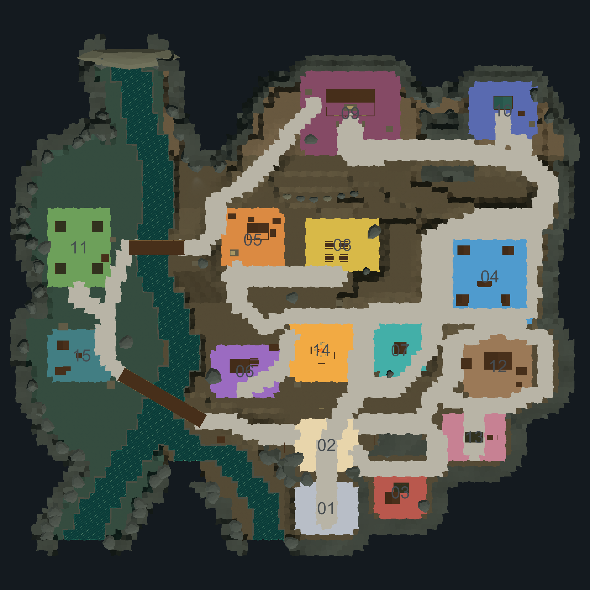
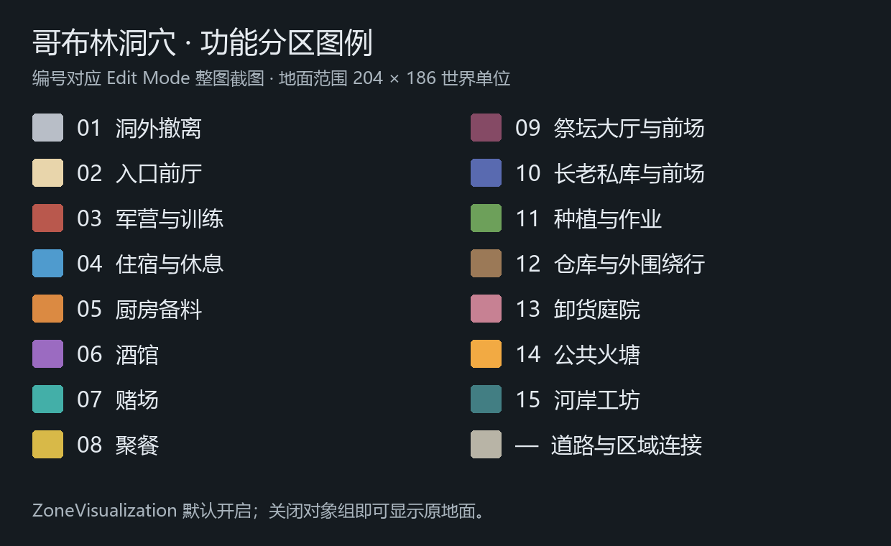
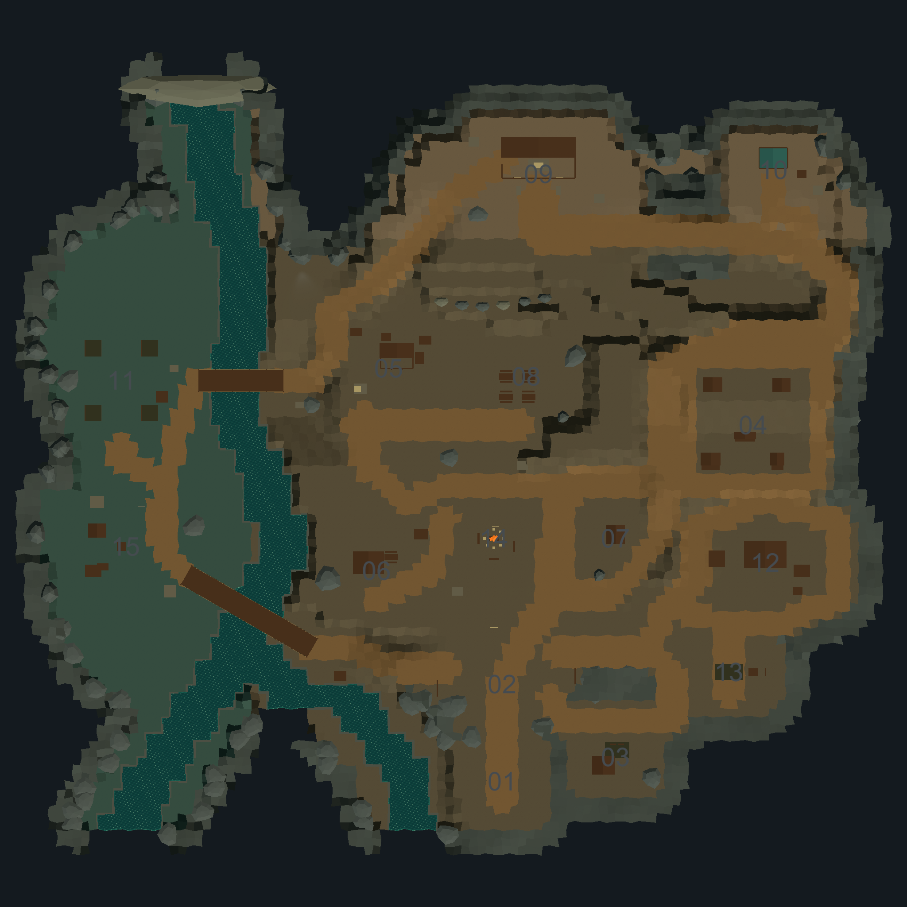
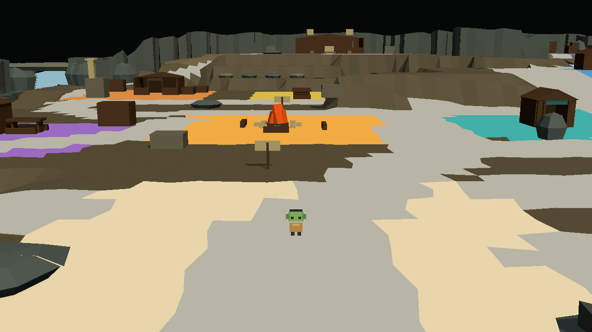
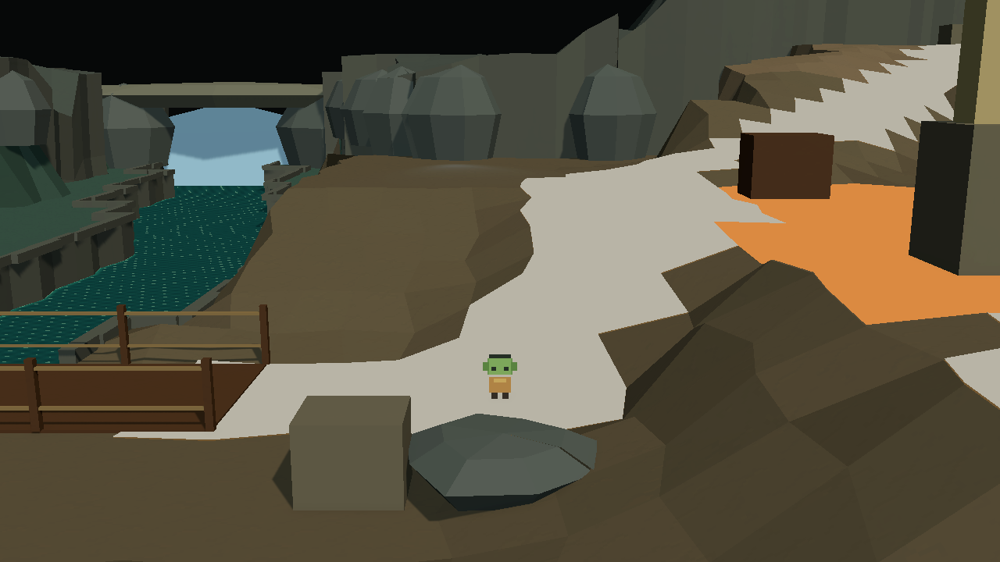
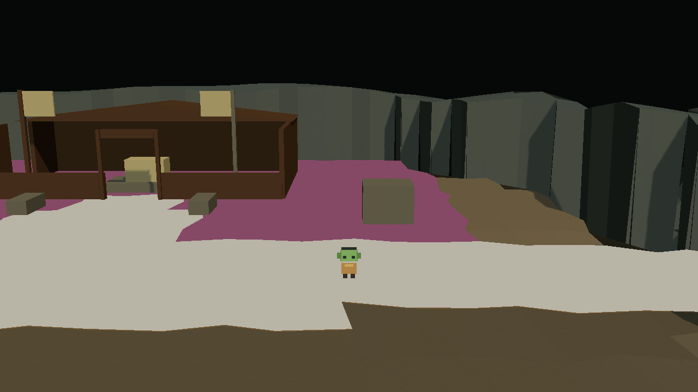
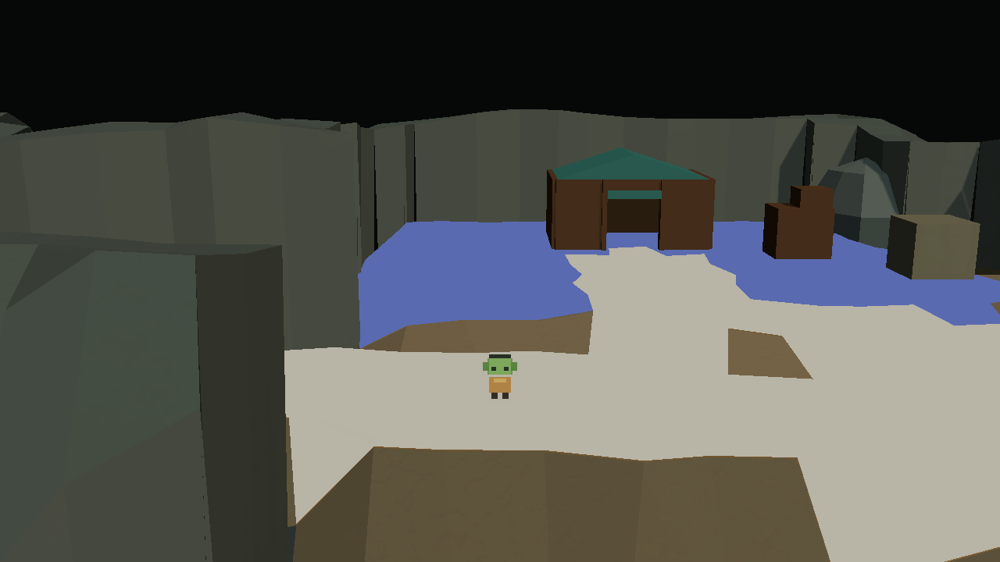

# 哥布林洞穴扩图与彩色功能分区

日期：2026-10-12。版本：V7。阶段：地图扩容与功能分区制作。

实施场景：`Assets/Scenes/CaveHD2DLocal.unity`。原 [2D 功能图](images/cave_functional_plan_reference.png) 的 13 类功能区均有正式占位；本轮扩大各区地面、拉开建筑与道路，并增加可隐藏的彩色分区层，继续使用简单建筑占位。

**整图扩容与彩色分区已制作，并完成 Edit Mode 静态构图检查；未经试玩、通行、感知或性能验证。**

## 1. 尺寸与高度

正式 Floor 外框从 `68×62` 格扩至 `102×93` 格，每格仍为 2 世界单位，即从 `136×124` 扩至 `204×186`。外框面积为原来的 2.25 倍；加入新增场地后，Floor 单元由 2859 增至 7234，其中 River 为 754 个单元。Floor 包含河流，不能直接当作可行走面积。

保留 LayoutGrid 原点和格子尺寸，扩充 Floor/River Tilemaps 与 `CaveElevation`，没有缩放地图根节点、角色或整批建筑。正式格子范围为 X `[-17,85)`、Y `[-25,68)`，世界外框为 X `[-98,106]`、Z `[-82,104]`，不包含外沿围岩余量。

低岸 `-4`、主层 `0`、住区 `2.4/4.8`、大厅与私库台地 `7.2` 的高度体系保留。河谷中心线展开，两座桥延长，桥面宽 `5.4`，两侧限制之间预留超过 `4.8` 净宽。水面、河床高度参数和河流材质未调整。

## 2. 区域对应

坐标使用世界平面 `(X,Z)`，尺寸表示包含建筑、前场、通道与作业空间的区域包络。彩色边缘按 2 单位网格贴合地形，裁去角部与道路，不代表封闭矩形房间。

| 编号 | 原 2D 功能 | 中心 | 场地尺寸 | 颜色 |
| --- | --- | --- | --- | --- |
| 01 | A 洞外撤离 | `(16,-70)` | `22×20` | 灰白 `#B8BEC7` |
| 02 | B 入口前厅 | `(16,-46)` | `24×18` | 米白 `#E8D5AB` |
| 03 | C 军队 | `(44,-64)` | `20×18` | 砖红 `#B9584D` |
| 04 | D 休息区／住宿 | `(78,18)` | `36×34` | 天蓝 `#4F9BCE` |
| 05 | E 厨房备料 | `(-12,32)` | `24×22` | 橙色 `#DB8A42` |
| 06 | F 酒馆 | `(-15,-18)` | `24×18` | 紫色 `#9B6BC1` |
| 07 | G 赌场 | `(44,-10)` | `20×18` | 青绿 `#43AFA8` |
| 08 | H 聚餐 | `(22,30)` | `28×20` | 黄色 `#D8B948` |
| 09 | I 祭坛大厅 | `(25,80)` | `36×30` | 暗红 `#854A65` |
| 10 | J 长老私库 | `(83,81)` | `24×20` | 靛蓝 `#596AB0` |
| 11 | L 种植区 | `(-78,29)` | `24×30` | 草绿 `#6DA05A` |
| 12 | N 仓库 | `(81,-16)` | `24×22` | 棕色 `#9B7957` |
| 13 | O 卸货庭院 | `(72,-43)` | `24×18` | 粉色 `#C78193` |
| 14 | 公共火塘 | `(14,-10)` | `24×22` | 金橘 `#F2AA43` |
| 15 | 河岸工坊 | `(-77,-12)` | `24×20` | 深青 `#427E83` |

五处棚屋展开在住区前后两层，前排西屋为让开通巷进行局部横移。四块种植床与边框移入左岸作业区，床体尺寸不变。厨房与宴会、仓库与卸货、军营与入口分别拥有独立场地与开放连接口。大厅正面前场、西侧入口和长老私库前场各自接入道路。

仓库三组货垛、卸货货物、厨房炉体和局部岩肩移到路线侧边，入口翼侧物件为通道退让。普通门口净宽仍为 `2.4`，大厅两处入口为 `3.2`。本轮补充区域空间，没有制作完整室内或新增互动玩法。

## 3. 道路与撤退

- **东侧主路：**入口 → 火塘东侧 → 住区前街与上坡 → 后街 → 东侧折返坡 → 大厅正面，制作宽度为 `8` 世界单位。
- **西侧供给路：**入口西侧 → 入口桥 → 左岸工坊 → 供给桥 → 厨房西后侧 → 侧坡 → 大厅西侧入口，地面制作宽度为 `6`，桥中央开放。
- **换路与撤退：**厨房—火塘、厨房—宴会、火塘—住区、仓库—入口和仓库外围返回连接保留；住区两侧上坡与前后巷形成小环路，巷道制作宽度为 `4`。

区域连接按 `6` 单位宽度制作，桥头、坡口和重要转角加宽地面，预留约 `6×6` 落脚面。主路宽度不替代门洞宽度。掩体分散在侧边，开放段与作业空地保留，不用随机箱子填满新增空间。

既有手工围岩展开位置；处于新增场地与道路内的部分旧岩肩逐件隐藏，后墙和边缘继续保留洞穴体量，近侧岩体保持低矮、分段。观察空对象只记录位置，连接由正式地形、建筑开口与物件间距表达。

## 4. 彩色层与保存

`CaveMap/Landform/ZoneVisualization` 默认 active，包含 15 个区域对象和 `16_Routes_Neutral`，道路颜色为中性灰 `#B8B4A6`。彩色网格贴合最终高度及派生地形轮廓偏移，高于地面约 `0.03`；使用不透明 URP Unlit 材质，无 Collider，不投射或接收阴影。河流不覆盖彩色层，桥面保留原木材。

关闭 `ZoneVisualization` 即恢复原地面。没有新增 runtime 切换、脚本、公开 API 或通用 Editor 工具。后续改地形高度时，需要同步更新受影响的彩色网格，原地形重建机制不自动更新展示层。

Floor/River Tilemaps 与 `CaveElevation` 继续是布局权威来源，派生资源按本地场景 GUID 保存。建筑与掩体保存在 `MapProduction` 和 `StealthBlockout`；旧 `Architecture`、`PlacedProps` 继续隐藏。普通保存与 `Rebuild Scene Geometry` 保留手工对象，不要用 `Replace With Terraced Settlement Layout` 刷新本轮地图。

当前相机保持 Cinemachine `2.10.7`、Pitch 约 `12.09°`、FOV `34°`、距离 `24.6`，跟随、屏幕位置、阻尼及 URP/Volume/CaveWallReveal 引用不变。角色根节点 `0.9` 缩放、出生位置保留，灯光、水面、后处理与 Package 不变。

## 5. Edit Mode 静态记录

整图来自临时正交相机，编号仅用于截图，未保存进场景。局部图使用当前 Cinemachine 参数和固定 `16:9` 输出；临时移动跟随目标后恢复玩家与相机，没有进入 Play Mode。

| 画面 | 临时定位点 `(X,Z)` | 静态结果 |
| --- | --- | --- |
| 入口与火塘 | `(16,-46)` | 角色、开放入口、火塘方向与左右换路方向可见。 |
| 供给桥与厨房 | `(-31,29)` | 角色、桥头与登坡可见，炉体／烟囱和厨房位于右前方，桥面开放。 |
| 大厅接近 | `(38,65)` | 角色、下一段路、大厅前门、祭坛和旗架可辨认，掩体在前场侧边。 |
| 长老支路补充图 | `(77,64)` | 私库与独立前场可辨认，扩图后不要求两处目标建筑同屏。 |

核对了 13 类功能区、五处棚屋、四块种植床、两座桥、展示层开关、保存引用和提交范围。根据手工 BoxCollider 的变换与尺寸静态核对通道占位，修正相关掩体、栅栏、标识和货垛；没有运行物理模拟，不能证明实际坡道、门口、撤退或潜行成立。

没有新增守卫、巡逻、感知、导航、任务、战斗或其他 runtime API。地图资源与文档分别本地提交，不 push；已有亮洞口材质修改及其他场景未跟踪派生资源保留，不纳入提交。当前已打开的 Unity 场景需重新加载保存结果。后续单独安排试玩、通行、感知和性能验证。
