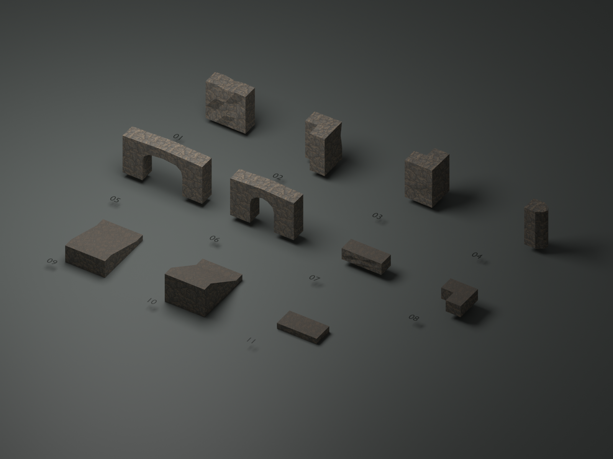

# 洞穴模块素材

11 个可摆放的 3D 模块，使用最新两轮 `TerrainBasic` 中的 `cave_rock_face.png` 岩面与 `cave_earth_wet.png` 湿土。沿用原贴图的 Point / Repeat 导入设置，不使用旧的 `CaveHD2D/*candidate.png` 或干土图。像素外观来自现有贴图；几何采用有厚度、硬边法线的岩层体块。

- Prefab：`Assets/Prefabs/Terrain/CaveModules/`
- Unity 原生 Mesh：`Assets/Art/Models/CaveModules/`
- 材质：`Assets/Art/Materials/CaveHD2D/cave_module_rock.mat`、`cave_module_soil.mat`
- 展示场景：`Assets/Scenes/Props/CaveModuleGallery.unity`

## 模块与尺寸

尺寸均为 Unity 世界单位，X / Z 是水平面，Y 是高度。根节点 Scale=1，Visual 与根节点对齐。所有模块带静态、非 Convex 的 MeshCollider，直接使用渲染网格；洞口保持镂空，没有横跨开口的碰撞盒。它们用于静态场景，不作为动态 Rigidbody 道具。

| 编号 | Prefab 文件名（省略 .prefab） | 规格与用途 |
| --- | --- | --- |
| 01 | `cave_wall_straight_02` | 宽 4、接口高 4、接口厚 1.5；岩面略有起伏，正面朝 -Z |
| 02 | `cave_wall_corner_inner_01` | 从 (-2,0,0) 转至 (0,0,2) 的 L 型壁，-Z 面形成内转角 |
| 03 | `cave_wall_corner_outer_01` | 从 (-2,0,0) 转至 (0,0,-2) 的 L 型壁，-Z 面形成外转角 |
| 04 | `cave_wall_end_01` | 接口在 X=0，向 +X 延伸约 1.9 的切角岩壁端头 |
| 05 | `cave_entrance_wide_01` | 外宽 8、最高 4.18、厚 1.5；底部开口宽 4，拱顶净高 3.2 |
| 06 | `cave_passage_narrow_01` | 外宽 6.4、最高 4.18、厚 1.5；底部开口宽 2.4，拱顶净高 3.2 |
| 07 | `cave_ledge_straight_01` | 宽 4、厚 1.5、台地面高 1.2；土面与岩侧分材质 |
| 08 | `cave_ledge_corner_01` | 同规格的 L 型台地边缘，顶面 Y=1.2 |
| 09 | `cave_ramp_low_01` | 宽 4、总长 6、抬升 1.2；中间 4 单位斜坡，两端各 1 单位平接，约 16.7° |
| 10 | `cave_ramp_high_01` | 宽 4、总长 6、抬升 2.4；中间 4 单位斜坡，两端各 1 单位平接，约 31° |
| 11 | `cave_landing_01` | 宽 4、长 2、厚 0.6 的土面落脚平台，根节点位于顶面中心 |

## 摆放与拼接

- 直壁两端 X=±2，端面 Z=±0.75、Y=0～4。沿 X 每隔 4 单位摆放，或绕 Y 旋转 90°，即可接成连续岩壁。沿用已有 `cliff_straight_01` 的接口尺寸；旧模块的材质未修改，搭配时可手动改为新岩面材质。
- 转角 pivot 位于两段中心线交点；端口位于上表中的坐标。端头 pivot 就是接口中心，接右端时放到该端 X 坐标；接左端时绕 Y 旋转 180°。
- 洞口正面朝 -Z，根节点在底部中心；两侧外端面 Y=0～4，可以接同高直壁。两款洞口都有两个 2 单位宽的侧壁，开口宽度指底部净宽，上部随拱形收窄。
- 坡道低端 Z=-3、顶面 Y=0，高端 Z=3、顶面 Y=1.2 或 2.4。坡道底部 Y=-0.6。落脚平台顶面 Y=0，可通过根节点 Y 对齐相邻地面。台地边缘顶面是根节点 Y+1.2；它只是边缘模块，大片地面仍使用地图自身 Terrain 或地面 Mesh。
- 展示场景前三排是单件；Z≈36 后方提供直壁→内转角→直壁→端头的组合，以及低坡→平台→台地边缘组合。所有摆放均保存于 Scene，没有 runtime 重建脚本。

## 编辑源与检查

`tools/art/cave_priority_modules.blend` 保存独立可编辑模型和打包贴图。`tools/build_cave_priority_modules.py` 是本套素材的离线制作源：普通 Python 导出 Unity Mesh、Prefab 与展示场景；Blender 加 `--preview` 可重建编辑源与预览图。修改已导出的 Mesh / Prefab 后不应直接重跑脚本，以免覆盖手工修改；脚本不会更改其他地图场景。

已检查每件网格的非退化三角面、封闭边、相邻面朝向与正体积；检查导出顶点 / 索引缓冲和资源引用。贴图复用原文件，不改变导入设置。预览是 Blender 材质近似渲染，不能代替 Unity 的 Shader 与光照验收。没有新增 C#，未运行 Unity Editor 导入、Play Mode 或游戏构建。

人工验收：

1. 打开 `CaveModuleGallery.unity`，确认单件材质正常，Scene View 查看后方拼接组；尤其检查直壁端口和转角接缝。
2. 从 `CaveModules` 拖入需要的模块，保持 Scale=1，通过 Position 和 Y Rotation 拼接；用实际游戏镜头判断贴图颗粒、拱顶及近侧墙遮挡。
3. 把坡道和洞口放入已有可试玩地图，沿用真实 Player 检查上下坡、平台接缝及洞口碰撞。几何检查不等同于 CharacterController 实际通行验收。
