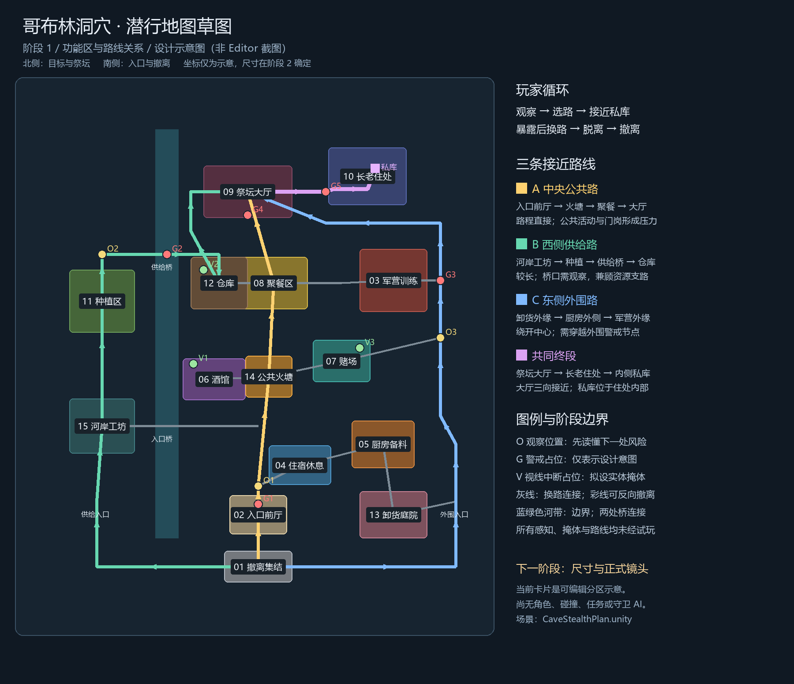

# 哥布林洞穴潜行地图：阶段 1 草图

日期：2026-10-12。新场景：`Assets/Scenes/CaveStealthPlan.unity`。

本文保留阶段 1 的设计记录；当前场景已进入[阶段 2：尺寸与镜头](cave-stealth-stage2-scale-camera.md)。下图与草图坐标对应阶段 1，当前场景的世界尺寸以阶段 2 为准。

**已完成功能分区、接近路线、换路连接、目标与视觉地标的草图。当前场景是可编辑的平面示意，不是可试玩地图。** 卡片尺寸和坐标只表达空间关系；角色比例、实际通道尺寸、正式镜头、碰撞、守卫感知、任务与美术制作留到后续阶段。

## 1. 设计目标与参考

玩家从洞外集结点进入，先观察环境，再选择接近长老私库的路线。过程中可以绕行、探索资源支路，遇到风险时切换路线并返回撤离点。私库作为主目标位置占位；取回什么、是否需要其他前置目标、警报后的任务规则尚未确定。

原地图参考 `Assets/Scenes/CaveHD2DLocal.unity`、[原地图制作记录](cave-hd2d-scene.md)、[功能区设计记录](cave-map-redesign-plan.md)及其整图截图。沿用河流分隔、两处跨河连接、生活区、军营、祭坛与长老住处的世界关系，并保留原 13 类功能区和新增的火塘、工坊。新场景独立保存草图。

以下两点来自开发者公开资料，后面的具体布局是本项目的设计建议：

- **《合金装备 V》：**小岛秀夫在 Xbox Wire 访谈中说明，开放环境用于让玩家自行规划路线并尝试自己的潜入策略。本草图据此提供多条接近路线和横向连接，具体守卫点、掩体与资源风险由本项目提出。[开发者访谈](https://news.xbox.com/en-us/2013/12/09/games-mgs-v-qa-with-hideo-kojima/)
- **《八方旅人 II》：**开发者说明探索采用固定镜头，并尽量让玩家想去的地方出现在同一屏幕内；2D 像素角色与 3D 背景的协调需要专门处理。本草图先标出火塘、桥、祭坛与长老入口作为构图锚点，阶段 2 再从实际游戏镜头验证逐段目标可见性，不要求整图同时入镜。[开发者访谈](https://www.unrealengine.com/developer-interviews/octopath-traveler-ii-builds-a-bigger-bolder-world-in-its-stunning-hd-2d-style?lang=en-US)

## 2. 空间组织与功能区

南侧是入口与撤离，中部是生活与供给区域，东侧是军营和外围通路，北侧是祭坛大厅与长老住处。河流把西侧种植、工坊与中心聚落分隔；两处桥允许换路，河带暂按不能直接涉水的边界设计。实际地形高差在阶段 2 决定。

编号沿用参考地图，颜色表示功能区，不表示安全等级。

| 编号 | 功能区 | 在潜行路线中的作用 |
| --- | --- | --- |
| 01 | 洞外撤离集结 | 起点与撤离终点，三条接近路线在此分开 |
| 02 | 入口前厅 | 中央入口与第一处警戒压力 |
| 03 | 军营与训练 | 东侧警戒来源，外围路线绕其外缘经过 |
| 04 | 住宿休息 | 中央入口与厨房之间的生活区连接 |
| 05 | 厨房备料 | 东侧资源支路，连接卸货、住宿 |
| 06 | 酒馆 | 西侧入口桥与中心火塘之间的换路点 |
| 07 | 赌场 | 火塘与东侧外围路之间的换路点 |
| 08 | 聚餐区 | 中央公共路的中段，连接仓库与军营 |
| 09 | 祭坛大厅 | 三向接近的汇合区，也是北侧视觉地标 |
| 10 | 长老住处与内侧私库 | 主目标位置；私库处于住处内部，接近终段从祭坛侧进入 |
| 11 | 种植区 | 西侧供给路的资源支路 |
| 12 | 仓库 | 供给桥后的资源与换路节点 |
| 13 | 卸货庭院 | 东侧入口附近的资源支路 |
| 14 | 公共火塘 | 中心辨向地标，连接酒馆、赌场和公共路 |
| 15 | 河岸工坊 | 西侧供给入口后的第一个功能区 |

资源点仅表达后续内容的候选位置，尚无采集物、奖励数量或交互实现。

## 3. 三条接近路线与共同终段

| 路线 | 接近顺序 | 选择理由与代价 |
| --- | --- | --- |
| A 中央公共路，金色 | 集结 → 入口前厅 → 火塘 → 聚餐 → 大厅正面 | 路程直接、地标清楚；拟由门岗与公共活动形成风险 |
| B 西侧供给路，青绿色 | 集结 → 供给入口 → 工坊 → 种植 → 供给桥 → 仓库 → 大厅西侧 | 路程较长，兼顾资源探索；桥口是需要预先观察的节点 |
| C 东侧外围路，蓝色 | 集结 → 外围入口 → 卸货外缘 → 厨房外侧 → 军营外缘 → 大厅东侧 | 绕开中心公共区；外围较开放，拟由军营警戒形成不同风险 |
| 共同终段，紫色 | 祭坛大厅 → 私人通道 → 长老住处 → 内侧私库 | 保留私库位于住处内部的关系，作为最终接近压力点 |

三个大厅接近方向表达的是布局意图，尚未制作实际门洞。共同终段是刻意设置的目标防线，后续需要验证能否通过时机、掩体和侧向接近提供足够选择，避免形成只有一种解法的强制等待点。

灰色连接用于在三条路线之间切换：入口桥连接工坊与中央路；酒馆—火塘—赌场连接西中东；仓库—聚餐—军营连接上半区；卸货—厨房—住宿连接入口附近。

所有彩色路线都可以反向作为撤离方案。设计上鼓励从与进入不同的路线撤离；入口桥和生活区连接提供途中切换，仍回到 01 集结点。当前没有警报封路、追踪、单向机关、攀爬或涉水能力的假设。

## 4. 观察、警戒与脱离占位

这些标记记录待制作的设计意图，既不是运行中的守卫，也不是已验证的安全位置。

| 标记 | 位置与意图 |
| --- | --- |
| O1 | 入口前厅后的观察位置：理解中央路，并决定是否横向换路 |
| O2 | 西侧供给桥前的观察位置：看清桥口压力再跨河 |
| O3 | 东侧外围的观察位置：接近军营前先判断下一段风险 |
| G1 | 中央入口门岗占位 |
| G2 | 供给桥警戒占位 |
| G3 | 军营外围警戒占位 |
| G4 | 祭坛大厅正面警戒占位 |
| G5 | 祭坛至长老住处通道的最终警戒占位 |
| V1 / V2 / V3 | 酒馆、仓库、赌场附近的拟设视线中断位置，用于换路和脱离 |

阶段 3 再用实体墙角、岩体或货堆实现视线中断，并在实际镜头和移动条件下确认。守卫数量、巡逻轨迹、视野距离、声音传播、发现与搜索规则都尚未确定。

## 5. 场景编辑与验收

在 Project 面板打开 `Assets/Scenes/CaveStealthPlan.unity`。Hierarchy 中的 `02_Zones` 保存可移动的分区卡片，`04_Routes` 保存路线段，`05_Links` 保存换路连接，`06_TacticalMarkers` 保存观察、警戒与脱离占位，`07_Landmarks` 保存地标位置。

草图直接保存在 Scene 内；没有 runtime 自动重建或覆盖。`SketchOverview` 只用于俯视草图预览，不是已经定型的 HD-2D 游戏镜头。编号和英文短标签对应本文中文说明；若手动调整 Scene，本文图片需同步更新。

阶段 1 人工验收：

1. 从 01 集结点分别沿 A、B、C 指认到大厅和私库的路线，并说明各自代价。
2. 指认至少两处横向换路连接，以及一条与进入路线不同的撤离方案。
3. 检查功能区是否符合哥布林聚落设定，确认主目标位置和需要修改的空间关系。

已完成序列化对象内部引用、参考场景保留、资源 GUID 与文本 diff 的静态检查，并查看中文示意图。没有运行 Unity Editor 导入检查、Play Mode、通行、感知或性能验证。下一阶段按[地图构建顺序](hd2d-map-build-order.md)处理尺寸与正式镜头。
