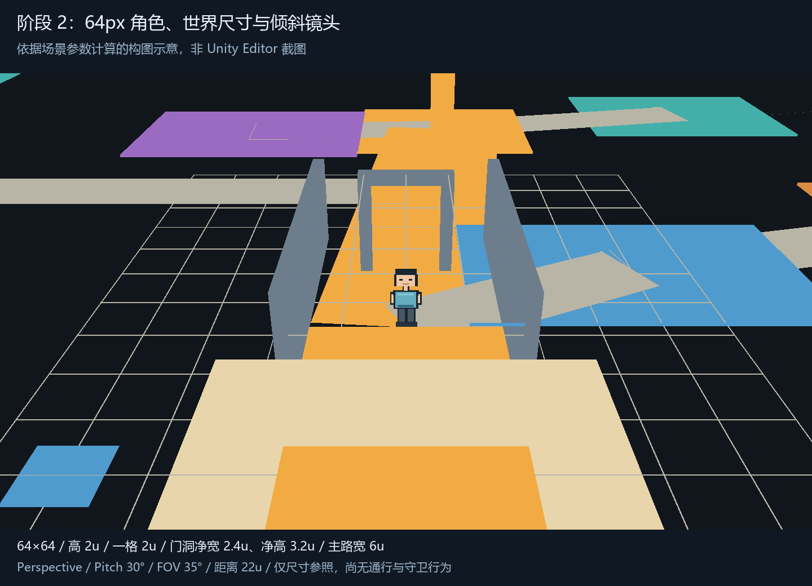

# 哥布林洞穴地图：阶段 2 尺寸与镜头

日期：2026-10-12。场景：`Assets/Scenes/CaveStealthPlan.unity`。Unity 2022.3.62f3c1 / URP 14.0.12。

本阶段在[阶段 1 草图](cave-stealth-stage1-plan.md)上加入 64px 角色占位、世界尺度、道路宽度参照、门洞和墙高参照，以及跟随角色的倾斜镜头。以下数值是可调整的初始方案，比例与画面效果仍需人工确认。

本文保留阶段 2 的记录；当前场景已进入[阶段 3 白盒](cave-stealth-stage3-blockout.md)，地面、阻挡与基础移动已接入，出生点调整到撤离集结区。

## 1. 64px 角色与世界尺度

先按 **64×64 单帧、完整人物高 64px** 理解需求。使用简单矩形组成的像素人轮廓作比例尺，后续替换为正式角色。资产为 `Assets/Art/Sprites/pixel_person_64_placeholder.png`，Prefab 为 `Assets/Prefabs/PixelPerson64Placeholder.prefab`。

| 项目 | 保存值 | 作用 |
| --- | --- | --- |
| 图像 | 64×64，透明背景 | 人物从顶部到脚底覆盖 64px，保留两侧透明留白 |
| PPU | 32 | 64px 对应 2 世界单位 |
| Texture Import | Point、无 mipmap、无压缩、Single / Full Rect | 保留像素边缘和完整画布尺寸 |
| Sprite pivot | Bottom Center | 未来使用 SpriteRenderer 时，以脚底作为摆放基准 |
| Prefab 根节点 Scale | `(1,1,1)` | 保持位置与物理尺寸清楚 |
| Visual | Quad 高宽均为 2，中心位于根节点上方 1 | 完整画布高 2；脚底落在根节点位置 |
| CharacterController | 高 2、半径 0.4、中心 `(0,1,0)` | 保存拟用的 0.8 单位身体占地直径；本阶段保持禁用 |
| Billboard | `keepUpright = true` | 只旋转视觉子对象的 yaw，人物保持竖直 |
| 材质 | URP Unlit + Alpha Clipping，双面 | 裁掉透明背景，便于先判断比例；受光方案留到美术样板阶段 |

PPU 表示图像像素与世界单位之间的比例，64px 不等于固定的屏幕显示高度。当前使用 Quad，实际高度由其 Scale 明确设为 2，和 `64 / 32 = 2` 的导入比例一致。[Unity 2022.3 Sprite Import 文档](https://docs.unity3d.com/2022.3/Documentation/Manual/texture-type-sprite.html)

Prefab 不带 PlayerEntity、输入、移动或动画。本阶段只复用已有 `SpriteBillboard`，不依赖 Manager 初始化。

## 2. 地图与建筑尺寸

采用 XZ 平面、Y 表示高度。地图原点 `(0,0,0)`，一格为 `2×2` 世界单位；后续格子索引按 `(floor(x/2), floor(z/2))` 映射，坐标表示格子左下角起算的区间。

阶段 1 的示意 X/Z 坐标及区域范围按 0.5 转为世界尺寸，通过修改各对象的位置和几何尺寸完成；地图根节点 Scale 仍为 `(1,1,1)`。三条路线与功能区的拓扑关系保留。底板调整为 `92×100` 世界单位，作为 46×50 格范围的参照，不代表整块区域都可以通行。

| 参照 | 尺寸 | 与角色的关系 |
| --- | --- | --- |
| 一格 | 2×2 | 格子边长与人物高度相同 |
| 中央公共路 | 净宽 6 | 3 格，预留观察与绕行空间 |
| 西侧供给路 | 宽 4 | 2 格 |
| 东侧外围路 | 宽 3 | 1.5 格 |
| 横向换路连接 | 宽 3 | 1.5 格 |
| 共同终段 | 宽 2.4 | 进入长老住处的较窄接近段 |
| 门洞 | 净宽 2.4、净高 3.2 | 高度为角色的 1.6 倍，留出通过空间 |
| 墙高参照 | 3.2，厚 0.4 | 高于人物，用于判断尺度与遮挡 |
| 地标高度参照 | 4 | 火塘位置的简单高柱，供检查后续辨向目标 |

道路颜色带现在表达宽度包络。转角、桥面、门洞周围的实际地面和阻挡将在阶段 3 制作；目前没有基于物理模拟确认净宽或通行。

入口附近的 `08_ScaleReferences` 保存 2 单位网格、门框、6 单位净宽墙段及各路线宽度标尺。门洞内边缘位于 X `±1.2`，墙段内边缘位于 X `±3`。这些参照物没有 Collider。

## 3. 倾斜镜头

相机采用原 `CaveHD2DLocal` 场景的 Cinemachine 2.10.7 方案：`HD2D Camera` 上使用 Cinemachine Brain，由 `CaveExplorationCamera` 跟随占位角色根节点。Body 为 Framing Transposer，Aim 为 Do Nothing。将原方案约 `12.09°` 的俯角改为 **15°**，其余跟随与构图参数沿用原方案。

| 参数 | 值 |
| --- | --- |
| Projection | Perspective |
| Virtual Camera Pitch | 15° |
| Yaw | 0° |
| 垂直 FOV | 34° |
| Framing Transposer Camera Distance | 24.6，沿相机前向轴计算 |
| Follow | `PixelPerson64Placeholder` 根节点 |
| Tracked Object Offset | `(0,1.6,0)` |
| Screen X / Y | `0.5 / 0.6` |
| X / Y / Z Damping | `0.25 / 0.25 / 0.25` |
| Dead Zone Width / Height / Depth | `0.05 / 0.05 / 0` |
| Soft Zone Width / Height | `0.8 / 0.8` |
| Brain Update / Blend Update | Late Update |
| Near / Far | 0.1 / 200 |
| 后处理、相机 MSAA | 关闭 |
| 默认角色位置 | `(0,0.03,-25.5)` |
| 默认相机位置 | 约 `(0,9.45,-48.87)`，按站定构图计算并保存 |

Framing Transposer 根据 Follow、Tracked Object Offset、Camera Distance、Screen X/Y 与跟随区域调整相机位置；Do Nothing 保持 Virtual Camera 的 15° 朝向；Brain 把 Virtual Camera 的状态应用到实际相机。`SpriteBillboard.LateUpdate()` 只让 Visual 跟随相机 yaw。根节点不因 Billboard 倾斜，后续碰撞体可保持竖直。

原方案的 `Center On Activate`、`Target Movement Only`、Priority 等设置也一并沿用。旧 `CameraController` 已从本场景的主相机移除，避免两个组件同时驱动相机。Framing Transposer 只改变位置、不负责旋转，并可用于透视相机与 3D 环境。[Cinemachine 2.10 Framing Transposer 文档](https://docs.unity3d.com/Packages/com.unity.cinemachine@2.10/manual/CinemachineBodyFramingTransposer.html)

Perspective 保留近大远小，FOV 控制观察角度。这组参数先平衡地面可见面积、人物厚度和前方目标占屏关系。[Unity 2022.3 Camera 文档](https://docs.unity3d.com/2022.3/Documentation/Manual/class-Camera.html)

按站定构图的投影计算，默认位置的 2 单位人物在 1440×810 画面中约高 101 屏幕像素；在同宽高比的 1920×1080 画面中约高 135 像素。Screen Y `0.6` 对应 Cinemachine 从屏幕顶部起算的目标构图位置；本次计算参照本地 Package 中 `ScreenToOrtho` 的坐标换算。结果仅用于初步判断，运行时位置还受 Dead Zone、Soft Zone 和 Damping 影响，未进行运行时测量。

`09_ViewpointAnchors` 保存四个检查位置和对应的 CameraPose：入口 `(0,0.03,-25.5)`、供给桥前 `(-30,0.03,19)`、军营外缘 `(35,0.03,3)`、大厅正面 `(-2,0.03,26.5)`。运行时可把角色根节点移到这些位置，检查同一组镜头参数在不同区域的构图。

整图俯视镜头 `SketchOverview_Disabled` 保留为参考并默认禁用。原草图的 `03_Labels`、`06_TacticalMarkers` 默认关闭，查看设计标记时可在 Hierarchy 启用。

## 4. 检查与人工验收

已检查 PNG 尺寸与透明边界、导入设置、Prefab 与场景的序列化引用、资源 GUID、根节点 Scale、门洞与墙段几何尺寸，并查看按参数计算的构图示意。原参考场景保持一致；没有修改 C# 脚本、共享角色 Prefab 或 Package。

未运行 Unity Editor 导入检查、Play Mode、物理通行或完整构建。当前没有可走地面、边界阻挡与输入移动，阶段 3 再接通。

1. 打开 `CaveStealthPlan`，在 Game View 使用 16:9，确认占位人物、门框和墙高的比例。
2. 进入 Play Mode，通过 Inspector 调整 `PixelPerson64Placeholder` 根节点到上述检查位置，确认镜头跟随、人物保持竖直；结束后退出 Play Mode。
3. 选中 `08_ScaleReferences` 中的门框与路宽参照，确认 2.4 门宽、3.2 墙高和 6/4/3 道路宽度适合后续搭图。

人工反馈主要决定角色占屏大小、俯角与尺寸是否需要调整；达到本步目标后，再按[构建顺序](hd2d-map-build-order.md)推进可走白盒地图。
