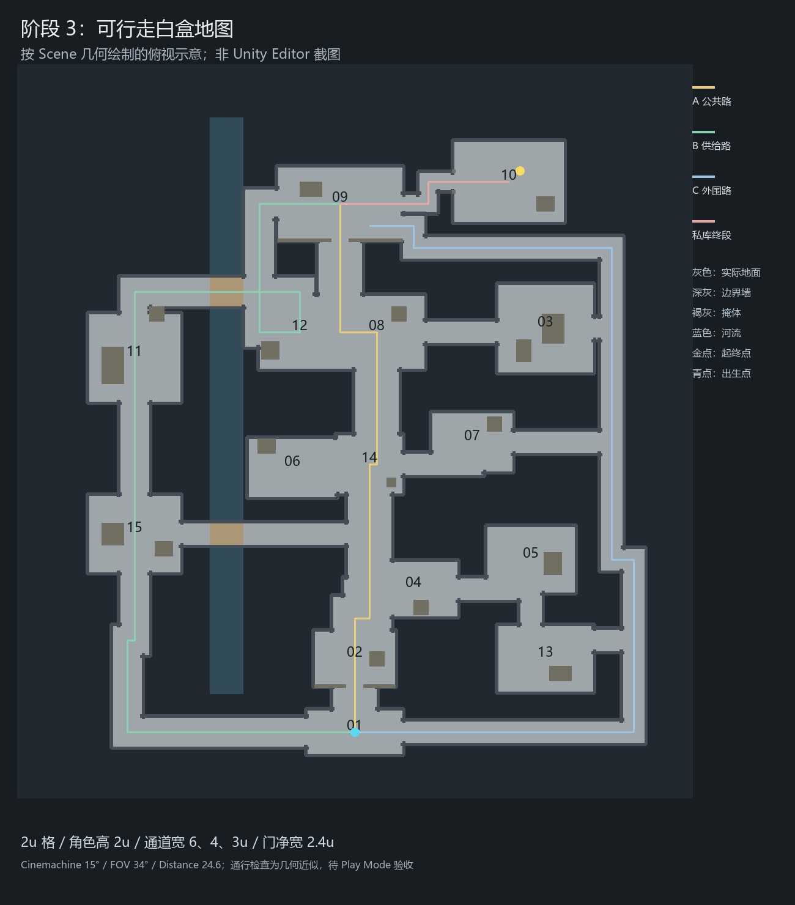

# 哥布林洞穴地图：阶段 3 白盒

日期：2026-10-12。场景：`Assets/Scenes/CaveStealthPlan.unity`。承接[阶段 2 尺寸与镜头](cave-stealth-stage2-scale-camera.md)。

本文保留之前的平面白盒记录。阶段 3 当前交付为 [WhiteBox 台地地形白盒](whitebox-terraced-terrain.md)，采用有高差的地形、实体坡道和真实 Player，场景为 `Assets/Scenes/WhiteBox.unity`。

本阶段把草图变成保存于 Scene 的可编辑地面、墙体、门洞和掩体，并为 64px 占位角色接入基础移动与重力。目的在于试玩三条接近路线、换路连接及私库终段，检验空间尺寸和碰撞。守卫、视野、蹲伏、警报、任务交互与遮挡淡出尚未实现。

## 1. 地图与路线

保留阶段 1 的 15 个功能区、两处跨河连接和三条潜入路线。原草图中的斜线改成直角通道，以便用原生 Cube 表达明确的净宽、转角和碰撞边界；中央生活区相邻房间作为连通的开放空间。

| 路线 | 试玩路径 | 通道净宽 |
| --- | --- | --- |
| A 公共路 | 撤离集结 → 入口 → 火塘 → 聚餐区 → 大厅正门 | 6 |
| B 供给路 | 集结点向西 → 工坊 → 种植区 → 上桥 → 仓库 → 大厅西侧 | 4 |
| C 外围路 | 集结点向东 → 卸货、厨房外缘 → 军营外围 → 大厅东侧 | 3 |
| 私库终段 | 大厅 → 东侧折角窄道 → 长老住处西门 → 私库标记 | 2.4 |

下桥连接工坊与中央公共路；酒馆、仓库、军营、赌场、厨房与住宿区保留横向换路连接。上桥宽 4，下桥宽 3。桥面与普通地面保持同高，本步没有台阶或高差跳跃需求。

河流只表示不可涉水的区域，河岸和其他地面外缘用实际 BoxCollider 阻挡。深色整图底板是视觉背景，没有 Collider；可走范围来自灰色地面。

角色出生在撤离集结点 `(0,0.03,-41)`，可以直接选择三条路线。私库位置 `(22.5,0,35.5)` 和撤离点以金色地面标记表示，只供路线验收，没有触发任务完成或拾取逻辑。

## 2. 白盒尺寸与对象

沿用 2×2 世界单位格子、角色高 2、CharacterController 半径 0.4、Skin Width 0.04、Step Offset 0.2。地图根节点 Scale 为 `(1,1,1)`，X/Z 表示平面位置，Y 表示高度。

- 54 块地面 Cube 合成连续的通行区域，地面顶面统一为 Y=0，厚度 0.4，物理顶面不重叠。
- 156 段外缘墙体位于地面边缘外侧，厚 0.4，保持通道净宽。房间后墙高 3.2，近侧墙与通道护栏高 1，适合先检查低俯角下的可读性。
- 入口、大厅正门、长老西门各有一个门框，净宽 2.4、净高 3.2；角色碰撞体保持竖直。
- 工坊、仓库、厨房、军营等区域放入 16 个高低掩体，低掩体高 1.2，高掩体高 2.6。另有入口和大厅前方的分隔墙，以及高 4 的火塘地标。
- 场景新增 271 个 GameObject，其中 240 个带 BoxCollider；没有为每块地面或墙体增加 Update。

掩体现在提供碰撞和画面遮挡，用于观察绕行空间；不代表已经实现守卫视线检测或躲藏判定。保留顶盖开放的结构，墙体透明和角色遮挡反馈留到阶段 4。

白盒使用独立的 `cave_blockout_*.mat` 灰色 URP Lit 材质与一盏普通 Directional Light，便于识别几何面；河流使用独立的 Unlit 材质。尚未进行精细灯光、贴图或后处理制作。

## 3. 移动与相机

`PixelPerson64Placeholder` 保持原 64×64 贴图与 2 单位 Visual。只在当前 Scene 的 Prefab Instance 上启用 CharacterController，并添加 `Assets/Scripts/Levels/Cave/CaveBlockoutPlayer.cs`，共享占位 Prefab 没有修改。

输入链路为已有 `InputActions.Player.Move` → `CaveBlockoutPlayer.Update()` → `CharacterController.Move()` → 场景内 3D Collider。WASD、方向键或手柄左摇杆控制 XZ 平面移动，速度为 5 世界单位/s；输入向量限制长度为 1，避免斜向加速。

移动脚本拥有独立的 InputActions instance，只启用 Move action，在 OnDisable 时禁用，在 OnDestroy 时 Dispose。当前小场景不需要启动 Bootstrap、数据库、UI 或其他 Manager，也不会发送全局交互事件。输入资产和生成的 wrapper 没有修改。[Input System 1.14 Action Assets 文档](https://docs.unity3d.com/Packages/com.unity.inputsystem@1.14/manual/ActionAssets.html)

脚本按帧积分重力，将速度乘 Time.deltaTime 后传入 Move；落地时保持向下速度以贴地。Move 接收的是位移，且不会自动施加重力。[Unity 2022.3 CharacterController.Move 文档](https://docs.unity3d.com/2022.3/Documentation/ScriptReference/CharacterController.Move.html)

相机仍为原 Cinemachine 方案：15° Pitch、FOV 34°、Camera Distance 24.6、Tracked Object Offset `(0,1.6,0)`、Screen X/Y `0.5/0.6`；Damping、Dead Zone、Soft Zone、Brain Late Update 保留。只把保存的初始相机位置平移到新出生点附近，Follow 引用仍指向角色根节点。

## 4. 编辑方式

Hierarchy 的 `CaveStealthBlockout_Stage3_可走白盒` 是当前地图，包含地面、边界、桥、掩体、门框、地标、环境和 15 个房间锚点。可以直接在编辑状态移动或缩放 Cube、调整 Collider，并正常保存 Scene；这些操作使用 Unity 自带 Undo/Redo。

`Stage2Reference_Disabled_草图与尺寸参照` 保留之前的平面设计与比例尺，默认关闭；整图参考相机也保持禁用。需要对照时临时启用，完成后关闭。原 `CaveHD2DLocal` 参考场景未修改。

Scene 中保存的对象是布局权威来源。没有新增 runtime 建图或自动恢复逻辑，也没有为本步引入新的 Editor 重建工具。

## 5. 检查与验收

已检查场景内部引用、新增资产 GUID、资源与 `.meta` 配对、相机参数、出生点及原参考场景未变化。Unity Editor 日志确认新增移动脚本完成编译与 assembly reload，无编译错误。

针对白盒几何，以 0.25 单位采样，并考虑角色半径与 0.04 余量检查连通性：三条路线各自到达大厅，15 个功能区、两座桥、私库和撤离点均连通。这是基于几何的近似检查，不能代替 CharacterController 在 Play Mode 中的实际碰撞验证。

尚未打开新白盒进行 Game View 检查、Play Mode 试玩或完整构建。请按以下三项验收：

1. 退出播放后打开 `CaveStealthPlan`，等编译完成，进入 Play Mode 并点击 Game View；用 WASD 或方向键移动，确认 15° 相机跟随且角色正常贴地。
2. 从集结点分别走 A/B/C 路线到大厅，再沿窄道到金色私库标记并返回；途中使用两座桥及横向连接换路。
3. 顶住墙、河岸、护栏和掩体，确认不能穿过或走入虚空；穿过三个门框，并记录卡住的位置或被墙遮住的人物，供阶段 4 调整。
