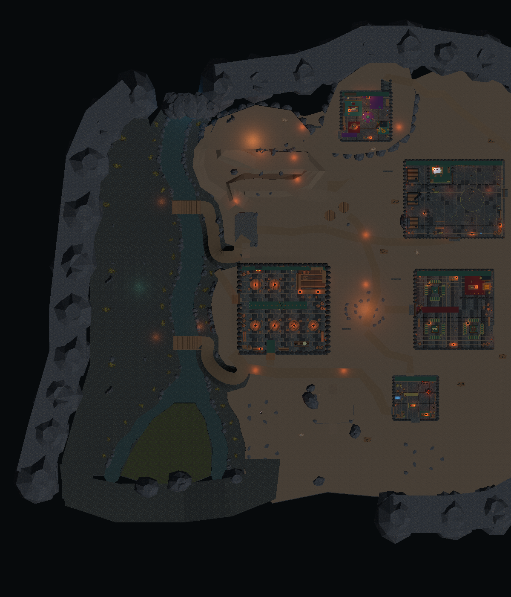
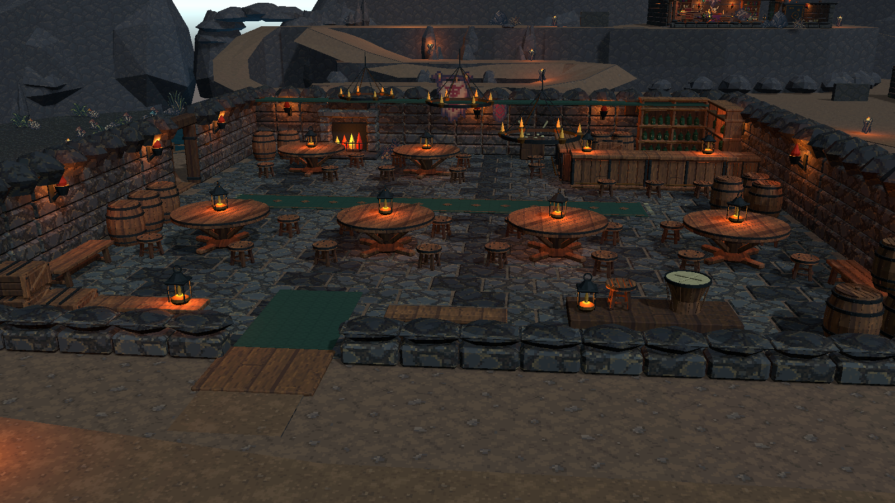
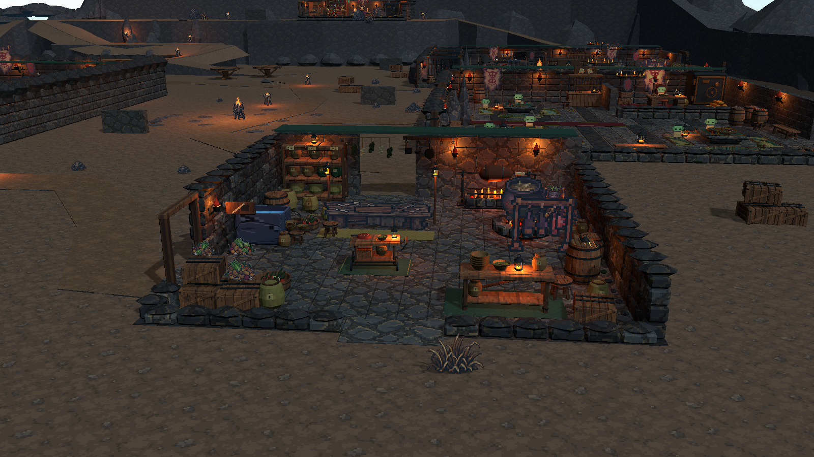
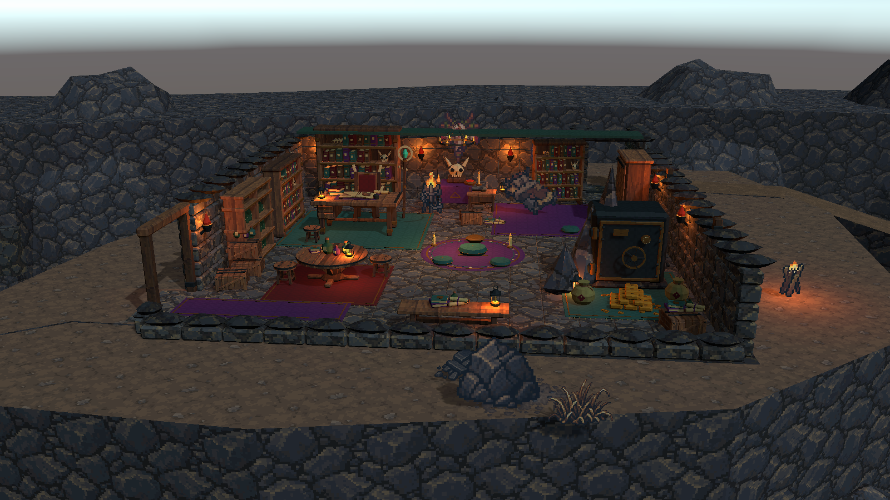

# 洞穴台地 V2：建筑与潜行空间

场景：`Assets/Scenes/CaveTerracedTerrainV2.unity`。已接入原尺寸的酒馆、厨房、赌场、训练院和长老住处，室内外连续通行。原建筑 Demo 与其他洞穴场景保留。当前包含玩家、实际碰撞、掩体和路线；没有新增守卫 AI、警报、锁门、任务结算或经营规则。

## 地形、河道与木桥

- 向东扩展生活区，向东北扩展长老台地，洞壁保持错落轮廓。南入口、西河谷、中部生活区与北侧大厅的功能关系保留。
- 主河宽 8.4 m，南侧两支末段宽 5.6 m。水、河床、两岸碎石地及分叉河洲同步调整。
- 低岸 Y=-2.4，水面 Y=-3.05，河床 Y=-4.75。水面低于岸边 0.65 m。
- 生活区主层 Y=+2.4，大厅与长老台地 Y=+9.6，中间台地 +4.2 / +6.0。食堂与五栋建筑直接衔接所在主层，住宿和仓库保留 +2.85 m 的小台地与缓坡。
- 两座木桥铺板总宽约 4.8 m，栏杆内净宽约 4.5 m；桥头弯曲缓坡净宽 4.4 m。供应桥缓坡向内退让，避免加宽河道后挤入水边。
- 木板、横梁、栏杆和木桩分别建模，木桩穿过水面插入河床。河边阻挡为桥面保留开口，南侧边界随台地实际边缘和高度设置阻挡。

## 建筑与路线

五个地图用 Prefab 位于 `Assets/Prefabs/Levels/CaveSettlement/`，根节点 Scale=1。主体内部尺寸分别为酒馆 32×32、厨房 16×16、赌场 28×28、训练院 36×28、长老房 18×18 m。下面的 Width / Depth 是地形用地尺寸，包含建筑地基余量，与内部尺寸不同。

| 编号 | 功能区 | 局部 X / Z | Y | 地形用地宽 × 深 |
| --- | --- | --- | --- | --- |
| 01 | Evacuation | 0 / -60 | 2.4 | 17.6 × 8 |
| 02 | EntranceForecourt | 0 / -45.2 | 2.4 | 16.8 × 12 |
| 03 | MilitaryTraining | 70 / 32 | 2.4 | 38 × 30 |
| 04 | Residence | 26 / -44 | 2.85 | 15.2 × 10.4 |
| 05 | KitchenPreparation | 56 / -40 | 2.4 | 18 × 18 |
| 06 | Tavern | 8 / -8 | 2.4 | 35 × 35 |
| 07 | Casino | 70 / -8 | 2.4 | 30 × 30 |
| 08 | Feast | 24 / 28 | 2.4 | 18 × 12.4 |
| 09 | AltarHall | -3 / 57 | 9.6 | 28.8 × 12.8 |
| 10 | Elder | 38 / 62 | 9.6 | 19.2 × 19.2 |
| 11 | Planting | -48 / 15.6 | -2.4 | 13.2 × 16 |
| 12 | Warehouse | -5.4 / 20.8 | 2.85 | 8.4 × 12.8 |
| 13 | UnloadingCourt | 60 / -62 | 2.4 | 17.6 × 12 |
| 14 | PublicHearth | 38 / -8 | 2.4 | 12 × 10 |
| 15 | RiverWorkshop | -48 / -20 | -2.4 | 14 × 14 |

- 中央线：入口 → 住宿西侧 → 火塘 → 食堂 → 分段折返坡道 → 大厅。
- 供应线：工坊 → 种植区 → 供应桥 → 仓库 → 西侧上山路。入口桥另接酒馆南侧服务通道和厨房西侧收货门。
- 外围线：卸货庭院 → 厨房外侧 → 赌场外侧 → 训练院东侧 → 大厅东侧上山路。
- 换路连接：厨房—火塘、食堂—火塘、赌场—中央区、训练院—食堂、仓库—食堂。
- 长老主门连接大厅高台通道。北侧书柜移开，暗道末端封墙移除，通过连续坡道返回东北外围线。
- 货堆、实墙和岩体提供实体阻挡与绕行空间。观察点、警戒点和私库目标定位点为后续玩法配置预留，不具有感知、任务或交互行为。Demo 中的静态人物也不具备守卫行为。

## 美术与默认镜头

建筑结构使用与地形一致的 64×64 / Point 贴图、16 px/m 世界像素密度。新织物贴图为实际绘制的 64×64 像素纹理；木、石及其他实体表面使用地图专用共享材质。像素图集道具保留自身 UV、透明裁切和方向帧。原 Demo 材质不修改。

建筑保留主要功能区与陈设，只调整阻塞通道的物件：厨房锅台间保留约 2.6 m 通道；肉架退至东侧；长老床、床头柜与货箱退让出通往暗道的路线。赌场新增东侧服务门并加宽老板房入口；训练院加宽东侧门口。

近侧墙为剖面视觉，完整高度 Collider 独立保留；后侧窄顶棚维持建筑轮廓，室内可见。整图只有一个启用主相机、一套地图 Volume 和一个 Bootstrap。建筑仅携带必要的局部灯光。

默认跟随镜头：俯角 18.10°、偏航 -5°、距离 25.72 m、FOV 36.98°、焦点偏移 (0,1.74,0)。ACES、少量 Bloom、暗角和远处景深沿用地图配置。审阅相机关闭运行，建筑预览采用默认镜头姿态，导出时临时关闭景深以便检查陈设。

水延续连续世界坐标波纹、动态法线、深度透明及三处 Reflection Probe；保持实际独立河床。未加入屏幕折射或实时平面倒影，见 [水面经验](hd2d-scene-development.md#8-水面经验让水有自己的表面行为)。

## 编辑与保存

- Blender 作者源：`tools/build_cave_terrain_v2.py` 与 `tools/art/cave_terraced_terrain_v2.blend`；布局坐标由 `cave_terraced_layout.json` 输出。
- `Untitled/Cave/Reimport Combined Terrain V2` 仅重建派生地形、细节、锚点与地图灯光。建筑保存在独立的 `SettlementBuildings`，潜行空间保存在 `SettlementGameplay`；地形重导入不会替换它们。
- `Untitled/Cave/Integrate Settlement Buildings` 是首次明确组装入口；已有建筑时拒绝重复覆盖。后续直接编辑保存的 Prefab 实例和 Scene，支持正常 Undo/Redo。
- 场景根节点统一原点 (0,0,200)、单位缩放，XZ 为水平坐标，Y 为标高。进入 Play 不生成或重建地图。

## 验证与试玩

已完成 Unity 编译、材质 Shader 检查、15 个区域标高和 910 个地形路线采样检查。临时检查使用保存玩家的 CharacterController，双向走通 26 段地形路线及 8 组室内连接；另检查三处南侧边界阻挡。检查工具留在临时项目，不作为新增 runtime 系统提交。

人工试玩集中在三项：

1. 从入口沿中央、供应及外围线接近大厅，过两座木桥检查两岸和缓坡。
2. 进出五栋建筑，经过长老房北侧暗道返回外围线，再从其他路线撤回入口。
3. 用默认镜头检查人物、门口、陈设与前方路线的可读性；守卫感知及警报不在本轮验收范围。

