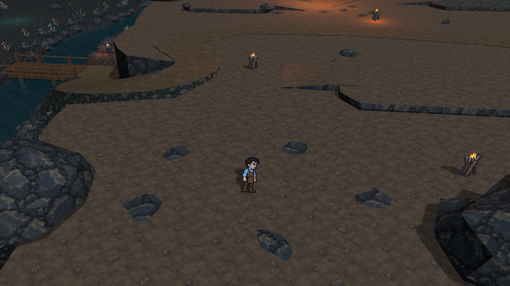
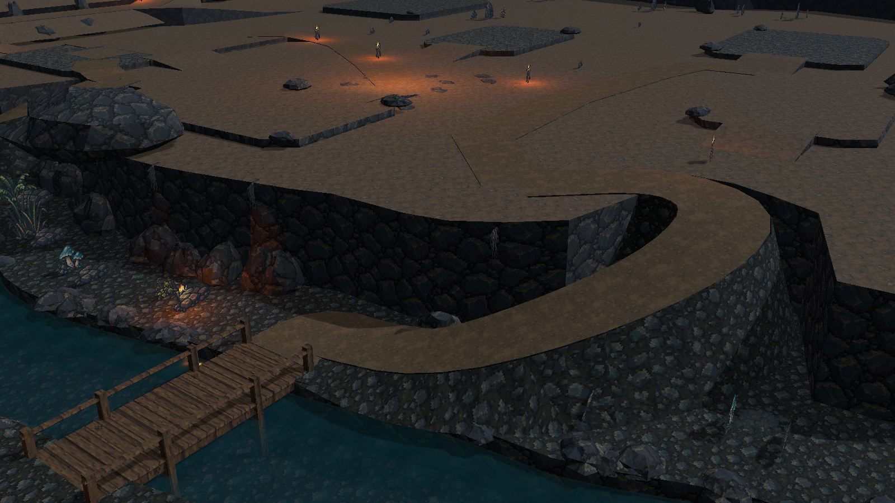
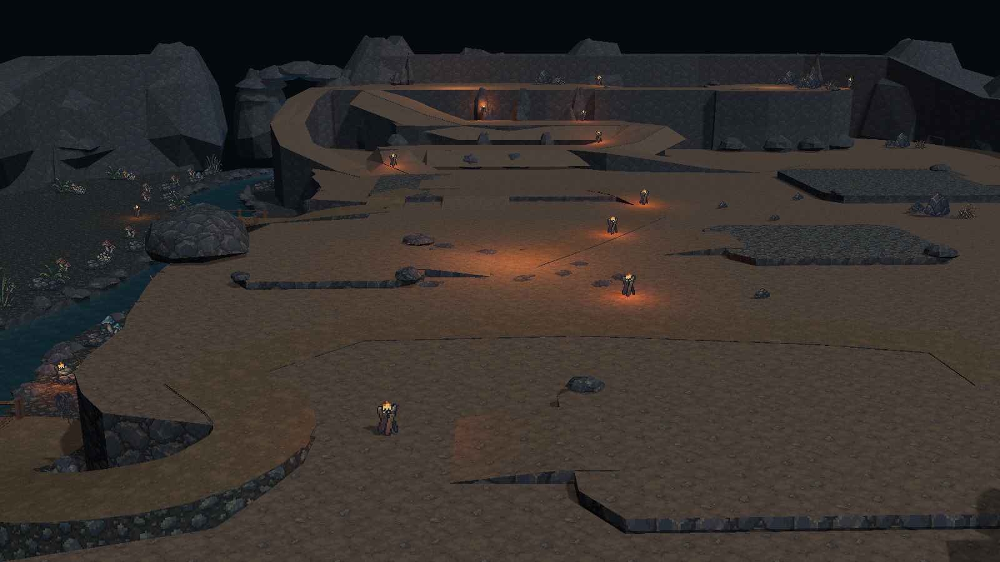

# 洞穴台地 V2：扩展地图

场景：`Assets/Scenes/CaveTerracedTerrainV2.unity`。保留南入口、西河谷、中部生活区、北部祭祀大厅和东北长老住处的关系；场景中已有玩家和跟随相机。建筑尚未摆放，预留用地与路径分开。

## 地形与路线

- XZ 平面长宽均为前一版两倍，面积约四倍；角色尺寸、速度与高差保持独立。
- 主河道宽 7.02 m，支流末段宽 4.68 m；南侧分流更明显，保留中间河洲与沿岸碎石、菌类和植被。
- 低岸 Y=-2.4，水面 Y=-3.05，水下河床 Y=-4.75；水面低于岸边 0.65 m。
- 生活区主层 Y=+2.4，比河岸高 4.8 m；北侧依次经过 +4.2、+6.0 的中间台地，到达 +9.6 的大厅高台。生活区到大厅再升高 7.2 m。
- 中央、西侧供应与东侧外围路线均能上山；食堂东侧新增 `FeastToHearthGardenWalk`，向南弯至公共火塘。
- 两座木桥使用独立木板、横梁、栏杆和木桩。木桩向下越过水面并插入河床；桥头以沿岸转弯的连续缓坡连接主层，坡脚铺碎石，替换原来集中抬升的直石阶。供应桥上坡接入仓库南侧。

## 材质与水

土壤、路径、碎石岸、苔土、岩壁、铺石和木桥全部使用项目已有的实际 64×64 贴图。使用 Point 采样、每 4 m 重复一张完整贴图，即 16 px/m；去除旧图集裁片和酒馆木纹混用。V2 专用 shader 以世界坐标投射，让地面、岩壁与缩放岩石保持一致的像素密度。菌类、草丛、根须和矿石沿用 CaveDetails 素材。水继续使用连续流动的专用 shader。

水面依据 [HD-2D 场景经验第 8 节](hd2d-scene-development.md#8-水面经验让水有自己的表面行为)：连续世界坐标波纹、动态法线、高光、真实深度参与的透明混合，以及三处一次性实时 Reflection Probe。岸线有克制的浅色涟漪，可透见河床与木桩。未实现屏幕折射或实时平面倒影；Reflection Probe 只在进入运行时捕获环境。

## HD-2D 画面与玩家镜头

冷蓝环境光负责河谷和岩壁，暖色火光强调生活区与上山方向。入口、桥头和台地边缘放置已有像素火盆，独立保存在 `Wayfinding | warm pixel braziers`，装饰碰撞关闭。土壤和步道降低纹理对比，角色周围保留明晰轮廓。

玩家跟随镜头使用 30° 俯角、-8° 偏航、20 m 距离、38° FOV，并向前预留 2 m 视野。近处保持清晰，24–48 m 的远处使用轻微 Gaussian 景深；ACES、少量 Bloom 和暗角统一明暗。参数由 Editor 的 `PlayPitch` / `PlayYaw` / `PlayDistance` 与 `PlayFocusOffset` 同时配置真实跟随相机和玩家视角预览相机，避免只调观察相机。

全景审阅图临时关闭近距离景深，导出后恢复；运行时使用保存的画面配置。`cave_player.png` 为 Unity 按玩家镜头参数渲染的预览，不代表手动 Play Mode 试玩录像。

## 建筑用地

下表使用 `CaveTerrain` 根节点的局部坐标（米）。长宽为规划用地，边界为自然切角轮廓；入口、步道和出入口坡道需保持畅通。Scene 的 `LayoutAnchors` 保存 01–15 的定位点，布局 JSON 同时保存 Width / Depth。

| 编号 | 用地 | X / Z | Y | 规划宽 × 深 |
| --- | --- | --- | --- | --- |
| 01 | 撤离集合 | 0 / -60 | 2.4 | 17.6 × 8 |
| 02 | 入口前厅 | 0 / -45.2 | 2.4 | 16.8 × 12 |
| 03 | 军营训练 | 38.4 / 21.6 | 3.075 | 17.6 × 15.2 |
| 04 | 住宿休息 | 11.8 / -31 | 2.85 | 15.2 × 10.4 |
| 05 | 厨房备料 | 35.4 / -25.2 | 2.85 | 16.8 × 12.8 |
| 06 | 酒馆 | -8 / -6.6 | 2.85 | 11.2 × 10 |
| 07 | 赌场 | 23.6 / -1.4 | 2.85 | 14.4 × 10 |
| 08 | 食堂 / 聚餐区 | 4.6 / 20.8 | 2.85 | 18 × 12.4 |
| 09 | 祭祀大厅 | -3 / 57 | 9.6 | 28.8 × 12.8 |
| 10 | 长老住处 | 36.6 / 54.4 | 9.6 | 14.4 × 12 |
| 11 | 种植区 | -48 / 15.6 | -2.4 | 13.2 × 16 |
| 12 | 仓库 | -5.4 / 20.8 | 2.85 | 8.4 × 12.8 |
| 13 | 卸货庭院 | 38.4 / -45.2 | 2.4 | 17.6 × 12 |
| 14 | 公共火塘 | 3 / -5.8 | 2.4 | 12 × 10 |
| 15 | 河岸工坊 | -48 / -20 | -2.4 | 14 × 14 |

## 编辑与验证

Blender 源文件：`tools/art/cave_terraced_terrain_v2.blend`；明确重建入口为 `tools/build_cave_terrain_v2.py` 和 Unity `Untitled/Cave/Reimport Combined Terrain V2`。重建会替换派生地形、细节与锚点，因此手工编辑场景后不要随意重建；进入 Play Mode 不会自动重建。

导入时检查 15 个区域与路线采样点的实际 Collider 高度、材质 Shader 和表面贴图尺寸。CharacterController 的双向路线检查覆盖上山路线、食堂步道、木桥与桥头缓坡；美术观感仍需在玩家镜头下试玩确认。

本轮已通过 Unity 编译与 Shader 检查、720 个路面高度采样，以及 10 段关键路线的 CharacterController 双向移动检查。玩家镜头与全景已由 Unity 渲染导出；当前交互窗口无法自动切入 Play Mode，实际输入、跟随镜头移动与视觉观感留待人工试玩。

试玩建议：从南入口向西过木桥看河谷；经食堂旁弯路到火塘；再走北侧折返坡道到祭祀大厅。

## 概念图空间调整

- 入口两侧加入高低错落的岩体，形成收窄的前景；朝火塘的中央通道保持开阔。
- 火塘用地外缘增加断续碎石铺边；北侧大厅岩壁增加细长岩柱，突出前后高差。
- 新增 `BridgeheadToKitchenPromenade`：入口木桥东侧平台通往厨房既有入口坡道，和主路交汇。
- 河岸主层崖面增加竖向岩层与垂根，桥头可以看清低岸、石阶和生活区之间的层次。
- Scene 保存两台关闭状态的 `Concept A Camera` / `Concept B Camera`，用于入口与桥头构图审阅。玩家跟随相机继续负责试玩。

此轮仍为地形与空间调整，15 处建筑用地保持原尺寸与 XZ 位置；概念图中的帐篷、厨房、祭坛建筑尚未摆放。

## 制作尺度与交付约定

- XZ 为水平面，Y 为标高；Scene 根节点保持单位缩放，坐标与 15 处建筑用地由布局 JSON 统一导出。
- 木桥及桥头缓坡净宽约 3.7 m，曲线入口保留平缓过渡，避免栏杆、岩块和植物挤占通行带。
- 桥头以连续坡面连接 4.8 m 高差；大厅通过两个中间台地分段上升。既有建筑预留区随所在台地抬高。
- 地表材质统一为 64×64 / Point / 16 px/m；地形、建筑预留区、路线、装饰、灯光与观察镜头分组保存，可在 Editor 中编辑。
- Blender 脚本中的 `MAIN_ELEVATION` / `HALL_ELEVATION` 为本轮标高配置；修改后明确重建并检查通行，运行时不生成地形。

以下为当前版本的 Unity 实际预览。

