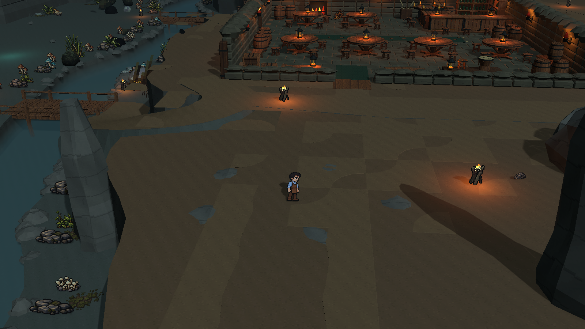
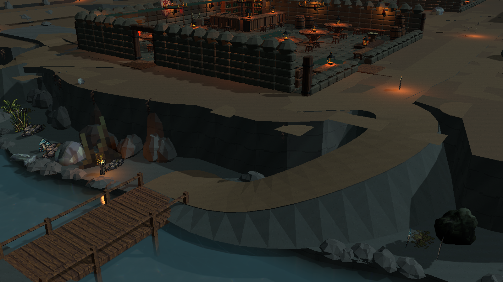
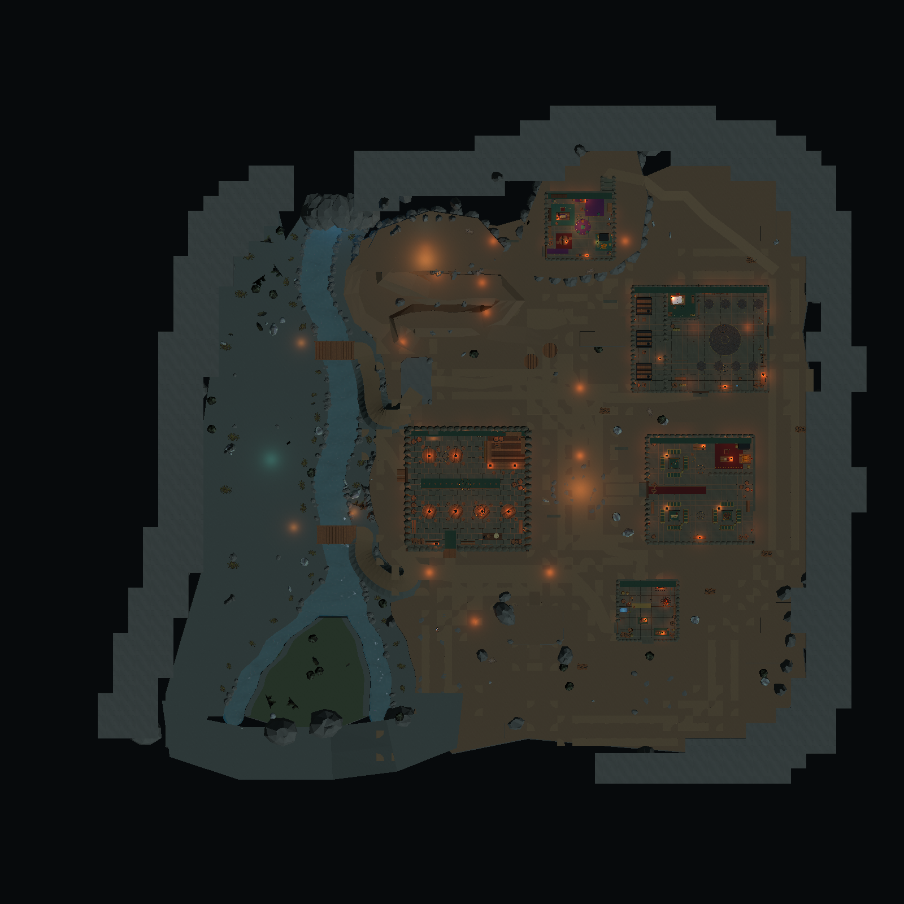

# 洞穴 HD-2D 方块地形版

场景：`Assets/Scenes/CaveTileWorldHD2D.unity`。这一版以 HD-2D 画面重新组织洞壁、岩台、土路与景物，不要求一比一还原旧地图。原 `CaveTileWorld.unity`、原台地地图和建筑 Demo 保留。

## 参考与落地方式

参考 Acquire 在 [Octopath Traveler II 官方开发者采访](https://www.unrealengine.com/developer-interviews/octopath-traveler-ii-builds-a-bigger-bolder-world-in-its-stunning-hd-2d-style?lang=en-US) 中介绍的方式：探索时采用固定镜头，把可前往的目标安排在画面内；环境主要由 3D 背景构成，通过灯光使像素角色与环境协调。另参考 [初代的官方制作采访](https://www.unrealengine.com/spotlights/octopath-traveler-s-hd-2d-art-style-and-story-make-for-a-jrpg-dream-come-true) 中 2D 像素与 3D 环境、局部光照结合的方向。

完整方块优先是本项目的制作选择和用户要求，不把它说成采访中规定的唯一技术实现。

- TileWorldCreator 负责保存和生成完整的地面块、岩台块及洞壁块。4×4 m 平面单元、3.2 m 岩层高度，根节点保持单位缩放。
- 原大块不规则外洞壁的 Renderer 关闭，改由 414 列完整方块叠出四层围壁。旧边界碰撞保留，同时新方块也具备真实 MeshCollider。
- 生活区增加 20 个完整岩台单元，形成绕行、分隔与遮挡；新地形避开 15 个建筑用地及已保存路线。仅土路使用外角、内角和双转角过渡块。
- 配置保存为 `Assets/Configs/CaveTileWorldHD2D/hd2d_cave_configuration.asset`，共 18 个 Blueprint/Build 配对层、3,091 个绘制单元，输出 315 个保存的合并网格。
- 弯曲水道、木桥、桥头坡道及上山路线继续承担通行；近景岩体、路旁岩块和北侧立石提供不同距离的景物层次。

## 资源与像素尺度

从用户提供的八方旅人资源库选入岩块、洞穴石笋和苔石。Blender 中把模型转为米制、设置地面 pivot，保留原 UV 和原像素 albedo；纹理采用 Point、不生成 mipmap。来源与转换比例在 `Assets/Art/Models/CaveTileWorldHD2D/reference_manifest.json` 中记录。

地形采用四张原生 64×64 土、石、湿地、苔纹理和 16 px/m 的世界像素密度。细小像素簇提供材质差异，降低大面积格状色块。建筑实体结构改用本版共享材质，道具图集继续保留自己的 UV 和透明裁切。

Blender 作者文件：`tools/art/cave_hd2d_modules.blend`。作者脚本：`tools/build_cave_hd2d_modules.py`。模型、纹理、材质和 Prefab 均在各自的 `CaveTileWorldHD2D` 目录，原版共享资源不改。

像素道具在本场景中使用已有 `Cave Pixel Prop` Shader 的专用材料副本。它在 vertex stage 计算雾距离，避免把 fragment depth 当作世界距离而让近处火焰、植物过度变暗。原道具材料与公共 Shader 源码保持不变。

## 镜头与灯光

新版本使用俯角 26°、偏航 -5°、距离 27 m、FOV 35°、焦点偏移 (0,1.9,0) 的跟随镜头，让人物附近道路和台地边缘可见。原版本的 18.10° 镜头保留在原场景。

本版使用独立 VolumeProfile：ACES、Exposure 1.9、Contrast 12、Saturation -7、少量 Bloom、暗角及远处 Gaussian 景深。冷色环境光、暖色火光和北侧祭祀区域的局部冷光区分不同区域。Stylized Water 使用独立材质，降低泡沫、焦散和反射强度，与洞穴色调协调。

## 编辑与范围

- `Untitled/Cave/Create HD2D TileWorld Art Version` 是首次创建入口；已存在的场景拒绝覆盖。
- 在本版 TileWorldCreator 的 Inspector 编辑完整方块层，执行生成后使用 `Untitled/Cave/Save HD2D TileWorld Meshes`，再保存 Scene。合并网格作为资产保存，重载可保留。
- TileWorldCreatorManager 保持 disabled，Play Mode 使用保存的地形，不重建地图。建筑及景物分属独立根节点，地形生成不覆盖它们。
- 本轮保留五栋现有完整建筑及全部用地，没有补齐剩余建筑，没有新增守卫 AI、经营或任务系统。

## 验证

Unity 编译和材质 Shader 检查通过。保存重载后，910 个地形路线高度采样及资源引用检查通过；实际保存玩家的 CharacterController 双向走通 26 段地形路线和 8 组室内连接。另检查 182 个土路和岩台绘制单元的地面支撑，清除了两个位于地形边缘外的无支撑单元。预览由 Unity 渲染，没有用概念图替代实际场景。

没有执行完整构建。人工验收集中在三项：

1. 打开本版 Scene 后 Play，观察入口、桥头和台地的形体及像素素材是否协调。
2. 通过中央、供应、外围线与长老暗道，确认完整岩块不会遮住门口或堵住换路连接。
3. 编辑一个方块层，生成、保存网格和 Scene，重载确认修改保留。

