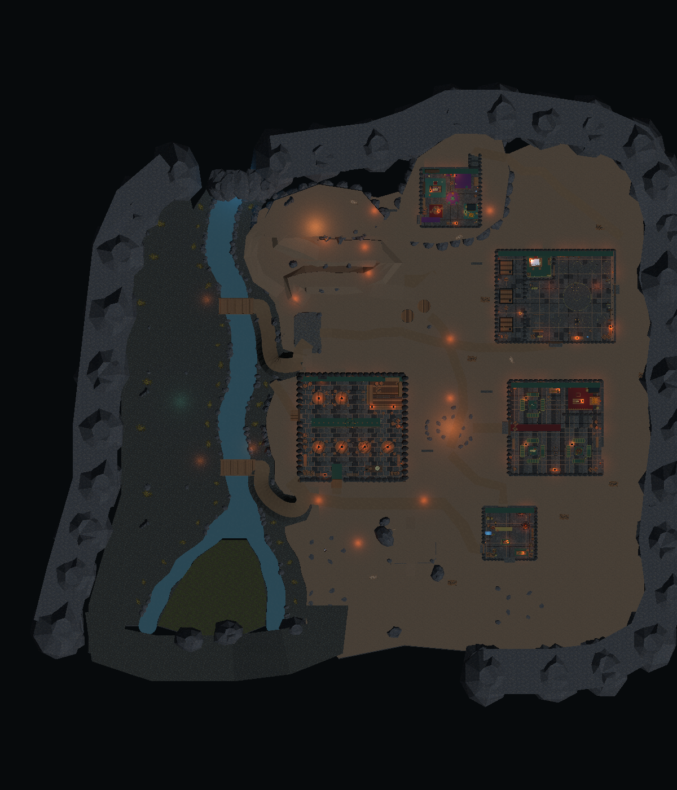
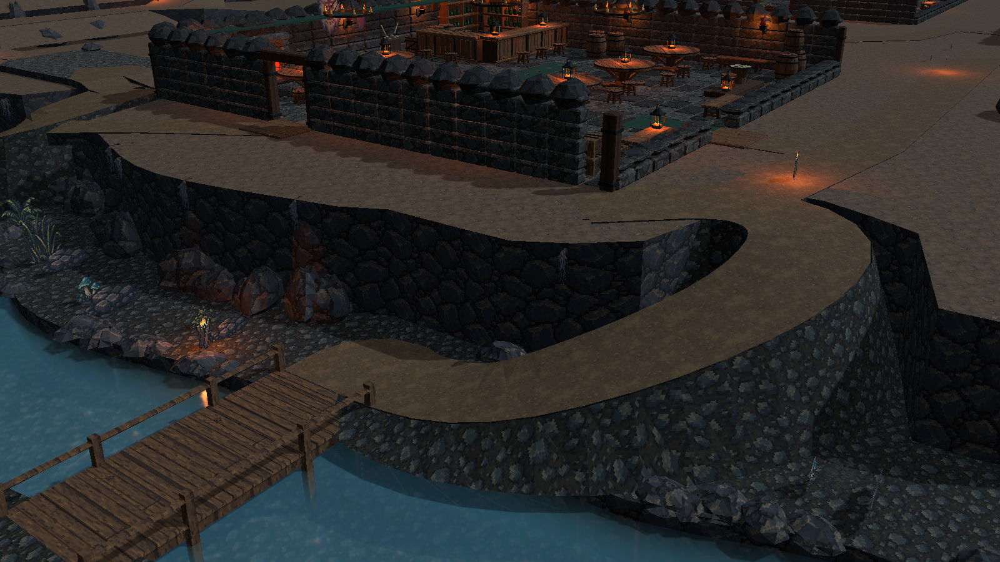

# TileWorld 洞穴场景

场景：`Assets/Scenes/CaveTileWorld.unity`。基于已保存的 `CaveTerracedTerrainV2.unity` 创建独立版本，原场景不修改。保留 15 个功能区、五栋完整建筑、玩家、默认跟随镜头、三条接近路线、换路连接和长老暗道。

## 地形与资源

- TileWorldCreator 4.3.5 实际生成规则台地铺块：1,253 个绘制单元、8 个材质/标高层，合并为 96 个网格区块。Blueprint 和 Build Layer 配置保存于 `Assets/Configs/CaveTileWorld/cave_tileworld_configuration.asset`，可继续绘制和执行生成。
- Blender 源文件为 `tools/art/cave_twc_tiles.blend`，作者脚本为 `tools/build_cave_twc_tiles.py`，导出模型为 `Assets/Art/Models/CaveTileWorld/cave_floor_tiles.fbx`。
- 14 种 standard-grid 模块采用完整 4×4 m 方形接缝、水平顶面和 0.35 m 厚度。角色门槛处不增加起伏。不同角色模块改变三角拓扑，外轮廓一致；并非用于独立生成曲岸的 dual-grid 拼图。
- earth、wet、moss、stone 四套地图 Prefab 在 `Assets/Prefabs/Terrain/CaveTileWorld/`。地形继续使用已有 64px、Point、16 px/m 像素材质，与建筑结构统一。
- 弯曲河岸、崖壁、折返坡道、桥头缓坡、河床和木桥保留原作者网格作为连续过渡结构。被 TWC 模块覆盖的旧水平面已裁掉，渲染和碰撞共用保存的过渡网格，避免重复地面。
- 台地标高保持低岸 -2.4 m、生活区 +2.4 m、大厅/长老 +9.6 m。河宽保持 8.4 m、南侧两支末段 5.6 m，水面 -3.05 m。
- 清理新场景中侵入五栋建筑用地的旧预留区岩簇和灯具，保留建筑内陈设及外部掩体。没有修改原建筑 Demo，也没有增加尚缺的五栋建筑。

## Stylized Water

使用 Stylized Water 2 v1.6.9 的 River 材质和 WaterObject。地图专用材质为 `Assets/Configs/CaveTileWorld/cave_stylized_water.mat`，原插件材质不改。

河水保持一张连续分叉网格，按 2 m 范围切分三角面，以支持低幅度顶点波浪。UV 横向沿原岸线插值，纵向连续滚动；采用缓慢流动、0.055 m 波高、深浅色透明、岸线交界、少量泡沫和折射，继续使用场景已有 Reflection Probe。没有新增实时平面反射。

场景各相机单独启用 URP Depth/Opaque Texture，不修改项目通用 Pipeline 设置。默认跟随参数仍为俯角 18.10°、偏航 -5°、距离 25.72 m、FOV 36.98°、焦点偏移 (0,1.74,0)。

## 编辑与保存

新场景的 TileWorld 根节点位于世界坐标 (-92,0,112)，单元尺寸 4 m；原地图原点仍为 (0,0,200)。这是网格坐标转换，场景和建筑根节点没有整体缩放。

1. 在 Edit Mode 选择 `TileWorldCreator | authored cave paving`，通过插件 Inspector 编辑对应 Blueprint，显式执行 Build Layers。模块只覆盖原地形中的完整平坦单元，边缘和曲坡另行编辑保存的过渡结构。
2. 生成结束后执行 `Untitled/Cave/Save TileWorld Cave Meshes`，再保存 Scene。合并网格必须保存为资产，才能在重载后保留。
3. 建筑和潜行掩体仍在独立的 `SettlementBuildings` / `SettlementGameplay` 根节点。TileWorld 重建只处理自己的地形层，不替换它们。

TileWorldCreatorManager 保持 disabled，生成出的子网格正常启用；Play Mode 使用保存结果，不自动重建地图或修改配置。`Untitled/Cave/Create TileWorld Cave` 只用于首次创建，已有场景时拒绝覆盖。

本次提交包含两款插件所需的代码、Editor、Shader、界面资源及河水纹理依赖。用户导入的插件演示场景、样例地形、样例包和无关特效资产保留本地，不混入地图提交。没有调用付费生成服务或从外部资源库新导入模型；本轮复用项目中已有像素资产，并在 Blender 制作地形模块。

## 验证

Unity C# 编译和材质 Shader 检查通过。保存并重新载入后，910 个地形路线高度采样、网格及资源引用检查通过；保存玩家的 CharacterController 双向走通 26 段地形路线和 8 组室内连接。临时检查脚本留在临时项目，没有新增 runtime 验证系统。

预览使用 Unity 实际渲染，关闭审阅画面的景深，运行镜头仍保留原景深配置。没有执行完整构建，也没有新增守卫 AI、任务或经营系统。人工试玩重点：

1. 默认镜头下过两座桥，观察岸边泡沫、低水位和南侧分叉。
2. 进出五栋建筑，经长老暗道换路返回，确认门口和坡道手感。
3. 编辑一个 Blueprint 单元，生成、保存网格与 Scene 后重新打开，确认修改保留。

