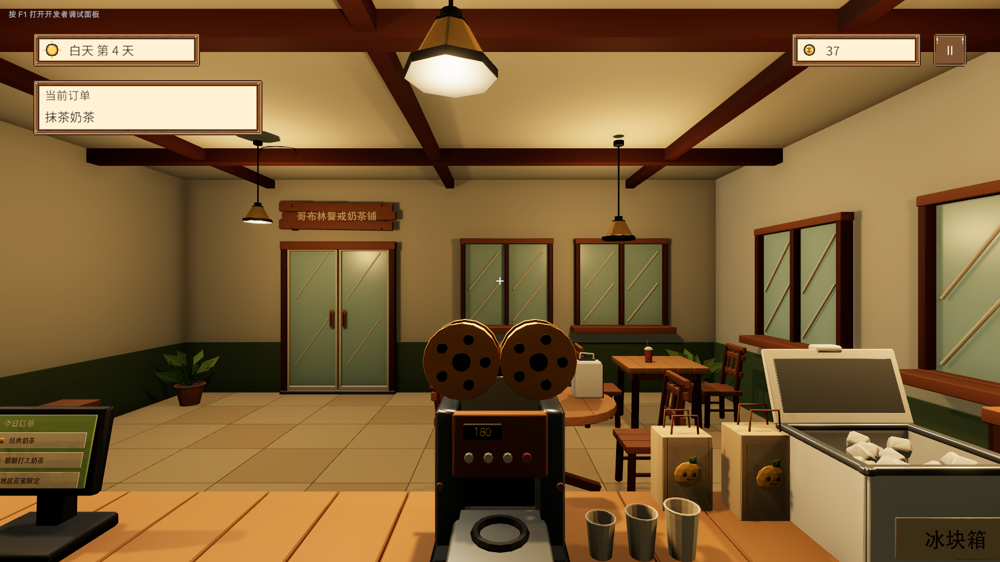
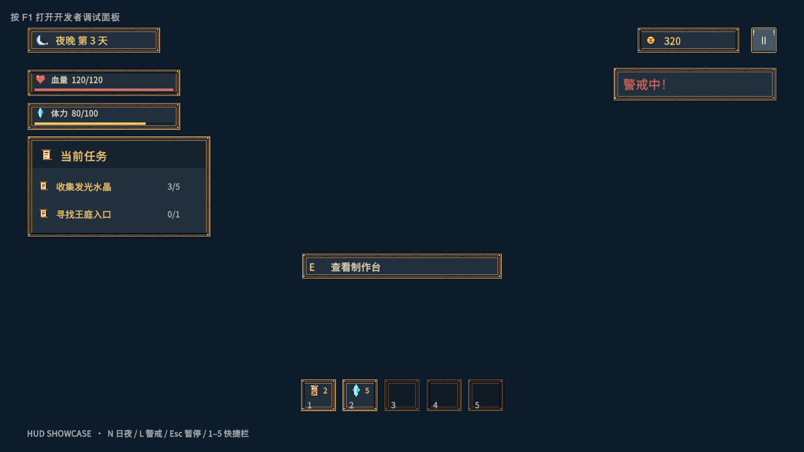
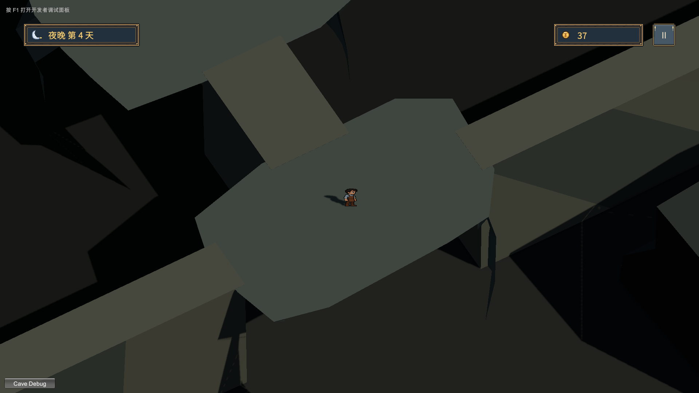

# 哥布林奶茶店 UI · 第三轮

本轮补齐轻量日夜 HUD、金币、状态条、交互提示、快捷栏和暂停菜单，并接入已有 `Bussiness` 与 `Adventure` 场景。沿用第一、二轮的 uGUI、TextMeshPro、日夜主题、9-slice 木框和独立像素图标。

## 交付与入口

打开 **Untitled → UI → Open HUD Showcase**，或 `Assets/Scenes/UI/UIHUDShowcase.unity`，进入 Play Mode。第一轮、第二轮 Showcase 保留。

| 资源 | 用途 |
| --- | --- |
| `Assets/Prefabs/UI/Goblin/UI_DayHUD.prefab` | 天数、金币、订单目标、中心准星与必要交互提示 |
| `Assets/Prefabs/UI/Goblin/UI_NightHUD.prefab` | 天数、金币、可选血量/资源、任务、快捷栏、警戒反馈 |
| `UICurrencyDisplay` / `UIStatusBar` / `UIInteractionPrompt` | 独立可绑定、可隐藏的显示组件 |
| `UIQuickSlot` / `UIHUDQuestRow` / `UIHUDQuestTracker` | 小型 HUD 格子与紧凑任务列表，复用已有格子和任务逻辑 |
| `UI_Inventory` / `UI_Workstation` | 正式仓库及订单工作台窗口，接入已有 UIManager 面板栈 |
| `Assets/Prefabs/UI/Panel/UI_Menu.prefab` | 既有暂停菜单的主题化视图，继续游戏、操作说明、键盘焦点 |
| `Assets/Scenes/UI/UIHUDShowcase.unity` | 独立 HUD 演示，Mock 与正式来源分离 |

新运行代码位于 `Assets/Scripts/UI/Goblin/`，Editor 制作和验收代码位于 `Assets/Editor/GoblinUI/`。暂停菜单沿用原 GUID 和 `UI_Menu` Addressables 地址；新增两个窗口注册于原 `Panels` 组。

## 三步人工验收

1. 在 HUD Showcase 按 N 切换日夜、L 切换警戒，查看天数、金币、订单、状态条、任务和快捷栏；按 1–5 发出快捷栏操作请求。切换主题不改变展示数值。分别选择 1920×1080 与 1280×720 的 Game View。
2. 按 Esc 或点击右上角暂停按钮；点击操作说明，Tab / 方向键选择，Enter / 空格确认，点击继续游戏或 Esc 恢复。暂停时快捷栏不触发，白天第一人称鼠标视角不转动。
3. 打开 `Bussiness`，WASD 移动、鼠标观察，朝仓库/制作台/订单板按 E 打开对应窗口，用 × 或 Esc 关闭；再打开 `Adventure` 查看夜晚 HUD 和暂停恢复。现有调试按钮保留。场景之间的七日自动流程仍由后续玩法系统实现。

## 已接入的数据与业务边界

`UIHUDData` 是只读显示快照，复制任务和快捷栏集合；`UIStatusData` 表示资源数值，零上限时安全显示空条。`IUIHUDReadModel.Current / Changed` 是 HUD 的输入接口，`UIGameplayHUD` 只投影数据、切换视觉和发送输入请求。

生产适配器 `UIGameplayReadModel` 连接已有接口：

- 金币读取 `GameManager.GameData.Money`，订阅新增 `MoneyChanged` 事件。业务调用 `AddMoney` / `TrySpendMoney` 后自动刷新；兼容保留的公共 Money 字段若被直接赋值，需要业务主动 Publish 显示快照。
- 仓库读取 `InventoryData.Items` 和真实 `ItemDatabase`，每次打开重新 Publish；名称、描述和数量来自已有数据。当前图标解析使用独立钱袋占位，后续可替换为真实图标缓存。
- 白天交互提示订阅 `ShopRaycastInteractor.TargetChanged`，保留原遮挡/距离判断。店铺柜台、订单板、制作台通过 `ShopSceneBindings.StationRequested` 打开订单窗口；仓库站点打开背包窗口。封口、交付、地下入口等站点仍沿用其原接口，没有添加业务规则。
- 夜间提示订阅 `InteractManager.CurrentChanged`，交谈/收集/普通交互仅显示可执行提示。
- `UIShopWorkPanel.WorkRequested(orderId)`、`UIQuickbar.ActionRequested(itemId)` 只发送意图，宿主业务系统负责校验和执行，不在视图中扣金币、消耗物品或完成任务。

正式订单、任务、血量、体力、快捷栏和警戒系统尚未提供稳定的现有来源。本轮提供发布接口与独立 `UIHUDMockSource` 演示；正式场景未接入的状态条、任务列表和快捷栏隐藏，订单显示“等待顾客下单”。截图中的第 4 天、37 金币和抹茶订单由验收程序在运行时注入，其中金币和仓库读取真实 GameData，订单与天数用于检查快照保留；未写入场景默认游戏状态。

已有业务宿主可以发布自身权威状态：

```csharp
hudSource.Publish(new UIHUDData(
    dayNumber, economy.Money, isNight, currentOrder, currentQuests,
    new UIStatusData("血量", health, maximumHealth, heartIcon),
    new UIStatusData("体力", stamina, maximumStamina, staminaIcon),
    quickbarItems, interactionText, isDetected));
```

以上变量由业务提供。生产适配器的场景阶段与真实金币保持权威；Publish 不修改 GameData。也可将任意实现 `IUIHUDReadModel` 的 MonoBehaviour 指定到 `UIGameplayHUD.Source`。

## 场景、输入与生命周期

两套 HUD 使用 1920×1080 Canvas Scaler、64px 设计安全边距与 `UISafeArea`；面板位于四周，中央保持角色/敌人视野。背景、框、文字、进度填充、图标及按钮分别可编辑。

`UIWorldInputBridge` 设置当前 Canvas 为 UIManager.Root。面板栈状态负责暂停、鼠标解锁及店铺视角隔离，关闭后恢复原光标意图；同一帧 Esc 不再同时关闭菜单又切换店铺光标。UI 输入由 `InputSystemUIInputModule` 管理，快捷栏单独拥有 `UIShortcuts` actions；原 InputManager 只启用其 Player map。新增输入定义通过 importer 生成 wrapper。

为避免每个场景中的 Bootstrap 重建 GameData，本轮让已有纯 C# Manager 在同一次游戏会话内只初始化一次。新 Play 会话在 SubsystemRegistration 重置静态状态、事件与 InputActions。UIManager 在场景卸载时释放失效面板和 Addressables 引用；新的 Canvas 重新注册 root。显示快照另存于会话内只读缓存，切换场景不清空订单/任务展示；交互提示和警戒不会沿用上一场景。此缓存不是存档系统，后续正式业务仍需发布最新状态。

没有更换、移动原玩家、摄像机、关卡对象。接入前后原 Camera 组件与 Transform 序列化指纹一致；店铺控制器只增加 UI 输入阻断，原射线目标选择仍用于交互。输入与视图事件在销毁/隐藏时退订，快捷栏自身 InputActions 在禁用时停用、销毁时 Dispose。

## 实际验证

Unity **2022.3.62f3c1** Editor 编译通过，Play Mode 验收通过，记录见 `docs/images/ui_hud/verification.txt`。

- 日夜切换、状态值、零上限处理、警戒、快捷栏数字键一次性请求与模态输入隔离。
- 真实鼠标点击帮助/继续按钮、Tab 焦点、Esc 开关、三次重复暂停恢复。
- 1920×1080 / 1280×720 日夜中文与 TMP overflow 检查，截图人工复核未见截断或面板重叠。
- 载入真实 Bussiness：金币事件刷新、仓库真实 4 个物品、制作台订单快照、暂停时视角/位置保持。
- 切换真实 Adventure：同一 GameData 引用、金币/仓库数量、天数/订单显示保留、夜间主题生效、未提供血量时隐藏；暂停时 W 不移动，关闭后恢复。

视觉复核修正了填充图层的 Preserve Aspect 与日夜图标同步。真实玩法截图等待 Shader 编译完成再采集，避免首次载入时的临时纯色画面。7 张截图来自实际 Play Mode Game View；最终验证运行错误为 0。没有执行 Player 构建，也未宣称完整七日剧情、潜行发现规则、制作/交付订单业务已完成。







## 美术与后续接入清单

本轮沿用标记为 Placeholder 的木框、羊皮纸、按钮和 32px 图标，新添 `heart_hud_placeholder.png`。心形是本项目程序绘制的临时独立 Sprite，Point 过滤、无压缩、无 Mipmap，由现有 Sprite Atlas 文件夹收录。概念图仅用于视觉方向，没有作为背景贴图。

字体沿用 **Noto Sans CJK SC / SIL OFL 1.1**，随项目附带字体、授权文本和 `Assets/Art/UI/Goblin/Fonts/SOURCE.md`。中文动态字体的罕用字范围说明见第一轮文档。

仍需完善：正式血量/体力/警戒图标，原料与装备完整图标，警戒边框及动效，日夜各自的木质角饰、羊皮纸细节，NPC 独立肖像。业务接入剩余项为正式订单/配方、角色状态、任务、装备快捷栏与警戒事件；UI 不替这些系统决定规则。

前两轮说明：[第一轮](goblin_ui_first_round.md)、[第二轮](goblin_ui_second_round.md)。
