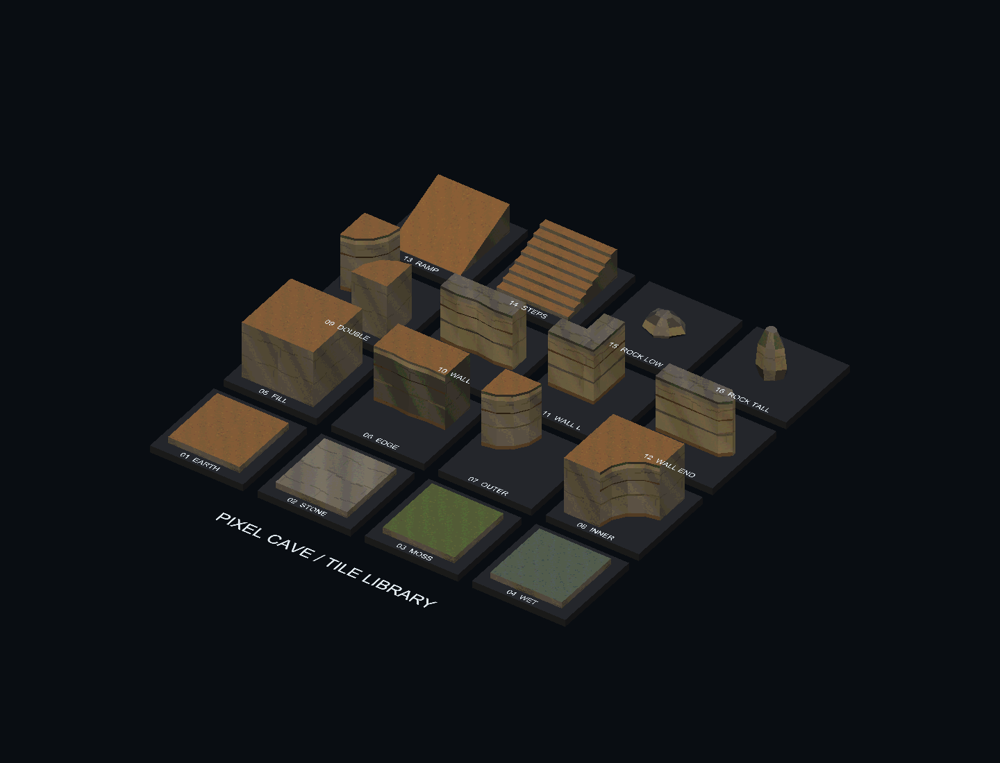
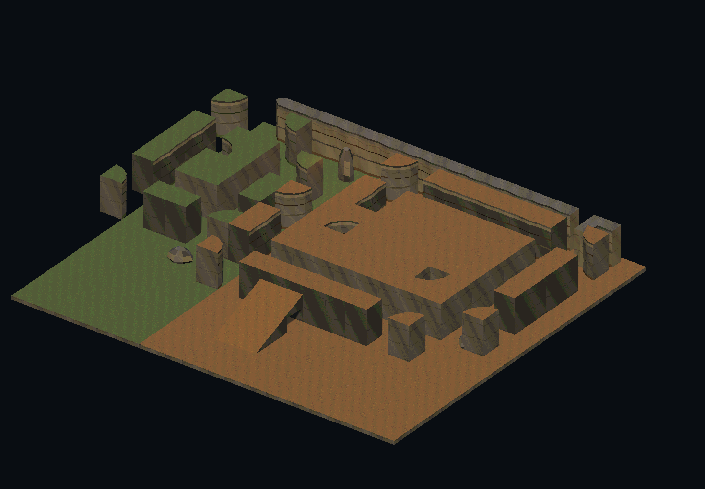

# 像素洞穴 Tile 样品

独立预览场景：`Assets/Scenes/PixelCaveTilePreview.unity`。这一组先用于比较模块形状与像素外观，再决定正式地图采用哪些模块。

## 内容

- 16 种基础模型：土／石／苔藓／湿地地面，岩台填充／边缘／外角／内角／双角，直洞壁／转角洞壁／端头，坡道／台阶，低岩块／高岩块。
- 21 个 Prefab：基础模块 16 个，加 5 个苔藓岩台变体。全部包含 MeshCollider。
- 两套 TileWorldCreator V4 dual-grid Preset：`pixel_cliffs_earth`、`pixel_cliffs_moss`，各配置五种岩台形状。
- 预览场景同时保存单块样品及 TileWorldCreator 生成的土色、苔藓台地组合。生成器在 Play Mode 禁用，使用保存的地形网格。

## 尺度与美术

完整地面单元为 4×4 m，岩台厚度 3.2 m。dual-grid 边缘和转角只占单元的部分面积，这是拼接规则的一部分。地面与岩台 pivot 在顶面中心；洞壁与岩块 pivot 在底部。Prefab Transform 保持单位缩放。

坡道长 4 m、宽 4 m、上升 1.6 m；连续两段连接 3.2 m 台地。台阶有 8 级，每级高 0.2 m。

沿用现有 64×64 土、石、苔藓及湿地像素贴图和世界坐标投射 Shader，16 px/m、Point 采样。岩台侧面用明暗不同的材质表现岩层，顶面保持平整。预览关闭景深和抗锯齿，便于查看形状及贴图。

Prefab 位于 `Assets/Prefabs/Terrain/PixelCaveTiles/`，配置位于 `Assets/Configs/PixelCaveTiles/`。Blender 作者文件为 `tools/art/pixel_cave_tiles.blend`，对应作者脚本为 `tools/build_pixel_cave_tiles.py`。

## 查看与编辑

1. 打开预览 Scene，默认 Game View 展示 16 个单块样品；在 Scene View 可以逐件检查。
2. 要查看组合，在 Hierarchy 关闭 `Tile Library Camera` 的 Camera component，启用 `Assembly Camera` 的 Camera component。
3. 编辑台地时选择对应 `TileWorldCreator`，绘制 Blueprint 并执行生成，然后运行 `Untitled/Cave/Save Pixel Tile Preview Meshes`，再保存 Scene。

`Untitled/Cave/Create Pixel Tile Preview` 只用于首次创建，已有预览场景时拒绝覆盖。普通地面、洞壁、坡道和岩块为独立 Prefab，可手动摆放；两套 Preset 负责岩台自动拼接。

## 检查

已完成 Blender 16 个模型的闭合网格检查、Unity Editor 编译和材质检查、TileWorldCreator 生成与保存、台地中心及邻近位置支撑采样、8 个坡道接缝高度采样。下图由 Unity 实际渲染。未运行角色 Play Mode 试玩或完整构建，台阶移动手感待正式地图接入后确认。

