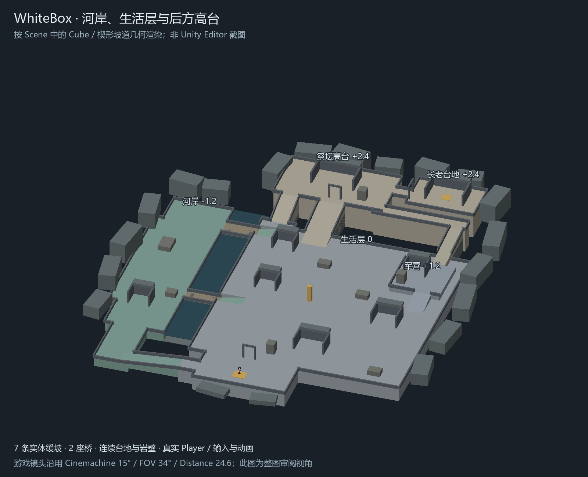

# WhiteBox：阶段 3 台地地形白盒

> 2026-10-14：`Assets/Scenes/WhiteBox.unity` 已从当前版本移除，本文保留历史设计记录。当前场景参见 [资源索引](project-resource-index.md)。

日期：2026-10-12。场景：`Assets/Scenes/WhiteBox.unity`。

按三级台地参考图和原 `CaveHD2DLocal` 地形 demo，以简单 Cube 和楔形坡道搭出有厚度、有高差的洞穴地形。沿用[阶段 1](cave-stealth-stage1-plan.md)的功能关系和[阶段 2](cave-stealth-stage2-scale-camera.md)的 15° Cinemachine 相机，接入真实 Player。本场景是当前阶段 3 的交付；之前的 `CaveStealthPlan` 平面版本保留作历史参考。

## 地形层次

| 地形 | 地面 Y | 布局与作用 |
| --- | --- | --- |
| 河岸低地 | -1.2 | 西侧工坊、种植、观察位置与供给路线 |
| 中央生活层 | 0 | 入口、住宿、厨房、酒馆、赌场、聚餐、火塘、仓库和卸货区 |
| 军营短台地 | +1.2 | 东侧局部抬高，提供中途转折和外围接近 |
| 后方高台 | +2.4 | 祭坛大厅和独立的长老台地，窄道连接私库 |
| 河面 | -1.65 | 位于低岸以下，两座桥跨过，河面没有 Collider |

高度采用本次参考图的 -1.2 / 0 / +2.4；原 demo 中更深的低岸和更高的台地作为体量、道路与岩界组织参考。军营的 +1.2 是连接外围路线的短退台。

地面由连续实体台地组成，底部到 Y=-3.5，形成可见的侧面与岩壁厚度。后方大厅与长老平台分开，中间仅通过宽 3 的短通道连接。外围岩块以有不同尺寸、高度和少量 yaw 的 Cube 表达洞穴包围感；近侧边界保留低护栏，给 15° 镜头留出读图空间。

## 坡道、桥与路线

七条坡道都使用同一个简单楔形 Mesh，坡面和 MeshCollider 一致，不用传送或 runtime 高度修正。坡道在 Scene 中独立命名，可以直接移动、缩放或调整 yaw。最大坡度约 16.70°，低于真实 Player 的 45° Slope Limit。

| 连接 | 净宽 | 高度变化 |
| --- | --- | --- |
| 西侧入口下坡 | 4 | 0 → -1.2 |
| 下桥东岸上坡 | 3 | -1.2 → 0 |
| 上桥东岸上坡 | 4 | -1.2 → 0 |
| A 公共路上坡 | 6 | 0 → +2.4 |
| B 西侧供给上坡 | 4 | 0 → +2.4 |
| C 军营入口上坡 | 4 | 0 → +1.2 |
| C 东侧上坡 | 3 | +1.2 → +2.4 |

下桥位于 Z=-12，宽 3；上桥位于 Z=16，宽 4。桥面 Y=-1.2，有实体桥板、支撑和边界护栏，东岸分别用坡道接回生活层。所有坡道端点与相邻台地顶面接齐。

- A：入口 → 火塘、聚餐 → 中央宽坡 → 大厅正面。
- B：西侧下坡 → 工坊、种植 → 供给桥 → 西侧窄坡 → 大厅西侧。
- C：入口东侧 → 卸货、厨房外缘 → 军营短台地 → 东侧上坡 → 高台前方横廊 → 大厅东侧。

共同终段从大厅东侧进入长老台地，再到金色私库标记。15 个功能区在 `09_RoomAnchors` 中保留编号与命名；房间以开口朝前的墙体和简化后屋顶表示体量，庭院、道路和转向空间保持连续。

## 真实 Player 与相机

直接实例化 `Assets/Prefabs/FirstRoom/GoblinPlayer.prefab`，与原地图使用同一真实 Player，保留 `PlayerEntity`、CharacterController、`PlayerRunAnimation` 的侧面／正面／背面动画，以及原材质和 Mesh。没有使用 `PixelPerson64Placeholder` 或 `CaveBlockoutPlayer`。

角色根节点 Scale 保持 Prefab 的 `(1,1,1)`，出生位置为 `(0,0.12,-40)`。保留 Prefab 的 Speed=7.625、重力开启、半径 0.6、Skin Width 0.025 和 Slope Limit 45；当前 Scene 的 Step Offset 为 0.18，沿用原地形场景的台地通过设置。CharacterController 保存的 Height=1、Center Y=0.5；几何检查按不小于直径 1.2 的 capsule 高度保守处理。

Visual 在当前 Scene 上沿用原地图的 `keepUpright=true`，显式引用主相机，保持像素角色竖直；共享 Player Prefab 没有修改。

场景复用原 `Bootstrap`。它在 Awake 中初始化包括 InputManager 和 DebugManager 在内的已有 Manager；之后 `PlayerEntity.Update()` 读取输入及速度倍数，调用 CharacterController.Move，动画根据实际移动速度选择方向与帧。没有新增另一套角色控制或输入 wrapper。DebugManager 的速度倍数初始为 1，调试面板和项目现有启动行为继续沿用。

相机沿用 Cinemachine Brain → Virtual Camera → Framing Transposer，Follow 指向真实 Player 根节点。Pitch=15°、FOV=34°、Distance=24.6、Tracked Object Offset=(0,1.6,0)、Screen X/Y=0.5/0.6，Damping、Dead Zone、Soft Zone 和 Late Update 保留。相机初始位置随出生点调整，运行时跟随真实高度变化。

## 编辑、检查与验收

地形、坡道、桥、岩界、房间体量、掩体和区域锚点都保存在 Scene。根节点 Scale=1。没有新增自动建图脚本，Play Mode 不会把手工摆放恢复为预设布局；使用 Unity 原生 Transform、Collider 和 Undo/Redo 编辑并保存。

新增 `whitebox_wedge.asset` 和四个独立灰色材质，保持资源与 `.meta` 配对。原参考地形、旧平面 Scene、真实 Player Prefab、输入定义、动画脚本和共享材质没有修改；`WhiteBox.unity` 保留原 GUID。

已检查序列化引用、资源 GUID、Mesh 顶点／索引／法线、坡道端点和坡度，以及真实 Player、Bootstrap 与相机的依赖关系。以 0.25 单位采样，按半径 0.6 加 0.025 余量检查地形连通性，15 个功能区和七条坡道中心均可到达，通行高度范围为 -1.2 至 +2.4。这是几何近似检查，不等同于 CharacterController 的实际物理试玩。

本次没有修改 C#、运行 Unity Play Mode 或完整构建。实际坡道贴地、动画切换和低俯角遮挡仍需人工确认：

1. 退出播放后打开或重新加载 `WhiteBox.unity`，等资源导入完成，进入 Play Mode；点击 Game View，用 WASD／方向键移动，确认真实人物与方向动画。
2. 分别走西侧低岸与两座桥、中央上坡、军营短台地与东侧上坡，到大厅后经窄道进入长老住处；确认没有卡在坡道接缝或滑入河流。
3. 检查 15° 相机随上、下坡跟随，记录墙体、屋顶或岩块遮住角色的位置，作为下一步遮挡调整依据。
